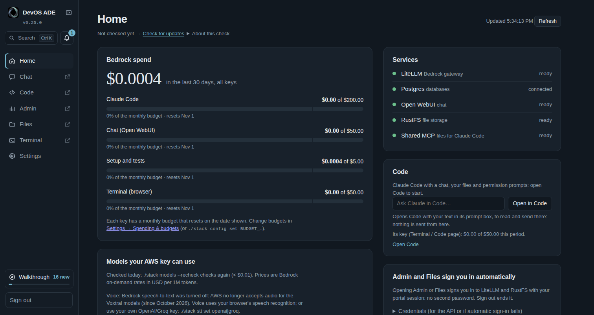

# DevOS ADE

DevOS ADE (formerly bedrock-now) is a private, single-user AI workbench for your own Mac or Linux machine: a chat
app, Claude Code and a shared file store. Models run on **Amazon Bedrock** in your own AWS account (an IAM user's
access key, or an EC2 instance role) and are billed there; the only other places a call can go are ones you turn on
yourself — **OpenRouter** with your own key (billed by OpenRouter; some models are free), the **Experiential Labs**
gateway with your own key (its credits, or your own provider keys connected there) and speech-to-text through **OpenAI or
Groq** with your own key. The microphone in Chat uses your browser's own speech recognition unless you choose
otherwise, and that sends what you say to the browser's maker (Google, Microsoft or Apple; [Voice](#voice-speech-to-text)).
You get modern models without sending your work to a consumer AI service, and you see what every answer costs.
Install it with one command; nothing listens beyond `127.0.0.1`.



## What you get

Everything below runs on your computer, behind one portal sign-in. The optional parts are off until you turn them on;
the Code page and its browser terminal are on by default (`./stack terminal disable` turns both off, `./stack code
disable` the Code page alone; either stays off across updates).

| Part | What it is | Default | On / off |
|---|---|---|---|
| [**Chat**](#chat-open-webui) | Open WebUI with the Bedrock models your key can use (and OpenRouter's, once you turn it on): the cost under every answer, documents and knowledge bases, images | on | — |
| [**`devos-claude`**](#claude-code-devos-claude) | Claude Code in your own terminal, billed to Bedrock (or to OpenRouter for its models), with a lean config folder and each session's cost; any chat model of the catalog (`--models` lists them and how each works, `--model` picks one) | on (needs `claude`) | setup offers to put it on your `PATH` |
| [**Home, Admin, Files**](#the-portal-one-login-for-everything) | health, spend and budgets; LiteLLM's UI; the shared file store (also an MCP server for Claude Code) | on | — |
| [**The API for your tools**](#the-models-from-your-own-code) | the same models for your own scripts and apps: OpenAI- and Anthropic-compatible, on `127.0.0.1`, a key and budget per tool (Admin › Virtual Keys) | on | — |
| [**Activity & search**](#activity-and-search) | a bell for budget alerts, updates, Code sessions that need you and jobs; **Ctrl/⌘+K** finds pages, settings, Code sessions and workspace files, Chat conversations, the walkthrough and these docs | on | — |
| [**Settings**](#settings) | every setting of `.env`, shown in the portal | on (read-only until the update helper is installed) | `./stack helper install` makes it editable |
| [**Terminal**](#claude-code-in-the-browser) | Claude Code in the browser, in a sandbox that sees one folder of yours (`~/devos-ade-workspace`) and reaches public internet addresses through an egress proxy of its own — not this computer's services or your network | on, as the Code page's sandbox (internet: public addresses only) | `./stack terminal disable` / `enable` (disable turns the Code page off too); its internet: Settings › Claude Code › Sandbox internet access |
| [**Code page**](#the-code-page) | Claude Code as an IDE-like page: chat with any chat model of the catalog, @-mentions of the terminal, the changes, failed runs and file lines, permission modes, comments on a plan's lines, editor, file and dev-server previews, review changes, Git with remotes (Git hosts: clone, fetch, pull, push), Run & test | on (Bypass, Auto and remote access to it: off) | `./stack code disable` / `enable`, or Settings › Claude Code; the Code tab stays and says how while it is off |
| [**Your AI subscriptions**](#your-ai-subscriptions) | your own plans in the sandbox, each through its provider's own, unmodified app signed in with its own sign-in: Claude Code on your Claude plan (`claude-sub`), Codex (ChatGPT), Gemini CLI, Copilot, Cursor, Grok — a **who answers** menu above the Terminal and Chat (where the tool itself opens in place of Open WebUI) and in the Code page's terminal panel; DevOS ADE never sees a login | on (the tools are in the sandbox; nothing is signed in) | `TERMINAL_AI_TOOLS` in `.env` (all, none or some); Settings › *Models & providers* |
| [**Remote access**](#remote-access) | the portal from your phone or laptop over HTTPS ([on a phone](#using-it-on-your-phone)) | off | `./stack remote enable tailscale` / `disable` |
| [**Voice**](#voice-speech-to-text) | speech-to-text for Chat's microphone and voice calls (Mistral Voxtral on Bedrock: AWS no longer accepts its audio since October 2026; your own OpenAI/Groq key, or the browser) | browser speech (Bedrock: on when your key can use Voxtral and AWS takes its audio) | `./stack stt set openai\|groq` / `bedrock` / `remove` |
| [**OpenRouter**](#optional-openrouter) | hundreds of other models, some free | off | Settings › Models & providers, or `./stack openrouter set` / `remove` |
| [**Experiential Labs**](#optional-experiential-labs) | one gateway in front of many models, on its credits or your own provider keys | off | Settings › Models & providers, or `./stack config set EXPLABS_API_KEY` |
| [**Costs & budgets**](#costs--budgets) | a monthly budget per key, prices updated daily, `./stack costs` | on | Settings → Spending & budgets |
| [**Updates**](#updating) | `./stack update` with a backup and `./stack rollback`; one-click on Home; automatic at night | one-click: setup asks; automatic: off | `./stack helper install`; `./stack helper auto on` / `off` |

## Quickstart

**Prerequisites**

- macOS or Linux, with **Docker Desktop** (macOS) or **Docker Engine 28+ with Compose v2** (Linux), **Compose 2.24.4 or
  newer** (2024 on: its compose files use `!override` and `!reset`; `./stack setup` and `./stack update` say so and stop
  on an older one). Docker Desktop 4.29 or newer (Engine 26+) also keeps
  the sandbox from looking up outside names, a way out by DNS; with an older one `./stack test` says so
- `git`, `curl`, `openssl` (macOS's built-in bash 3.2 is fine). Nothing else on your computer: no Node or Python
  (the browser terminal and the Code page bring Claude Code in their own image)
- Room for Docker: about 6 GB of disk for the downloaded images and about 1.6 GB more for the two built on your
  computer for the Code page and its browser terminal (on by default: the terminal's about 1.2 GB, the Code page's
  about 0.4 GB, the sandbox's egress proxy a few kB on the same base; an update keeps the previous version of each, so
  allow more), and about 2 GB of memory for the stack
  (~1.3 GB when idle; the terminal, its egress proxy and the Code page about 130 MB of that while idle). While Claude
  works there their containers may use up to 4 GB (`TERMINAL_MEM_LIMIT`), 192 MB and 768 MB of memory; on Docker
  Desktop, *Settings → Resources* sets what Docker may use
- An **AWS access key ID and secret** for an IAM user with Bedrock access (long-lived `AKIA…` key; see
  [Asking your AWS admin for model access](#asking-your-aws-admin-for-model-access)), or, on an EC2 VM, an
  **IAM role** instead (no keys stored; see [Run it on a cloud VM](#run-it-on-a-cloud-vm))
- Optional: **Claude Code** (`claude`) on your computer, for `devos-claude`

**Install** with the one-liner:

```bash
curl -fsSL https://raw.githubusercontent.com/JongoDB-Labs/devos-ade/main/install.sh | bash
```

or inspect first:

```bash
git clone https://github.com/JongoDB-Labs/devos-ade && cd devos-ade
less install.sh setup.sh      # optional
./setup.sh
```

The installer checks the prerequisites and says how to install anything missing, clones the latest release
into `~/devos-ade` (`BEDROCK_NOW_DIR=/path` — or `DEVOS_ADE_DIR` — for another folder, `BEDROCK_NOW_REF=main` for the
newest code) and starts setup. It never overwrites an existing folder: for an existing checkout it tells you to run
`./stack update` — also for an install made before v0.25.0 in `~/bedrock-now`, which it finds there and leaves as it
is. Arguments go to setup (`… | bash -s -- --yes`). Without a terminal to ask in, it runs
`./setup.sh --yes` when `AWS_ACCESS_KEY_ID` and `AWS_SECRET_ACCESS_KEY` are exported (or the EC2 instance has an IAM
role), and otherwise tells you to run `./setup.sh` in the new folder.

**What happens.** Setup asks for your AWS key (the secret is hidden) and region (default `us-east-1`). Exported
`AWS_ACCESS_KEY_ID` / `AWS_SECRET_ACCESS_KEY` are offered first; temporary credentials (`ASIA…`,
`AWS_SESSION_TOKEN`) are refused because they expire. On an EC2 instance with an IAM role and no key configured,
setup offers the role instead and stores no key ([Run it on a cloud VM](#run-it-on-a-cloud-vm)). A first setup
then asks, once each:

- whether to use the portal **only on this computer** (the default) or also from your phone or laptop through
  Tailscale ([Remote access](#remote-access); it is set up at the end, and `./stack remote enable tailscale` does it
  later);
- an **admin email** for Chat and Admin (default: your `git config user.email`; kept in lowercase, as Chat keeps
  every address, and setup says so when it changed yours);
- an optional **OpenRouter key** (Enter skips; [Optional: OpenRouter](#optional-openrouter));
- **speech-to-text** for Chat's microphone and voice calls: Bedrock (the default), OpenAI, Groq or the browser only
  ([Voice](#voice-speech-to-text)).

Then it:

1. verifies the key with AWS, picks free ports and the portal address, and generates every secret into `.env`
   (mode 600, never committed), including the portal password. When port 80 is taken, it says so and asks which port
   the portal should use instead (Enter takes the suggestion, 8800 or the next port free at that moment; a port in
   use is asked again; `--yes` takes the suggestion), and names the new address;
2. starts the stack and **probes every model** with a 1-token request (< $0.01 in total) to see which ones
   your key can use, and prints a table of ENABLED/DISABLED models with prices and reasons. A later setup or update
   does not probe again while nothing it depends on changed (the same AWS key and region, model catalog and
   LiteLLM, and a probe less than a week old): it says so and keeps the last answers. `./stack models --recheck`
   probes again at once;
3. creates LiteLLM keys with monthly budgets, configures Open WebUI and runs a smoke test;
4. turns on the [Code page](#the-code-page) — Claude Code in the browser, like its desktop app — and the
   [browser terminal](#claude-code-in-the-browser) it runs in: a sandbox container that sees only one folder of
   yours, `~/devos-ade-workspace` (created, mode 700), or `~/bedrock-now-workspace` on an install that already has it,
   with its own LiteLLM key and budget. It builds their images
   (a few minutes the first time) and says so; no question is asked, and `./stack code disable` turns it off;
5. offers to link `devos-claude` into `~/.local/bin`, with its old name beside it (`~/.local/bin/claude-bedrock`),
   and to turn on one-click updates from Home (the [update helper](#updating), which also makes Settings editable;
   default yes). Both only in interactive runs; `--yes` installs the helper only with `BEDROCK_NOW_HELPER=1`, and
   links `devos-claude` only where `~/.local/bin/claude-bedrock` already points into this checkout (an update from
   v0.27.x). It never edits your shell rc files or `~/.claude`.

At the end it prints the portal address, the first time only (and only to a terminal) its password (always in
`.env` as `PORTAL_PASSWORD`; `./stack password --show` prints it) and a `devos-claude` command to try, and, when
run in a terminal, opens the portal: the installed app if you have one, else a browser tab (`BEDROCK_NOW_NO_OPEN=1`
turns that off). On your first visit (not on a phone) the [walkthrough](#walkthrough) opens by itself.

**What it takes:** about 5 GB of Docker images (downloaded once, announced first), 5–15 minutes on the first
run depending on your connection (about 2 minutes after that), and under $0.05 of Bedrock usage to try it
(the probe and smoke test cost < $0.01; a short `devos-claude -p` prompt about $0.02–0.04). The browser terminal,
its egress proxy and the Code page are built on your computer during the first setup (a few minutes more, about
1.6 GB).

**On a server, or in a script (`--yes`, nobody at the screen):** the Code page and its sandbox come on by default,
with internet access to public addresses through the sandbox's egress proxy (not this computer's own services or your
network). To keep them off, write it into `.env` before the first setup (setup keeps a `.env` it finds); or keep them
on without internet with `TERMINAL_EGRESS=off`:

```bash
git clone https://github.com/JongoDB-Labs/devos-ade && cd devos-ade
cp .env.example .env && chmod 600 .env
printf 'CODE_ENABLED=false\n' >> .env      # or: printf 'TERMINAL_EGRESS=off\n' >> .env  (the last line of a key wins)
./setup.sh --yes
```

**Next:** open the **Code** tab, under Chat, to use Claude Code in the browser: it asks for the portal password
once more, and in its default mode every command and file change waits for your OK ([the Code page](#the-code-page);
`./stack code disable` turns it off). Remote access, OpenRouter and voice can be changed at any time
([What you get](#what-you-get) lists the commands).

**Stop or remove:** `./stack down` stops everything and keeps your data; `./stack up` starts it again.
`./stack uninstall` removes the containers, **all data volumes** and this install's built images, the update helper
and the links `~/.local/bin/devos-claude` and `~/.local/bin/claude-bedrock` (it keeps `.env`, `backups/`, the
terminal's workspace folder and `~/.claude-bedrock`);
then delete the folder.

`./stack setup` is safe to re-run at any time: it keeps your keys and data and re-checks which models work.
Stopped with Ctrl-C, it says what it had done, which services still run, and how to go on (`./stack setup`) or
clean up (`./stack down` keeps the data; `./stack uninstall` removes it too); a Code page it was turning on by default
is off again, and the next setup turns it on.

## Using it

### The portal: one login for everything

Open http://bedrock-now.localhost (or the URL `./stack status` prints) and sign in with `PORTAL_PASSWORD`.
`*.localhost` names point at your own computer in every current browser, so there is nothing to configure. You
stay signed in for 30 days (Settings → Account & security → Session length); **Sign out** at the bottom of the sidebar ends every session at once. `./stack
open` opens it: the installed app if you have installed it (see [Desktop app](#desktop-app)), otherwise a tab in
your browser.

| Tab | What it is | Sign-in |
|---|---|---|
| **Home** | Health of each service, spend per key against its budget, the models your key can use with prices, the price source, the `devos-claude` command; with the Code page on, its card (the sessions that need you, Resume, a prompt to open in Code). Under the title: *Up to date · checked 12 min ago ·* **Check for updates** ([Updating](#updating)). Refreshes every 30 s; makes no Bedrock calls. Above the tabs: **Search** (Ctrl/⌘+K) and the **Activity** bell ([Activity and search](#activity-and-search)). | the portal |
| **Chat** | Open WebUI at `chat.bedrock-now.localhost`: chat, documents/knowledge, images (if enabled) | automatic |
| **Code** | On by default: Claude Code with a chat and your files, at `code.bedrock-now.localhost` ([The Code page](#the-code-page)); while it is off the tab stays, muted, and says how to turn it on | the portal, then the portal password again (12 hours) |
| **Admin** | LiteLLM's UI at `admin.bedrock-now.localhost/ui`: keys, spend by model and day, logs | automatic |
| **Files** | The RustFS console at `files.bedrock-now.localhost`: the shared object store | automatic |
| **Terminal** | While it is on (by default, as the Code page's sandbox): Claude Code in a sandbox, at `terminal.bedrock-now.localhost` ([Claude Code in the browser](#claude-code-in-the-browser)) | the portal, then the portal password again (12 hours) |
| **Settings** | Every setting of `.env`, secrets masked; change passwords, the owner email, the AWS key, budgets, voice, OpenRouter, the Code page, Claude Code's models, the sandbox's internet and updates; backups and diagnostics ([Settings](#settings); changes need the update helper) | the portal (each change asks for the password again) |

One sign-in is all there is: the portal signs you in to every app, in its tab, a pop-out window, on the remote
site and on a phone. Chat trusts the portal's word for who you are; for Admin and Files, which cannot, the portal
signs in to LiteLLM and RustFS for you with the sign-ins it already holds and hands the app's own session to your
browser on that app's address ([how](docs/security.md#automatic-sign-in-to-admin-and-files)). **Sign out** ends
the portal session that every request to Admin and Files needs, and every Admin (LiteLLM) session made before it
(also LiteLLM's own form's); the Files console's temporary credentials can stay valid in that browser for up to
12 hours, of no use without a portal session. LiteLLM's and RustFS's own sign-ins still exist, as a fallback and for
the API, under **Credentials** on Home:

| Fallback sign-in | User | Password |
|---|---|---|
| Admin (LiteLLM's form, `admin.…/ui/login/?sso=off`) | `OPENWEBUI_ADMIN_EMAIL` (`admin` before the first setup) | `LITELLM_UI_PASSWORD` |
| Files (the console's form, `files.…/rustfs/console/auth/login/?sso=off`) | `RUSTFS_ACCESS_KEY` | `RUSTFS_SECRET_KEY` |

Home's **Credentials** copies them and opens each app's own form; an app's own **Logout** shows that form too
(opening the app from Home again signs you in). A password changed inside LiteLLM's own UI is not known to the
portal: set it in Settings as well, or the automatic sign-in to Admin stops (it then says so, with a link to the form).

Each app stays open while you switch tabs; the arrow next to a tab opens it in its own browser tab. For more room,
the button at the top of the sidebar (or **Ctrl+\\**, **⌘\\** on a Mac, with the focus in the portal) folds it to a
column of icons, as on a tablet: each icon names itself in a tooltip, Search, the Activity bell and the version stay,
the walkthrough opens as a card beside the icons, and the apps get the width. The same button (or key) brings the names
back; the browser remembers which you chose. If port 80
is taken, the portal is on 8800 (`http://bedrock-now.localhost:8800`) and setup says so. To change the
password, use **Settings → Account & security** (or `./stack config set PORTAL_PASSWORD`). Setup prints the password once, and only
in a terminal; piped into a log it prints where it is instead. Tools can use the LiteLLM API at
`http://127.0.0.1:4000` (`LITELLM_PORT`; OpenAI- and Anthropic-compatible): [the models from your own
code](#the-models-from-your-own-code).

The installed version is always shown: under **DevOS ADE** in the sidebar (on a tablet's icon rail as a tiny
label, the full version in the logo's tooltip; on a phone in Home's header). A build after a release reads
`v0.3.0 +7 (1a2b3c4)`: seven commits after v0.3.0, at commit 1a2b3c4; its tooltip adds the branch and the commit
date. Clicking it opens that version's release notes on GitHub (a build after a release: the changelog). While an
update is available it carries a small dot and leads to the update card's release notes instead; after an update,
reloading the page shows the new version.

### Walkthrough

New here? **Walkthrough** at the bottom of the sidebar takes you through what a developer uses in DevOS ADE, in six
parts you can fold away or skip (about 30 minutes for all of it, a few cents of usage). It opens by itself on your
first visit (not on a phone, where it would cover Chat); on a desktop it widens the sidebar instead of covering an app
(with the sidebar folded to its icons, it is a card beside them), on a tablet it is a card next to the icons, and on a
phone it is under **More**.

1. **Set up:** the Bedrock models your AWS key can use (and how to get more), optional OpenRouter models and voice,
   Claude Code on your computer (`devos-claude` and its lean `~/.claude-bedrock` config folder), **Connect a git
   host** for the Code page (Sign in with GitHub or GitLab, an access token or an SSH key it makes; **Open Git hosts**
   opens its dialog), each app's budget, and extras (the desktop app, one-click updates). Each step shows its live
   status and the commands to run, with Copy buttons.
2. **Your apps (one sign-in):** the portal password is the only one you type; Chat, Admin (on Virtual Keys) and
   Files (on its buckets) open signed in, and opening each one ticks its step off. Admin's and Files' own sign-ins
   are folded away under **Credentials**, with Copy buttons and a link to each app's own form, for the API or in
   case the automatic sign-in ever fails.
3. **Chat:** a chat with its cost line (what its page loads, previews on a click by default, the Python runner's packages), voice,
   your documents.
4. **Code with Claude** (where the Code page is on; otherwise one step on how to turn it on): open Code and ask, the
   permission modes and cards, picking a model, your workspace (its folder on this computer, files, search, previews),
   a project's own settings and **Trust**, @-mentions and comments on a plan's lines, **Clone a repository**, review, commit and push, Run & test and
   previews of dev servers, the browser terminal, what the sandbox can reach, plugins and MCP servers.
5. **Your own tools:** `devos-claude` in your terminal, [the models from your own
   code](#the-models-from-your-own-code) (this install's API address, a key per tool, curl and Python examples to
   copy), [your AI subscriptions and keys](#your-ai-subscriptions) (which tools, how each signs in, the *who answers*
   menu on each page, the switch for your Claude plan, what is greyed out — a link to where it is turned on) and the
   store Claude Code and Chat
   share.
6. **Keep it running:** Home, Activity and search, where the money went, updates, backups and rollback, and the portal
   from your phone.

Steps tick off by themselves where the portal can tell (models enabled; OpenRouter, voice or remote access on; Chat,
Admin or Files opened; a key's spend going up; a git host connected, as the Code tab reports it; the update helper
running); the others have **Mark as done** or **Skip**. Progress is kept in this browser only; closing the walkthrough
leaves the button with your progress, and **Start over** at the end resets it.

**After an update** the walkthrough does not open again. A browser that went through an earlier one finds the steps
it has not opened yet marked **New**, and the button says how many (*16 new* beside **Walkthrough**; under More, *16
new steps since you last looked*) until each one is opened. On a first visit nothing is marked new.

### Activity and search

**Activity** is the bell at the top of the sidebar (on a phone: **More → Activity**, and a dot on More): its number is
what you have not read yet, and its panel lists, newest first:

- a **budget** at `BUDGET_ALERT_PCT` (80 % by default) of its monthly limit, or used up — one per key and period, with
  **Change the budget** (Settings, at that key's budget);
- an **update** available, with **What's new** (Home's update card);
- **Code sessions that need you** (a permission prompt, a question, a plan): what the Code tab reports while this
  browser has it open or loaded in the background, with **Answer**;
- **jobs**: what the update helper did (an update, a rollback, a clean-up, a Settings change, a backup, a diagnostic)
  and the last `./stack` command typed in a terminal that changed the stack — running, then finished or failed, for a
  week;
- the Code page **turned on by an update nobody watched**, with **Keep** and **Turn off**;
- a **model check** that could not check every model, and **failed OpenRouter requests** of the last 24 hours.

**Mark as read**, **Mark all as read** and **✕** (dismiss; **Show dismissed** brings them back) are kept in this
browser only. **Browser notifications** in the panel are off until you turn them on (the browser asks once): then a new
item raises one while a portal tab is open but you are not looking at it — never for what was there already, never
when the tab is closed (there is no push service). A notification says only what kind of thing happened ("A Code
session needs you", "A job failed", "Budget alert: Claude Code at 85 %"), never a session's title, a prompt or a job's
message, which can show on a lock screen: those stay in the panel.

**Search** (**Ctrl+K**, **⌘K** on a Mac, or the box at the top of the sidebar; on a phone **More → Search**) finds, as
you type: the portal's pages and **Check for updates**, every Settings section and setting by name or key (Enter opens
it, lit up), Code
sessions and **workspace file names** (asked from the Code tab while this browser has it open; Enter opens the file in
its editor), **Chat conversations** (Open WebUI's own search), the walkthrough's steps, and the sections of this README
and `docs/` (on GitHub, as of your release; indexed when the portal's image is built). Where a setting is changed
comes first: when the words you type start words of a Settings section's or setting's title, Settings is listed above
the walkthrough and the docs, its sections first (*budget* → **Spending & budgets**). ↑ ↓ choose, Enter opens, Esc closes. Ctrl/⌘+K works while the focus is in the portal itself: inside the Chat
or Code tab the key goes to that app (Open WebUI and the Code page have a Ctrl+K of their own) — click the sidebar's
search box there. Nothing typed there is sent outside your stack (over remote access it goes from your device to the
portal, like everything else); [docs/security.md](docs/security.md#activity-and-search) says what each part reads.

### Desktop app

Install the portal as an app and it gets its own window, its own icon in the Dock (macOS) or taskbar, a place
in Cmd-Tab / Alt-Tab, and it stays put when you minimize it. It is the same portal (same sign-in, Chat's
microphone keeps working), kept by your browser.

- **Install:** open the portal in Google Chrome or Microsoft Edge (`./stack open` does this) and click
  **Install app** at the bottom of the sidebar, or on Home. The button only shows when the browser can install
  it; otherwise use **⋮ → Cast, save and share → Install page as app** (Chrome) or **⋯ → Apps → Install this
  site as an app** (Edge). On macOS the app lands in `~/Applications/Chrome Apps.localized/` (Edge:
  `Edge Apps.localized`); keep it in the Dock with right-click → **Options → Keep in Dock**. On Linux it is
  added to your applications menu. Safari on macOS: **File → Add to Dock**.
- **Open it:** from the Dock, Launchpad, Spotlight or the applications menu, or with `./stack open`, which
  opens the installed app when it finds one and otherwise the portal as a tab in your everyday browser profile
  (with a one-time tip on how to install it). The app's **Chat** and **Home** shortcuts are on its Dock icon's
  right-click menu.
- **Once it is installed, a browser tab says so:** instead of **Install app**, the sidebar and Home show **Open
  in the app**, which brings the app forward (or starts it) on the tab you were on; the tab then says you can
  close it. The first time, the browser asks twice: **Open DevOS ADE?** (tick *Always allow…*) and the app's
  **Allow app to open web+bedrocknow links?** (tick *Remember this choice*); after that it just opens. If
  nothing opens, Home lists the other ways in (and Chrome's **Open in app** button in the address bar does the
  same). Google Chrome and Microsoft Edge 140 or newer tell the page that the app is installed; other browsers
  learn it once the app has run, since the app and the browser's tabs share the site's storage. A tab left open
  catches up when you come back to it. Uninstall it and the tab offers **Install app** again. On Android, Home
  says where the app is (home screen, or **⋮ → Open in app**): there is no link that opens an installed web
  app there. Inside the app there is neither button. An app installed before this version learns its link when
  the browser next refreshes it from the portal's manifest (it does so when the app or a portal tab loads);
  until then **Open in the app** falls back to the list on Home. Answered **Don't allow** with *Remember this
  choice*? Chrome then never opens the app from the link: uninstall and reinstall the app (your data is in the
  stack, not in the app), or try removing DevOS ADE under `chrome://settings/handlers` (Edge:
  `edge://settings/content/handlers`). If the same copy is installed in both Chrome and Edge, the operating
  system gives the link to one of the two apps.
- **Several copies:** each portal address is its own app: `DevOS ADE` for the default one, `DevOS ADE
  (bn-dev)` for a copy with `COMPOSE_PROJECT_NAME=bn-dev`, `DevOS ADE (port 8800)` when the portal is not on
  port 80 (an app installed before v0.25.0 is named `bedrock-now` until you accept its new name and icon when the
  browser offers them; `./stack open` finds it under either). If you rename the app in the install dialog,
  `./stack open` will not find it (it opens a tab). Each
  has its own **Open in the app** link (`web+bedrocknow` for the default copy, `web+bedrocknow` plus eight
  letters for any other copy or the remote address), so one copy's tab never opens another copy's app.
- **Uninstall:** in the app, **⋮ → Uninstall DevOS ADE** (or chrome://apps → right-click → **Remove from
  Chrome**; Edge: edge://apps). Your data is in the stack, not in the app.
- `BEDROCK_NOW_OPEN_MODE=window ./stack open` brings back the old separate window (Chrome `--app` with its own
  browser profile); it has no Dock icon of its own.

### Using it on your phone

The portal is a web app you can put on your home screen. The stack only listens on this computer by default,
so a phone needs remote access (HTTPS) turned on first; a tablet or a small browser window works the same way.

- **Install it:** on an iPhone or iPad, open the portal in Safari, tap **Share → Add to Home Screen**. On
  Android, open it in Chrome and tap **⋮ → Install app** (Chrome offers this over HTTPS only; over plain
  http it can still add a shortcut). It opens full screen with the DevOS ADE icon, like any other app.
- **Phone layout:** a tab bar at the bottom with **Home** and **Chat**; the phone opens on Chat and then
  remembers the tab you used last. Home is compact: total spend and each key's budget bar, one health line
  (tap it for every service), the update card when there is one, and the models as cards with an
  **Enabled only** filter (on by default on a phone). Chat fills the screen and shrinks above the keyboard, so
  the message box stays visible.
- **More** in the tab bar holds the rest: Code and Terminal (while they are on, full screen in a new tab; Code shows
  as *Code (off)* while it is off), Admin
  and Files (desktop apps: they open in a new browser tab, already signed in; from an iPhone or iPad Home Screen app
  they open in Safari, which asks for the portal password once), Settings, **Activity** (a dot on More while
  something is unread) and **Search**, the walkthrough and **Sign out**.
- **Over remote access** (so on a phone) Update, Rollback, Clean, the automatic-updates switch, Settings changes
  and Diagnostics are off unless `REMOTE_ADMIN_ACTIONS=true`; Home then says to use a desktop browser on the
  computer running DevOS ADE.
- **Tablets** get the sidebar as a column of icons.
- **Dictation on iPhone and iPad:** use the 🎤 on the keyboard. It works in any text box, runs on the device,
  and does not need Open WebUI's microphone button (Chat shows this tip until you close it with ✕).
- **Offline:** nothing from your account is stored on the phone. If the computer is asleep or out of reach,
  the app shows "Can't reach DevOS ADE" with a **Try again** button.

### Chat (Open WebUI)

- **Models and tiers:** the picker shows friendly names with a price tier, e.g. `Claude Sonnet 5.5 · $$`
  (`$` under $0.50, `$$` under $3.00, `$$$` from $3.00 per 1M input tokens), the provider's logo, the exact price in
  the description and tags (`Bedrock`, vendor, tier). Embedding, rerank and image models are hidden from the
  picker but still work. Your own renames, icons and tags are kept.
- **Defaults:** `claude-sonnet-5-5` (else `claude-sonnet-4-5`, else `claude-haiku-5-5`) for anyone who hasn't
  picked their own; chat titles, tags and follow-ups are generated by each chat's own model, so a chat on a free model
  stays free. Settings › Chat & voice pins the default, and under *More* a title and tag model for every chat (Haiku,
  say, if you chat with an expensive model).
- **Cost under every answer:** a line in italics like `≈ $0.0069 · 1,240 in / 380 out · Claude Sonnet 5.5 ·
  chat ≈ $0.0412` shows this answer's cost and the whole chat's, from the same prices as `./stack costs`. It comes
  from the "Bedrock cost" filter (Admin Panel → Functions), which strips these lines before the chat goes back
  to the model, so they never cost tokens. After **Continue response** the line prices only the continued
  part; `./stack costs` is always exact. A free OpenRouter model's line starts with `free` instead of a price
  (`free · 1,240 in / 380 out · Gemma 4 31B (free) · ≈ $0.0002 at paid rates · chat ≈ $0.0400`): nothing is
  charged, and the paid-rates figure (only when a paid version exists) is for comparison; the chat total stays
  what you actually pay.
- **Budget banner:** when the `open-webui` or `claude-code` key is at the alert threshold (80% by default) or more
  of its monthly budget, a banner says so (red at 100%). It is set by setup, `./stack up` and budget changes in
  Settings, not live: `./stack costs` and Home always show the current spend.
- **Knowledge:** Workspace → Knowledge to create a knowledge base and upload documents; type `#` in a chat to
  attach one.
- **Python runner:** a Python block's **Run** runs it in your browser (Pyodide), with **numpy, pandas and matplotlib**
  (and micropip): the stack builds its own Open WebUI image with their wheels in it (`open-webui/packages.txt`), each
  checked against the hash Open WebUI's Pyodide lists for it. Any other package is not available: Chat's page talks
  only to Open WebUI itself, so a package from Pyodide's CDN is refused and the block says so. `./stack status` says
  how many are ready, and which were left out and why (a build that could not download one goes on without it and
  tries again at a later `./stack up`, at most once an hour).
- **Voice:** read-aloud uses your system's voices. The microphone and voice **calls** (the sound-wave button)
  use [server speech-to-text](#voice-speech-to-text): Mistral Voxtral on Bedrock, on by default when your AWS
  key can use it (AWS no longer accepts its audio since October 2026), or your own OpenAI or Groq key. Without
  server speech-to-text (`./stack stt remove`, or Voxtral not available) the microphone
  uses your **browser's** speech recognition — Chrome and Edge send dictated audio to Google or Microsoft
  (Safari can work on-device) — and Call is unavailable.

Settings changed in Open WebUI's admin panel revert at restart by design: `.env` and setup own the
configuration.

### Claude Code: `devos-claude`

`devos-claude` is Claude Code pointed at this stack. It sets the environment for its own process only, so
plain `claude` stays exactly as it was, and it takes the same arguments. It runs Claude Code with **its own config
folder, `~/.claude-bedrock`**, not your `~/.claude` ([why and how](#a-lean-config-folder-for-bedrock)).
It was formerly `claude-bedrock` (until v0.28.0), and that name still works: it runs `devos-claude` with the same
arguments. Its folder, settings and LiteLLM tags keep the old name
([internal names](docs/internal-names.md#devos-claudes-old-name)).

- Models: main/opus = `claude-opus-5-5`, sonnet = `claude-sonnet-5-5`, haiku (background tasks, subagents) =
  `claude-haiku-5-5`. Any chat model of the catalog works too — Bedrock's other providers and the OpenRouter models
  you enabled ([which work with Claude Code's tools](#models-for-claude-code)): `devos-claude --models` lists them
  with prices and how each works (`--models all`: also those Settings › Claude Code › Models for Claude Code leaves
  out), and
  `devos-claude --model mistral-large-3` (or a name: `--model "Mistral Large 3"`; an OpenRouter id with or without
  `or/`) starts on one. An unknown model is refused before Claude Code starts, naming the choices. For a cheaper
  session: `CLAUDE_BEDROCK_MODEL=claude-haiku-5-5 devos-claude`. Without either, a session starts on Settings ›
  Claude Code › Default model for new sessions (`CODE_DEFAULT_MODEL`; blank: Claude Sonnet, the Sonnet slot; the main
  model only when no Sonnet is enabled). `devos-claude --models` marks it and says which rule applies.
- **`/model` in a session** lists the same models by name, price and how they work, instead of Claude Code's own
  lineup of aliases (`Opus`, `Sonnet`, `Haiku`: with an alias Claude Code picks the model itself, and *Plan* mode on
  Haiku plans on Sonnet) — a `modelPicker` in the wrapper's `--settings` (Claude Code's flag tier; at most 150 rows,
  the default always among them). *s* in the menu switches for this session; *Enter* also saves it in the config
  folder's settings, but the next `devos-claude` starts on `--model`, `CLAUDE_BEDROCK_MODEL` or the default again.
- Each launch prints a cost line and a config line (hide both with `CLAUDE_BEDROCK_QUIET=1`):
  `bedrock · claude-opus-5-5 ($4.40 in / $22.00 out per 1M tokens) · spent $X.XX of $200.00 this period`,
  with `· ⚠ 84% of monthly budget used` from the alert threshold (80% by default) on, and
  `· new prices pending — run ./stack up` or an available update when there is one; then
  `config: lean (~/.claude-bedrock) — …` ([below](#a-lean-config-folder-for-bedrock)).
- When Claude Code exits, it prints what **this session** cost:
  `session: 14 requests · 420K tokens (38% cached) · $0.0384` (only on a terminal; `CLAUDE_BEDROCK_SUMMARY=1`
  forces it, `CLAUDE_BEDROCK_QUIET=1` hides it).
- Claude Code warns that "claude.ai connectors are disabled". That is expected: the wrapper's auth token takes
  precedence over your claude.ai login.

#### A lean config folder for Bedrock

Your everyday `~/.claude` may hold plugins, hooks, skills, agents and MCP servers. Bedrock takes no Anthropic beta
headers, and Claude Code's tool search (deferring MCP tools until they are needed) needs one, so on Bedrock the
definitions of all of them go into **every request**, billed per token. Measured on Haiku with a one-line
`devos-claude -p "Reply with just: ok"`:

| Claude Code's config | Requests | Input tokens per request | Cost |
|---|---|---|---|
| a well-stocked `~/.claude` | 5 | 258K–340K each | $0.094 |
| the same with `--strict-mcp-config` (MCP: only `bedrock-shared`) | 13 | 5K–63K each, plus two of 353K (hooks) | $0.112: no cheaper, hooks, skills and agents still load |
| an empty config folder (what `devos-claude` uses now) | 1 | 25K | $0.001 |

The lean folder was about 100× cheaper per prompt. With the full setup one real Opus request cost $1.44, and every
interactive launch made 4 requests ($0.13) before anything was typed: plugins' own Agent SDK calls. On a flat-rate
claude.ai plan that is invisible; billed per token it is not. So:

- **Lean by default.** `devos-claude` sets `CLAUDE_CONFIG_DIR=~/.claude-bedrock` (created on first use, mode 700):
  Claude Code's own tools, the stack's `bedrock-shared` MCP server, and the working folder's own `.mcp.json`,
  `.claude/settings.json` and `CLAUDE.md` (Claude Code reads those from the folder you start it in, whatever the
  config folder). The launch line says so: `config: lean (~/.claude-bedrock) — your ~/.claude plugins, hooks and MCP
  servers are not loaded; …`. The first launch asks Claude Code's first-run questions (theme, trusting the folder)
  once more. In lean mode a launch makes no model request until you type (Claude Code 2.1.301).
- **Your full setup anyway:** `CLAUDE_BEDROCK_USE_MY_CONFIG=1 devos-claude` uses `~/.claude` (or the
  `CLAUDE_CONFIG_DIR` you exported for plain `claude`), as before this change, with a ⚠ on the launch line: that
  can cost about 100× more per prompt (an empty `~/.claude` costs nothing extra).
  `CLAUDE_BEDROCK_CONFIG_DIR=/some/folder` picks another lean folder: an absolute path, not `/` or your home folder,
  and — like `~/.claude-bedrock` — owned by you and not writable by group or others (it holds settings that run
  commands), or the wrapper stops and says how to fix it. A `CLAUDE_CONFIG_DIR` you exported for plain `claude` is
  not used in lean mode: that is where the plugins live.
- **Bring things in one by one.** (For the Code page's sandbox: [Bring your setup](#your-claude-code-setup-from-this-computer).)
  `~/.claude-bedrock` is an ordinary Claude Code config folder, and subcommands manage it: `devos-claude mcp add …`, `devos-claude plugin install …`. A personal
  `~/.claude-bedrock/CLAUDE.md` is read as usual; to reuse yours, `ln -s ~/.claude/CLAUDE.md ~/.claude-bedrock/`
  (or copy it for a Bedrock-only version) — the wrapper says this once, at a terminal, and never copies it, as it may
  hold things you don't want sent to Bedrock. Settings are separate now too: permissions, status line, output style
  (`settings.json`), `keybindings.json`, your own `commands/`, `agents/` and `skills/`. Copy what you want, e.g.
  `cp ~/.claude/keybindings.json ~/.claude-bedrock/`; from `settings.json` take only the keys you want
  (`permissions`, `statusLine`, `outputStyle`): a whole copy brings its `hooks` back, and an `env` block in it can
  override the wrapper.
- **Resume with `devos-claude --resume <id>`** (or `devos-claude --continue`): sessions are kept in
  `~/.claude-bedrock`, so the `claude --resume <id>` that Claude Code prints at exit does not find them. A new
  interactive session gets its id from the wrapper (`--session-id`), and when it ends the wrapper prints the right
  line, before the session cost: `resume: devos-claude --resume 0b2c3d4e-…` (with the `CLAUDE_BEDROCK_CONFIG_DIR=…`
  or `CLAUDE_BEDROCK_USE_MY_CONFIG=1` in front that you started it with). That is the session you started; if you
  moved on with `/clear` (or `/new`, `/reset`) or an in-session `/resume`, the line adds `(after /clear or /resume:
  devos-claude --resume to pick)`. After `--continue` or the picker it names the session it can tell apart, or
  suggests the picker (`devos-claude --resume`) when several sessions wrote in that folder meanwhile. There is no
  such line for `-p`, `--bg`, `--cloud`/`--remote`, subcommands, with `CLAUDE_BEDROCK_QUIET=1`, or when stderr is not
  a terminal (unless `CLAUDE_BEDROCK_SUMMARY=1`): use `devos-claude --resume` (the picker) or `devos-claude
  --continue` then.
- **Auto mode off, models in full.** Claude Code 2.1.283 and later counts its *auto* mode (a classifier model
  approving actions for you, on your key) as available behind this stack's API address, and may start in it.
  `devos-claude` turns it off in its lean folder's sessions, as the browser terminal and the Code page do unless
  Settings turn it on there: one `--settings={"disableAutoMode":"disable"}` argument (Claude Code's flag tier, above
  every settings file — nothing of yours is written; a `--settings` of your own replaces it).
  `CLAUDE_BEDROCK_AUTO_MODE=1` leaves auto mode to Claude Code; with `CLAUDE_BEDROCK_USE_MY_CONFIG=1` your own settings
  decide (add `"disableAutoMode": "disable"` to them for the same). Its classifier — the reviewer — runs on **Claude
  Haiku** (`CLAUDE_CODE_AUTO_MODE_MODEL`, set to your Haiku model while it is a Claude Haiku), whatever your
  session's model: a safety check stays on a Claude model trained for it. On the same key that is about half a cent
  for the first check in each 5 minutes and a twentieth of a cent for each further one (it sends ~47k tokens of
  instructions, cached; on Sonnet 5.5 the first check was $0.13). Without a Claude Haiku it asks for
  `claude-sonnet-5`, which the catalog maps to Sonnet 5.5 (an alias, rendered while Sonnet 5.5 is enabled). `CLAUDE_BEDROCK_MODEL=haiku` (or `sonnet`, `opus`) is passed as that slot's full id
  (`claude-haiku-5-5`): with the alias, Claude Code plans on Sonnet in *Plan* mode; so is `--model haiku`. A `/model
  haiku` typed in a session still goes to Claude Code as an alias: pick from the `/model` menu, or name it in full.

More details (session headers, signals, `--help`, the config folder): [docs/advanced.md](docs/advanced.md#claude-code-wrapper-details).

### Claude Code in the browser

On by default, as the sandbox of the [Code page](#the-code-page): setup (and `./stack update`, on an install that
never chose) turns it on with the workspace `~/devos-ade-workspace` (a second copy's default folder is
`~/devos-ade-<project>-workspace`; an install made before v0.25.0 keeps `~/bedrock-now-workspace` when it is there).

```bash
./stack terminal status                           # on or off, the folder, the container, its key and internet
./stack terminal enable --workspace ~/projects    # another folder of yours (or on again after a disable)
./stack terminal disable                          # off, with the Code page; it stays off across updates
```

The stack must be running to turn it on. The first `enable` builds the sandbox's image on your computer (a few
minutes); a later `enable` without `--workspace` keeps the folder it had.

This is the **Terminal** tab of the portal (on a phone: **More → Terminal**, full screen): `devos-claude` in a
tmux session, set up like the one on your computer (same models — `--models`, `--model`, the `/model` menu, read from
LiteLLM's `/model/info` — the shared MCP server, the cost line and the session cost on exit; plain `claude` there keeps
Claude Code's own `/model` lineup), but with **its own LiteLLM key**, `claude-code-terminal`, and its own monthly budget
(`BUDGET_TERMINAL`, $50: Settings → Spending & budgets or `./stack config set BUDGET_TERMINAL`; a Terminal
meter on Home). Its `devos-claude` prints no `resume:` line (`devos-claude --resume` without an id is the
picker), and its session cost is how much the terminal key's spend grew meanwhile, so a Code page session running at
the same time counts too. `Ctrl-b c` opens a shell window, `Ctrl-b n` switches. Its internet access and *Auto mode in
the terminal* change under Settings → Claude Code; its other settings are shown there read-only (they change with
`./stack terminal` or in `.env`).
Reloading, closing the tab or losing the phone's connection only detaches: the session keeps running and opens
where you left it (until the container restarts: `./stack update`, a new image or folder at `./stack terminal
enable`, an *Auto mode* or *Sandbox internet access* change in Settings → Claude Code, a reboot). Hold
Shift (Option on a Mac) to select text; an external keyboard helps a lot on a phone.

It is a sandbox, not a shell on your computer:

- Claude Code and the shell run in their own container, built on your machine from `terminal/` (Claude Code
  pinned by version and checksum, ttyd for the browser, git, gh, node/npm, `python3` with pip and venv, ripgrep,
  jq, curl, ssh, GNU `make`; no C compiler, so packages that build native code do not install): as your user id,
  without root, capabilities or the Docker socket, on a read-only system. Of your files it sees **only the
  workspace folder** (at `/workspace`); `enable` — and every later `./stack up` — refuses your home folder
  itself and the folders above it, hidden folders like `~/.ssh`, `~/Library`, system folders, `/Volumes`, `/mnt`
  and `/media` themselves, a temporary folder itself (`/tmp`, a Mac's `/private/var/folders/…/T` — a folder of yours
  inside one is fine) or a path through a folder of sockets (`tmux-<uid>`, `.X11-unix` …), and any folder inside or
  around the DevOS ADE folder (its `.env` holds every secret), in any spelling; a socket in the workspace is said at
  `./stack up`. Claude Code's settings and history live in the `terminal-home` volume. The container may use up
  to 4 GB of memory (`TERMINAL_MEM_LIMIT` in `.env`).
- Inside the stack its only neighbour is its own gateway (a second, minimal Caddy), which passes just what Claude
  Code needs — LiteLLM's Anthropic API, model list and key info, and the shared MCP server's `/mcp` — and answers
  404 to everything else: LiteLLM's admin UI and API, the Bedrock pass-through, the portal and its login, Open
  WebUI, the databases. It never holds the master key or the `claude-code` key of `devos-claude` on your
  computer, and its own key works only for those LiteLLM paths, wherever it is used.
- Out, it reaches **public internet addresses only** (git clone, npm, pip, Claude Code's web fetch), through an
  egress proxy of its own: the sandbox itself is on internal networks only, and the proxy passes HTTP and HTTPS (and
  ssh, for git) on ports 80, 443 and 22 to public addresses, checked after its own DNS lookup — never to this
  computer's own services (Docker's host address, ports published on `127.0.0.1`), your local network, private,
  link-local (the cloud metadata address) or IPv6 unique-local addresses. Anything that ignores the proxy has no
  route at all; refusals are logged (`./stack logs terminal-egress`). Settings › Claude Code › **Sandbox internet
  access** (`TERMINAL_EGRESS`) offers three choices: **Internet only** (the default), **+ this computer**
  (`host`: the sandbox on the internet itself, on any address and port, as v0.10.0 and earlier always had it — then
  this computer's own services are reachable from it: on Docker Desktop everything on its `127.0.0.1`, such as LiteLLM
  on port 4000, still with its own key's limits, the shared MCP server, the portal's login and any dev server; on
  Linux what listens on every address; and so are the Docker API if you exposed it and your network) and **Off** (only
  LiteLLM and the shared MCP server). Opening it further works only from this computer. `TERMINAL_EGRESS_ALLOW` (only
  these names, each with the names under it; `name:PORT` allows that name on that port instead of 80, 443 and 22,
  and `*,name:PORT` keeps every name and adds that port for that name) and `TERMINAL_EGRESS_DENY` (never these; while
  it is set, no IP addresses either) in `.env`, then `./stack up`, narrow it further. The sandbox's internal networks
  resolve no outside names (no way out by DNS) with Docker Engine 26.0 or later (25.0.4, 23.0.11; Docker Desktop 4.29
  and later); `./stack test` says so on an older one.
- Opening it asks for the **portal password again**; that unlock lasts 12 hours in that browser, and Sign out
  ends it. Another website cannot drive it with your cookies: the terminal accepts connections only from its own
  page. Whatever answers there, its page runs only ttyd's own script and can set or clear no cookies.
- Over [remote access](#remote-access) it is **off** unless you set `REMOTE_TERMINAL=true` in `.env` (then
  `./stack up`; in Tailscale mode it is one more Service to approve, `./stack remote status` names it).
- Claude Code's **auto mode** (a reviewer model approving actions instead of you) is off for every `claude` in it —
  the sandbox's managed settings say so — unless **Settings → Claude Code → Auto mode in the terminal** is on
  (`TERMINAL_AUTO_MODE`, from the computer running DevOS ADE; the terminal restarts). Then Claude Code decides as
  anywhere else: an interactive `claude` starts in it (`Shift+Tab` leaves it), its reviewer runs on Claude Haiku at
  about half a cent per 5 minutes in use on the terminal's key. With only the Code page's Auto mode on, `claude` typed in
  its shells and `devos-claude` keep auto mode off (`/usr/local/bin/claude` called directly does not:
  [docs/security.md](docs/security.md#auto-mode)).
- What runs in it can spend its key (within `BUDGET_TERMINAL`), read and write the shared store and knowledge
  bases (so it could plant text that Chat's answers later draw on), and change anything in the workspace — which
  you may open on your computer later: a `.git/hooks` script or `core.fsmonitor`/`core.sshCommand` in
  `.git/config`, `.vscode/tasks.json`, `.envrc`, an npm script or Makefile, or Claude Code's own
  `.claude/settings.json` hooks and `.mcp.json` run on your computer when your tools (or `devos-claude` there)
  open the folder. Treat what the terminal wrote like code from someone else.

`./stack terminal disable` removes the container and turns the Code page off too; the folder, Claude Code's history
(the `terminal-home` volume, your AI subscriptions' logins with it: [below](#your-ai-subscriptions)) and the key stay
(delete the key in Admin to revoke it). Every `enable` and `disable`
restarts the portal and Caddy (open apps reload), and the first `enable`, and `disable`, also LiteLLM and the shared
MCP server (they join or leave the terminal's gateway network): Chat answers, `devos-claude` requests and MCP
sessions in progress drop for a few seconds. Details and what was weighed:
[docs/security.md](docs/security.md#the-browser-terminal).

### Your AI subscriptions

Your own AI plans work in the sandbox too, each through **its provider's own, unmodified app**, signed in with **that
app's own sign-in** — a link and a code you open in your own browser. DevOS ADE never reads, copies, keeps or
passes on a login: each stays in its own app's file in the sandbox's home folder (the `terminal-home` volume: the
terminal's and the Code page's), and backups leave it out. Chat's sandbox has sign-ins of its own, apart (below: sign
in once more for Chat).

| Tool | Your plan | Type in the terminal | Sign in | Sign out |
|---|---|---|---|---|
| Claude Code (Anthropic) | Claude Pro, Max, Team or Enterprise | `claude-sub` | `/login` in it, or `claude-sub auth login`: a link, then paste the code your browser shows | `claude-sub auth logout` |
| Codex (OpenAI) | your ChatGPT plan | `codex` | `codex login --device-auth` — turn on **device code login** in ChatGPT › Settings › Security first (a workspace: its admin) | `codex logout` |
| Gemini CLI (Google) | an organisation's Gemini Code Assist Standard/Enterprise, or your own Gemini API key — **Google AI Pro and Ultra stopped working in Gemini CLI on 2026-06-18** | `gemini` | *Login with Google* in it: a link, then the code | `/auth signout` in it |
| GitHub Copilot CLI | your Copilot plan (Free included) | `copilot` | `copilot login` (GitHub's device flow: a code for github.com/login/device) | `/logout` in it |
| Cursor CLI | your Cursor plan | `cursor-agent` | `cursor-agent login`: a link, it waits | `cursor-agent logout` |
| Grok Build (xAI) | SuperGrok or the X Subscription (or its free tier) | `grok` | `grok login --device-auth`: a link and a code | `grok logout` |

`subscriptions` in the terminal (or `./stack subscriptions` on this computer) lists each with its version and whether
it says it is signed in; `subscriptions login TOOL` runs its sign-in (`./stack subscriptions login TOOL` shows the
sandbox's words here, each line marked `sandbox│`; what you type then reaches the sandbox only for Claude Code — the
code from your browser — and Copilot — whether to keep its login in a file — and it says so first). Add `--chat` for
Chat's sandbox: its own sign-ins, for your subscriptions as Chat models (`./stack subscriptions login codex --chat`).
Plain `claude` and
`devos-claude` stay on Bedrock: `claude-sub` is the same, unmodified Claude Code in its own config folder
(`~/.claude-subscription`), started without the stack's `ANTHROPIC_*` variables so it uses your login; only its
updates stay off (the image pins it). It does **not** get the stack's shared MCP server (Chat's knowledge bases and the
shared bucket, which that server can write): what it reads would go to Anthropic under your plan's terms —
`CLAUDE_SUB_STACK_MCP=1` in a shell gives it anyway, said each time. None of the tools gets the stack's own variables
(its gateway, the terminal's LiteLLM key, Bedrock's settings).

Claude on your plan, outside Anthropic's own apps: Anthropic's support article (*Use the Claude Agent SDK with your
Claude plan*, 2026-10-07) says *"You can still use the Claude Agent SDK, `claude -p`, and third-party apps with your
subscription limits"*; its legal and compliance page still says developers may not *"offer Claude.ai login into their
own applications, or … route requests through Free, Pro, or Max plan credentials on behalf of their users"*.
`claude-sub` is Claude Code itself, signed in by you with Anthropic's own flow on your own computer; DevOS ADE offers
no Claude login and never holds the token. Claude on your plan in the Code page and as a Chat model — the Agent SDK
running that same Claude Code, with its own login — waits for your choice: Settings › Models & providers › Your AI
subscriptions, on Claude Code's card: **Use my Claude plan in the Code page and Chat** (off by default; turning it on works
from the computer running the stack).

**Who answers** — one menu on each page:

- **Terminal**: *Open* above it — Claude Code on Bedrock, a shell, or one of your tools, each in a tmux window of its
  own (one that is not signed in starts with its sign-in). The Code page's terminal panel has the same *Open…* menu,
  in the project's folder. A tool starts only on your click of the button beside the menu (*Open*), never on a choice: the portal then makes a short-lived launch token for
  exactly that; a link to the terminal with a tool in it but no such token only asks *Open … here?*.
- **Chat**: each subscription that is signed in is **a model in Open WebUI's own menu** — *Codex · your ChatGPT plan*,
  *GitHub Copilot · your Copilot plan*, *Grok*, and *Claude · your Claude plan* while its switch is on (not Cursor: it
  has no switch that turns its tools off) —
  answering in the same chat, streamed, with its thinking. Each answer is the provider's own agent in the sandbox,
  signed in with its own login, through the interface it ships for other apps (the Claude Agent SDK, Codex's app
  server, the ACP mode of Copilot and Grok) — in **Chat's own sandbox** (the sandbox's image, but a home of its own,
  no workspace and no project folder, and **sign-ins of its own**: each tool signs in once more for Chat, with the same
  flow — `./stack subscriptions login codex --chat`, or Settings' Chat line for it; nothing is copied between the
  terminal's sign-ins and Chat's), in an empty folder of the conversation's own, and **without
  tools**: each starts with every switch it has that turns its tools off, and at the first sign of a tool it still
  reaches for, the agent is killed there and then — nothing it says after reaches the answer (which says so; the chat
  goes on in a new session of it). A
  conversation is one of the agent's own sessions, taken up again at each turn (its context, compaction and limits are
  the provider's); an edited or regenerated message starts a new session with the conversation so far. Under each
  answer: *on your ChatGPT plan · 1,240 in / 380 out* — tokens, never dollars. *Who answers* above Chat lists them too
  (greyed when one cannot answer — *Go to Settings* beside it, where that is turned on), next to the Bedrock and OpenRouter models and each tool **itself** in
  place of Open WebUI, in the folder you pick (you type into the real app, its own history and usage display); each
  choice there acts on the button beside the menu (*Use this model*, *Open it here*, *Use Open WebUI*, *Open it in …*
  for another folder), never on the choice alone.
  Google's plans no longer work in Gemini CLI: Gemini in Chat is planned through your own Gemini API key, like the
  other providers' keys (OpenAI, Anthropic, xAI, Mistral).
- **Code page**: the model picker's **Who answers** — Claude Code on Bedrock (as before), *Claude · your plan*, Codex,
  Copilot, Cursor or Grok. Choosing one starts a session with it in the project's folder (your conversation so far
  goes with your first prompt there, quoted as an earlier conversation); its own models in the same picker. It works like a Claude session: its answers,
  its tool cards (commands, edits with their diffs, to-dos), its questions on the same permission cards (*Allow once*,
  *Always* for this session, *Deny*), the watchlist after each turn, the same files, Git, Review and previews, and its
  history in the session list (a badge: *Codex*, *Plan* …), taken up again later with the tool's own session. Modes:
  Read only and Plan refuse its changes without asking, Accept edits allows its edits to plain files of the folder
  only where the repository's git config is plainly harmless — written plainly, every key one that never names a
  program or a path git or git-lfs loads, by its exact name (an include, an fsmonitor, a filter, a hook command … is
  not; the git-lfs filter exactly as `git lfs install` writes it, and `core.hooksPath` as a relative folder of the
  repository, which is then asked about like `.git/`, are) and no folder git runs hooks from is a link or holds one
  (`.git/hooks/pre-commit -> ../../scripts/pre-commit.sh` would make that script a hook; `.githooks` and `.husky` are
  looked at whatever the config says); otherwise every edit asks, and the session says why, quoting the key. **Edits to
  scripts a hook calls by name** (`npm test`, `make lint`, `scripts/check.sh` …) **go ahead without asking**, as with
  Claude Code's own Accept edits: what they do runs at your next commit. Not looked into either: the hooks of another
  repository inside the project (nested, or made with `--separate-git-dir`; git runs them when you commit, check out,
  merge, rebase or push there), and a `core.hooksPath` in your computer's own git config naming another folder (the
  sandbox does not see it). A project of the workspace with no repository at all is approved too (git runs nothing there);
  never the Workspace itself, nor a folder of your computer with no repository visible (one around it could be). Where it does allow them, an edit to `.git/`, `.github/`,
  `.vscode/`, `.idea/`, `.zed/`, `.claude/`, `.mcp.json`, git's hooks or a commit hook's file, a tool's own settings,
  another repository inside the folder, through a link, or outside it is still asked. Manual asks — a tool's own
  "approve everything" mode is never used. The meter says *on your ChatGPT plan · tokens in / out* and the plan's own
  limits where the tool reports them (Codex's 5-hour and weekly windows, Claude's), never dollars and no budget.
  Codex runs with its own sandbox off (the sandbox container is the boundary) and asks before what it does not count as
  safe. Claude Code's commands, plugins and MCP switches are Claude's; the tools' own (AGENTS.md, their project
  configuration) apply as in the terminal — so in a project whose own settings (Claude Code's, or a tool's: `.codex/`,
  `.cursor/`, `.grok/`, what Copilot reads of `.github/`, a `lsp.json`, Claude Code's plugins …, there or in a folder
  above it to the git root) you have not trusted, an agent does not start, and one running ends when they change: the
  project's *Claude Code settings…* shows them all, the other tools' files whole, to trust first. The other tools'
  files are a part of their own there: Claude Code on Bedrock and on your plan decide on Claude Code's part alone, as
  before, so a repository's `.github/` never keeps its CLAUDE.md and settings from them.

Settings › [Models & providers](#models--providers) › **Your AI subscriptions** is the one place to connect them: a
card for each tool, next to your keys' cards. It shows whether the tool said it is signed in and which kind
(*ChatGPT*, *Claude Max* …: its own status command, or for Gemini CLI and Grok whether their login file is there —
never opened; Copilot has no way to say: `/user` in it), the pickers it answers in, and its next step — **Sign in**,
which opens it in the terminal where its own sign-in starts, or for a tool left out of the sandbox (or with the browser
terminal off) the setting that puts it there — and **Sign out** (its own sign-out); two lines for each Chat model:
*Terminal & Code page* and *Chat*, each sign-in its own (Chat's **Sign in** shows the command for a terminal on this
computer: Chat's sandbox has no screen to sign in on); on Claude's card the switch for Claude on your plan; and under
the cards **Check again** for each sandbox (Sign out and Check again go through the update helper, with the password). Chat's sandbox always goes out through an egress proxy:
the terminal's, or — while the terminal's way out is the direct one (`TERMINAL_EGRESS=host`) — one of its own with the
same rules (public addresses only; never this computer's services or your network), so your subscriptions stay Chat
models whatever the terminal's way out is; with none (`off`) they are greyed, saying why. Usage counts against each
plan's own limits: DevOS ADE bills none of it and shows no $ for it.

**Greyed out means "set it up here".** Anything greyed because of a setting or a sign-in says where it is turned on,
and takes you there: in a menu — the Terminal's *Open*, Chat's *Who answers*, the Code page's terminal panel's
*Open…* — choosing it shows a button beside the menu (*Go to Settings*, named for where it goes; nothing moves until
you press it, and the same for every choice there: a model, a tool, Open WebUI, the folder a tool works in); elsewhere it
is a link or a menu item of its own — the Code page's *Who answers*, its Auto and Bypass modes, its model list's scope,
its previews over remote access, a read-only project folder, Home's update tools and the Terminal and Code cards on
your devices, Home's voice note. It goes to the Settings row that turns it on (scrolled to and highlighted; a switch
of its own focused), to Chat's sign-in row with its *Sign in* open and focused, or to the tool itself in the terminal,
where its own sign-in starts (`catalog/setup-links.tsv`). Not links, on purpose: *Your own API keys* (coming next),
Cursor and Gemini CLI as Chat models (nothing turns them on), what needs the update helper (`./stack helper install`,
a step in a terminal) and switches that open things further, which work only from the computer running DevOS ADE
(on your devices their rows say so, with the command).

The tools are in the sandbox's image, each **pinned and checked** when it is built on your computer: Codex's and
Copilot's release files by the SHA-256 their GitHub releases list, Gemini CLI and Grok Build by their npm lockfiles,
Cursor's by the SHA-256 DevOS ADE recorded (Cursor publishes none). A tool whose download or check fails is left out
of the image — the build says so, the tool's command says so, and the others are kept. Copilot's own package (the code
it runs) is unpacked into the image, not into your home; all of it is root's, read-only. Together about 1.5 GB;
`TERMINAL_AI_TOOLS` in `.env` (`all`, `none`, or e.g. `codex,copilot`), then `./stack terminal enable`, keeps fewer.
Their self-updates stay off (Codex still looks for a newer version and may say one is out: it cannot replace itself
in the read-only image; `./stack update` brings the pinned one). Each reaches its own provider through the sandbox's egress proxy (public
addresses on port 443: nothing to open with the default *Internet only*; with `TERMINAL_EGRESS_ALLOW` set, add their
names — [docs/security.md](docs/security.md#your-ai-subscriptions) lists them).

**What it means for your logins**: anything running in the sandbox — Claude, a command it runs, a page it reads —
can read those files and use your plan elsewhere until you sign out and revoke the login in your account's settings
at the provider (Anthropic, OpenAI, GitHub, Cursor, xAI). Sign in only with plans you are comfortable using there.
The Code page's `@terminal` leaves a pane of these tools alone (their screens may show a sign-in code; their launchers
mark their panes): a guard against reading one by accident, not a boundary. Which provider allows what, with links:
[docs/security.md](docs/security.md#your-ai-subscriptions).

### The Code page

**On by default**, with the browser terminal it runs in:

```bash
./stack code status                        # on or off, its address, the container, the sandbox it uses
./stack code disable                       # off, and it stays off across updates (the terminal stays)
./stack code enable --workspace ~/projects # on again, or another folder for its sandbox
```

The **Code** tab sits in the portal directly under Chat (on a phone: **More → Code**, full screen): Claude Code
in an IDE-like page instead of a terminal — your projects and an explorer of the shown project's folder on the
left, an editor (CodeMirror) in the middle, the chat on the right and the sandbox's terminal in a bottom panel
(`Ctrl+\``); on a tablet the chat and one of explorer/editor, on a phone the chat first with files, editor and diffs
as sheets. Pane sizes are remembered per browser.

In this section: [turning it on and off](#turning-the-code-page-on-and-off) ·
[chat and sessions](#chat-and-sessions) (with @-mentions of context) · [projects](#projects) ·
[models](#models-for-claude-code) ·
[permissions and modes](#permissions-and-modes) (with comments on a plan's lines) ·
[files, search and previews](#files-search-and-previews-of-files) ·
[review changes, Git, Run & test](#review-changes-git-run--test) ·
[remote repositories](#remote-repositories-git-hosts-clone-push-and-pull) (Git hosts, clone, push and pull) ·
[previews of dev servers](#previews-of-dev-servers) · [plugins and MCP servers](#plugins-and-mcp-servers) ·
[where it runs](#where-it-runs) · [costs](#costs-on-the-code-page) · [the page's code](#the-pages-code)

#### Turning the Code page on and off

**On by default.** A new install's setup turns it on, with the browser terminal (its sandbox) and the workspace
folder `~/devos-ade-workspace` (`~/bedrock-now-workspace`, when an install made before v0.25.0 has it), and says so; `./stack update` does the same on an install that never chose (no
`CODE_ENABLED` in `.env`, or a blank one) and names it in its *What's new*. An explicit choice stays: once
`CODE_ENABLED=false` or `TERMINAL_ENABLED=false` is in `.env` (`./stack code disable`, Settings › Claude Code › Off,
`./stack terminal disable`), setup and updates never turn it on. If the folder cannot be created or is refused,
setup says why and goes on without it; if an image does not build or the terminal's key cannot be made, it is
turned off again and the next setup or update tries again. What it can do on its own stays off until you allow it:
*Bypass permissions* and *Auto mode*, remote access to the sandbox (`REMOTE_TERMINAL`) and remote previews; the
sandbox's internet access keeps its default (public addresses only, through its egress proxy; `TERMINAL_EGRESS`).

While it is off, the **Code** tab stays in the sidebar, muted with an *off* pill (on a phone **More → Code (off)**):
it then shows what the Code page is, what turning it on does (with the folder Claude would see) and **Turn on in
Settings**, which opens Settings at the Code page's switch, with `./stack code enable` beside it — nothing is loaded
from the Code page's host. Over remote access without `REMOTE_TERMINAL=true` it says how to allow it there.

The first `enable` builds the page's image (a few minutes; with the terminal off, the stack must be running to turn
it on). `enable` and `disable` restart the portal, Caddy and Open WebUI (open apps reload; Open WebUI for its
connection to your subscriptions as Chat models: chats in progress drop for a few seconds) but not the terminal: its tmux session
goes on (only a terminal container from before v0.5.0, without the page's spawn server, is restarted once, and
`--workspace` with another folder recreates it).

From the portal: **Settings → Claude Code → Code page: On** (only on the computer running DevOS ADE; **Off** works from
anywhere). The update helper runs `./stack code enable` / `disable` for you. With the browser terminal off, **On**
turns it on too, with the folder Settings names before you confirm (the terminal's `TERMINAL_WORKSPACE`, or
`~/devos-ade-workspace`); another folder is chosen in a terminal (`./stack code enable --workspace DIR`, or
`./stack terminal enable --workspace DIR` later). If turning it on from Settings fails, the previous settings come
back and a terminal it had turned on is turned off again (`./stack code enable` in a terminal stops with the error
instead and leaves the settings as they are: run it again).

`./stack code disable` (or **Off**) leaves the browser terminal on; `./stack terminal disable` turns the Code page
off too. Two of its permission modes, *Auto* and *Bypass permissions*, stay off until **Settings → Claude Code** allows
them (*Auto mode*, *Allow Bypass permissions*; or `./stack config set CODE_AUTO_MODE` / `CODE_ALLOW_BYPASS`; turning
them on only from the computer running DevOS ADE; [permission modes](#permissions-and-modes)). Either switch
restarts the page's container (about 10 s: open Code sessions end, your next prompt resumes them), and *Auto mode*
also the terminal unless its own auto mode is on. `./stack code status` shows all of it. Its address is
`code.<portal host>` (`CODE_HOST` overrides it). Over remote access it is off unless the terminal is shared there:
`REMOTE_TERMINAL=true` in `.env`, then `./stack up` — `https://<name>-code.<tailnet>.ts.net` (one more Tailscale
Service to define and approve) or `code.<your domain>` ([Remote access](#remote-access)).

#### Chat and sessions

- **Chat.** You type a prompt, the answer streams in (markdown, rendered as text-only DOM), thinking folds away, tool
  calls show as cards (Bash with its output, Edit/Write as a diff, Read, Grep, web fetches, subagents nested, MCP
  tools, to-do lists), background tasks get a Stop each, and **Stop** (or `Esc`) interrupts a turn. The `/` palette
  lists built-in commands, skills and plugin commands; `@` picks a file anywhere in the workspace (it searches it,
  skipping build and dependency folders such as `node_modules`, `dist`, `build`, `target` and `.venv`); images can be
  pasted or dropped (sent to Claude, scaled to 1568 px), other files are uploaded into the workspace and mentioned. A
  prompt typed while Claude works waits below the answer and runs next (or, when Claude Code takes it into the running
  turn between tool calls, as the terminal does, it shows there). `/clear` (`/new`, `/reset`) starts a new session
  with the same model, mode and effort; `/resume` opens the Projects tab. Claude's latest to-do list stays pinned
  above the prompt; the conversation can be exported as Markdown (the whole transcript, not only what the page shows);
  notifications when a prompt waits or a turn ends are opt-in (⋯ menu).
- **@-mentions of context.** `@terminal` (the last 200 lines of the terminal panel's current window — `@terminal:500`
  for more), `@diff` (the changes the Review pane lists, as a diff), `@problems` (Run & test's failed runs and the end
  of their output) and `@file#L5-10` (those lines of a file — also the editor's selected lines: **Alt+K**, the button a
  selection shows, or the command palette); the terminal panel, the Review pane and the Problems list have an *Add to
  prompt* button too; an `@file#L5-10` typed in the box (or in a link's draft) becomes a chip as well. Each is a chip in
  the prompt box: click it to see exactly what goes (*Capture again*, *Take the changes again*, *Take the list again*
  take the terminal, the changes or the Problems list anew), × drops it — nothing goes that is not a chip. They go
  after your text as quoted context — one
  block each, headed with what it is, its content in a fence it cannot close, invisible and direction-changing
  characters shown as `⟨U+…⟩`, a line over 2,000 characters and a block over its share cut (and said), at most 80,000
  characters in all — between markers with an id made for that prompt, labelled as data from the workspace, not
  instructions (a line inside that looks like such a marker is marked `⟨quoted⟩`); the conversation folds it away under
  your prompt. Not with a `/command` or a `# memory` line (the chips wait). The workspace's text is anyone's to plant
  something in (a file, a command's output), and it goes as part of **your** message: in *Auto* or *Bypass* mode, read
  the chips before you send ([docs/security.md](docs/security.md#context-mentions-and-plan-comments)).
- **Memory.** ⋯ → *Memory (CLAUDE.md)* edits this workspace's `CLAUDE.md` and your own in the sandbox
  (`~/.claude/CLAUDE.md`). A shortcut of the page's own: a one-line prompt starting with `# ` is added to the
  workspace's `CLAUDE.md` instead of being sent (the terminal's Claude Code has no such shortcut: ask Claude there,
  or use `/memory`).
- **Checkpoints.** Claude's file changes are tracked per prompt: *Restore files to here* on one of your prompts shows
  which files would go back (a dry run), then puts them back — also in a session whose process has ended (it starts
  again, without a prompt), never while Claude is working, and with a fresh dry run if Claude worked since. *Fork* on
  a prompt starts a new session with the conversation before it and puts the prompt back in the box to change, as the
  terminal's rewind does.
- **Sessions.** Listed by project in the **Projects** tab ([Projects](#projects)), with search; resume, fork (also from
  any of your messages), rename — also from the Terminal tab's `claude --resume`, which shares them. The open ones are
  grouped as Claude Code's agent view does: **Needs you** (a permission card, a question or a plan waiting),
  **Working**, **Done** — with a dot on one that finished while you were looking at another (or away), and the tab's
  title says `(2) waiting`. On a phone, the Projects sheet opens first while a session waits for you. A session's title
  is the one Claude Code wrote (a rename, or its own summary or title when a transcript has one — Claude Code writes
  those only with its non-essential traffic on, which the sandbox turns off), else its first prompt. **Open in the
  terminal** (a session's ⋯, or ⋯ → *Continue this session in the terminal*) ends the page's process for it and types
  `devos-claude --resume <id>` into a new window of the terminal panel; until Claude Code exits there, the page
  refuses to resume it (two processes would both write the conversation). A session keeps working when you close the tab
  or reload: the page re-attaches and shows what it missed, nothing twice. At most 4 sessions run at once (each Claude
  Code process takes ~220 MB of the sandbox's memory); an idle one stops after 30 minutes and your next prompt resumes
  it.
- **Links into the page.** `code.<host>/?session=<id>` shows (or resumes) that session; `?prompt=<text>` puts the text
  into the prompt box as a **draft marked as coming from a link** (how many lines and characters, the site it was
  opened from) — never sent by itself, at most 4,000 characters, invisible characters shown — so read it before you
  send it: anyone can make such a link. The prompt box is not focused, Enter does not send it until you press **I
  have read it** (the Send button does), and it always goes into a **new session in Manual mode** — never into the
  session shown, never in the mode you last used. `?git=hosts` and `?git=clone` open the Git panel's Git hosts or
  (empty) Clone dialog — Settings › Claude Code › Git hosts, Activity and the walkthrough use them. All of them leave
  the address bar at once (a reload does not bring the draft back), and they survive the unlock. Home's Code card uses
  the first two.
- **Model, effort, cost.** You pick the model — [any chat model of the catalog](#models-for-claude-code), Bedrock's
  and OpenRouter's, with this stack's prices — and the effort; the meter shows each turn's and the session's cost and
  the context window's use. A switch Claude Code refuses is taken back and said ("Still on …"); the page lists the
  model in the session's own `/model` picker first, so Claude Code does not need an API round trip to accept it.
- **A budget per session** (⋯ → *Budget for this session*; off by default). An amount: the conversation says when the
  session has used half of it, 80 % and all of it (from DevOS ADE's spend logs, what Bedrock billed), and the cost
  meter shows the share. **Stop at the budget** (optional) is Claude Code's own stop: every Claude Code process of the
  session starts with what is left (its `maxBudgetUsd`), it ends a turn after the request that reaches it — by its own
  estimate, so up to one request over — and new prompts are refused until you raise the budget or turn the stop off;
  the page also stops a turn the spend logs show past it. A change while Claude Code runs applies from your next
  prompt (it restarts for it, which may write the prompt cache again). **New sessions start with this budget too**
  keeps it for the sessions you start in this browser. The terminal key's monthly budget (`BUDGET_TERMINAL`) applies
  anyway.
- **A cold prompt cache, before you send.** After 5 idle minutes Claude Code's prompt cache has expired: a line above
  the prompt box says what your next prompt writes to it again — the session's context, `~48k tokens ≈ $0.13 on
  Sonnet 5.5`, at the model's cache-write price, and what it would have cost warm. A new session on Opus shows how
  much more Opus costs than Sonnet per token, with a one-click switch (*Do not show again* hides it).
- **Command palette** (`Ctrl/⌘+K` or `Ctrl+Shift+P`; `Ctrl/⌘+P` goes straight to files; on a phone ⋯ → *Command
  palette*): actions (a new session, mode, model and effort, the terminal and explorer, Ports, export, memory,
  plugins, MCP, Settings), sessions to resume, files anywhere in the workspace and what you ran last, matched as you
  type and run by keyboard alone (`>` only actions, `#` only sessions). **Keyboard shortcuts** (`Ctrl/⌘+/` or `?`)
  lists every shortcut of the page.
- **The status bar's quick actions** (desktop and tablet): *Terminal* (`Ctrl+\``), *Run* (`Alt+R`), *Ports*
  (`Alt+P`), the permission mode (`Shift+Tab`, `Alt+M`) and the model — 28 px buttons (40 px on a touch screen) with an
  icon and a label (on a tablet the less used ones as icons), each with a tip that says what it does and its shortcut,
  on hover and on keyboard focus. On a phone they are in the ⋯ sheet, as 48 px rows.

#### Projects

A **project** is a folder of the workspace that the Code page works in. Pick one in the **project chip** of the top
bar (its name, folder and branch) or in the **Projects** tab of the sidebar (on a phone: ☰, the project's name at
the top, or ⋯ → *Projects*). The **Workspace** (`/workspace`, the whole folder, as before projects) is always there;
sessions from before projects are listed under it.

- **What follows the project.** New sessions start in its folder, so Claude Code reads that folder's `CLAUDE.md` and
  `.claude/` settings. The file tree, Search in files, the `@` picker, the Git panel, Review, Run & test,
  `.claude/launch.json`'s dev servers and ⋯ › *Memory (CLAUDE.md)* work on its folder; the watchlist checks its folder
  and the workspace's own top folder. An `@`-mention is written relative to the session's folder (a file of another
  project: its full path in `/workspace`).
- **The Projects tab.** Each project with its sessions: the open ones grouped **Needs you**, **Working**, **Done**,
  then the others it ran (resume, fork, rename, search). The project shown is unfolded. A project's ⋯: *New session*,
  *Open a terminal here*, *Connect a git repository*, *Claude Code settings…*, *Rename*, *Remove from Code…*. The
  limits on open sessions
  (4 running, an idle one stops after 30 minutes) are for all projects together.
- **New project** (the tab's *New project*, the chip, ⋯ › *New project…*, or the command palette):
  - *An empty folder in the workspace*: a new folder, with *Start a git repository (git init)* ticked by default.
  - *Clone a repository*: the Git panel's Clone dialog
    ([remote repositories](#remote-repositories-git-hosts-clone-push-and-pull)); the new folder becomes a project.
  - *A folder in the workspace*: one that is there already.
  - *A folder of this computer*: says where one is added ([below](#folders-of-this-computer)); the page takes no path.

  A project's folder is 1 to 4 levels below `/workspace`, no name in it starts with `.`, at most 160 bytes. At most
  64 projects.
- **A project's own Claude Code configuration** (everything under its `.claude/` — settings, skills, commands, agents
  —, its `.mcp.json`, and the skills, commands and agents of the folders above it up to the git root, a monorepo's
  for instance; a cloned repository may bring it) applies only once you trusted it as it is: until then a session
  there runs with your own settings only and, of MCP servers, only the stack's own, and says so above the prompt
  (*Review them…*). The project's ⋯ › *Claude Code settings…* — shown by itself before a new session there — lists what
  it sets (hooks and their commands, permission rules, environment, MCP servers, every other key, and each skill's or
  agent's granted tools), with *Trust this project's Claude Code settings* (or *Start without them*). Changed since (a
  pull adding a skill too): asked again. What the page cannot show in full (a link out of the workspace, a very long
  value, more than 500 files, a linked git worktree) is never trusted; scripts a trusted hook runs are not shown —
  read them too. A folder with none of it needs nothing (its `CLAUDE.md` is read). The Workspace's own apply as
  before. [docs/security.md](docs/security.md#projects)
- **Two things that work differently in Code page sessions** (the Workspace's too: every session starts Claude Code
  with `--project-config-root` set to its folder). Skills in `.claude/skills` folders *below* the session's folder are
  not picked up (Claude Code's discovery of nested skills is off): put them in the project's own `.claude/skills`, or
  make that folder a project. And `claude mcp add --scope project` is refused there ("Project-scope MCP server changes
  are unavailable…"): add MCP servers in the page's MCP panel (⋯ › *MCP servers*) or with user scope.
- **Add to project…** (a session's ⋯; or the tick button above the list, pick several, then *Add to project…*): the
  session is listed in that project from then on. It still runs in its own folder (Claude Code keeps a conversation by
  the folder it started in).
- **Connect a git repository** shows the project's Git panel. A folder that is no repository yet gets `git init`
  first; then add or change its remote's URL, with [Git hosts](#remote-repositories-git-hosts-clone-push-and-pull)
  for a private one.
- **Open a terminal here**: a new window of the terminal panel, in the project's folder.
- **Remove from Code…** takes the record away; the folder and its sessions stay (listed where their folder is). Tick
  *Also move its folder to the workspace trash* and type the folder's name to move the folder to
  `.bedrock-now-trash/` too (refused while a session runs there).
- **Command palette and links.** *New session in …*, *Switch project: …*, *New project…*, *Open a terminal in this
  project*. `code.<host>/?project=<id>` shows that project; a link only picks one of the list (an id it does not have
  is said), it never creates one.

The records (names and folders, and the sessions you added to a project) are kept by the code container, in its
volume `<project>_code-state`, not in the workspace. A project is not a boundary: every project is in the same sandbox,
and a session in one can read and change the others. Details: [docs/security.md](docs/security.md#projects).

##### Folders of this computer

A folder you work in on this computer (a repository under `~/src`, say) can be a project too: it is mounted into the
sandbox, so the Code page's sessions (and the terminal) work in it directly, with no copy in the workspace.

- **It is added on this computer**, never by a path typed into a page: in a terminal,
  `./stack project add ~/src/my-app` (`--read-only`, `--hide-path`, `--name NAME`), or Settings › Claude Code ›
  **Project folders** › **Choose on this computer…**, which opens a folder chooser on this computer's screen (with the
  [update helper](#updating) installed and a screen to show it on; from a phone or another computer it is not
  offered). At most 16.
- **Where the sandbox sees it**: at the same path as on this computer, so absolute paths keep working — or, with
  *Hide its path* (`--hide-path`), at `/projects/<name>`: your path (and so your user name) then stays out of what
  Claude Code sends the model and off the Code page; programs in the sandbox can still find it
  (`/proc/self/mountinfo`). A path the sandbox uses itself (`/home/claude`, `/usr` …) always becomes
  `/projects/<name>`.
- **Read-write or read-only.** Read-write by default: Claude, and anything it runs, can change the folder — and what
  it writes there can run on this computer when your own tools open the folder (git hooks, `.envrc`, VS Code tasks,
  `package.json` scripts; read the watchlist's cards). *Read-only for Claude* (`--read-only`, or **Make read-only** in
  Settings, from any device) mounts it read-only: writes fail in the sandbox ("read-only file system"), and the page
  greys out editing, new files, staging and commits there. Read-write again only in a terminal on this computer:
  `./stack project mode NAME rw`.
- **The sandbox restarts** when a folder is added, removed or changed (~15 s; the gateway, the code container and the
  rest keep running): open Code page sessions resume with your next prompt; the terminal's windows, dev servers and
  runs end. Settings restarts it *now* unless you choose *when no turn runs*; in a terminal `./stack project` asks:
  now, when no turn runs, or later (`./stack project apply` or the next `./stack up`). Waiting for no turn lasts at
  most 30 minutes: then a folder **removed or made read-only** restarts the sandbox anyway (a busy session never keeps
  the wider access), while a folder added (or read-write again) waits for later. A change applies only once the sandbox
  restarted with it — until then Settings, the Code page, `./stack project list` and `./stack code status` say so per
  folder ("applies when the sandbox restarts": not in the sandbox yet, still read-write there, still mounted though
  removed). If the sandbox does not start after a folder was removed or made read-only, the list stays narrowed: the
  sandbox stays down until it starts with it (`./stack logs terminal` says why), never back to the wider access; a
  folder added that keeps it from starting is taken off the list again.
- **What is refused**: your home folder and any folder around it, its hidden folders (`~/.ssh`, `~/.aws`, `~/.config`
  …) and `~/Library`; `/`, system folders and the folder that holds every disk; temporary and runtime folders and
  anything in them (`/tmp`, `/var/tmp`, a Mac's `/private/var/folders`, `/dev/shm`, `/run/user`): programs of this
  computer keep their sockets there (tmux, ssh-agent, X11 …), and a socket is a way to run commands on it; a path
  through such a folder of sockets (`tmux-<uid>`, `ssh-…` of ssh-agent, `.X11-unix` …), a `.claude` folder (a worktree
  Claude Code made, `.claude/worktrees/<name>`, is fine: nothing there is configuration) or a Time Machine backup; a
  folder holding a socket (down to 3 levels: git's fsmonitor daemon leaves one in `.git` — stop it first); this
  DevOS ADE folder and the workspace, or a folder inside or around them; another project's folder, or one inside or
  around it; a folder with keys or logins in it or one level down (`.ssh`, `.aws`, `.gnupg`, `.kube`,
  `.docker`, `.azure`, the gh, glab and gcloud logins under `.config`, a keychain, `.netrc`, `.git-credentials`), an
  `.npmrc` or `.pypirc` at its top with a token or password, another DevOS ADE folder or a Time Machine backup down
  to 3 levels (a heuristic; in a terminal, `--yes-it-holds-keys` adds such a folder anyway); a path with `:` or `,`.
  The folder is resolved first (a link counts as the folder it leads to; on a Mac `/tmp` is `/private/tmp`, and names
  differing only in case are one folder). Every `./stack up` checks the list again: a folder that is gone, is now a
  link or now breaks a rule is left out and said. A socket found then leaves the folder out too when the sandbox
  cannot have made it (the folder is read-only, or the socket is in a folder of sockets like `tmux-<uid>`); any other
  is only said (one the sandbox made in its own folder is harmless).
- **A linked git worktree or a submodule's checkout** (its `.git` is a file leading elsewhere) is added, with a plain
  note in `./stack`, Settings and `./stack project list`: git won't work on it inside the sandbox, because its history
  lives in the main repository's `.git`, which is never shared — its hooks and configuration would let the sandbox run
  code on this computer when you use git there. To use git in the sandbox, add the main repository instead.
- **Removing** (`./stack project remove NAME`; **Remove** in Settings, from any device; the project's ⋯ › *Remove
  folder from Code…* says where): the folder leaves the sandbox, nothing in it is touched. Its sessions are listed
  under **Folders no longer added**, read only; add the folder again to go on with them (*Forget this folder…* takes
  them off the list) — once the removal has applied (`./stack project apply`, if you chose later): a folder the
  sandbox still has is not added again, since what is checked in it when added must not change meanwhile.
- **The rest works as in any project**: its own Claude Code configuration applies only once trusted; the Git panel,
  Git hosts, Review and the watchlist work in it. `./stack project list` lists the folders (so do `./stack code status`
  and `./stack terminal status`), and `./stack test` checks that the sandbox sees each one. A backup keeps the list
  (`project-folders.tsv`) and `./stack restore` puts it back; `./stack uninstall` removes the generated files, never
  a folder of yours.
- **Docker Desktop** shares `/Users`, `/Volumes`, `/private` and `/tmp` by default: for a folder elsewhere, the restart
  fails and `./stack` says to add it under Docker Desktop › *Settings › Resources › File sharing* (the list is put back
  as it was). A folder Docker Desktop stops sharing later keeps the sandbox from starting at `./stack up`: `./stack`
  names the folder and says the same (or `./stack project remove NAME`).

Every project is in the one sandbox, a folder of this computer too: a session in one can read and change the others.
Details: [docs/security.md](docs/security.md#folders-of-this-computer).

##### Your Claude Code and devos-claude sessions from this computer

The sessions you had in a project folder with Claude Code (`~/.claude`) or `devos-claude` (`~/.claude-bedrock`) on
this computer can be copied into the sandbox and go on there, on any model of the catalog — one way: nothing is ever
written back to those folders.

- **Where**: a folder of this computer's ⋯ › **Import sessions from this computer…** (or the line under its sessions),
  three steps. *Look on this computer* (the portal password again: the portal checks it and hands the request to the
  [update helper](#updating) — the Code page's own server never sees it) asks the helper, which asks
  **you, on this computer's screen**, first: *Don't allow*, *Allow once* (that look, for an hour) or *Always for this
  folder* — then lists the sessions: titles, dates, sizes. *Pick* the ones to copy. *Check and copy*: each one read in,
  then what was found in it, before anything reaches the sandbox. Without the helper (or a screen): `./stack sessions
  import --project NAME` in a terminal there does the same, asking in the terminal. Only sessions that ran in this
  very folder are listed: another folder whose store folder has the same name (`/a/b-c` and `/a/b/c`) is told apart by
  the folder each session recorded.
- **Only on this computer** is a look allowed: from a phone or another computer the sheet reads and copies sessions of
  a look already allowed here, never asks for one. What may be read is listed in Settings › Claude Code › **What
  DevOS ADE may read on this computer**, where **Take back** (from any device) undoes it — and what the Code page's
  container read under it (the list, sessions waiting) is forgotten; `./stack sessions consent --project NAME --revoke`
  (or `--revoke-all`) in a terminal.
- **What is copied by default, and nothing else:** what you typed, Claude's text, its thinking (as below), its tool
  calls (the tool and its input) and compaction summaries (written by Claude: they may quote command output) —
  scanned, a best effort. What Claude Code adds to your turn in tags of its own (a `<system-reminder>`, a hook's
  output, a teammate's or another session's message, a task notification, a fetched page …) is not yours and is left
  out; so is a message that came from elsewhere. Everything else Claude Code
  recorded is left out: what its tools gave back (command output, files read — also the files it attaches again after
  a compaction —, web pages, MCP results), the output of `!` commands and local commands, hooks' output, its own notes
  to the model; each becomes one line saying so and its size, and a kind of record it does not know is dropped. The tool
  calls and their results' ids stay, so the session resumes as it was (Claude can run a tool again when it needs what
  it saw). Tick **Include tool outputs** on the sheet (`./stack sessions import … --with-tool-outputs` in a terminal)
  to bring those outputs, scanned and redacted as below — on the computer itself, or from another device with the
  portal password; the sheet says how many things were left out, and shows the transcript exactly as it would be
  copied.
- **Possible secrets** (AWS keys, Amazon Bedrock API keys, GitHub, GitLab, Slack, Anthropic, OpenAI, Google, Stripe,
  SendGrid, npm, PyPI, Hugging Face, DigitalOcean, Shopify, Linear and Atlassian tokens, Slack webhooks, Azure keys,
  age and private keys, JSON web tokens, `Authorization` and cookie headers, passwords in URLs and on command lines —
  `curl -u`, `mysql -p`, `sshpass`, `docker login`, `aws configure set`, SQL —, values set to a secret's name —
  `db_password: …`, `GH_TOKEN=…`, `--password …`, `<password>…`, a `.netrc`, a JSON field named `password`, `token`,
  `api_key`, `X-Api-Key` …, or a `name`/`value` pair such as Kubernetes' env — and `.env`-style lines with a random
  value) are listed per session — what kind, where, and its length; for a token only its public start (`ghp_…`),
  never anything of a password — and **redacted by default** (`[REDACTED:<kind>]`). Untick one to keep it as it is:
  that copy needs the portal password (the update helper makes it). The transcript and its subagents' transcripts alike
  (and the tool outputs, when you include them); a file beside it that cannot be read so, or of a kind the copy does
  not keep, stays behind. What you chose holds for the session as it was checked: read again, it is checked again. **The
  redaction is a best-effort safety net, not a guarantee**: a secret in a shape the scan does not know, or in prose,
  can still go along — the sheet shows the transcript as it would be copied.
- **Thinking blocks** of a session that ran elsewhere than Bedrock (Anthropic's API, a Claude subscription) are taken out
  by default (Bedrock may refuse their signatures on resume; the text stays); *Keep them* if you like — a block is
  copied as it was or not at all, so one that holds a possible secret or a path to rewrite is left out.
- **The copy** keeps the session's id (the same conversation; badged **CC** or **DC** in the project), its subagents'
  transcripts and its large tool results' files (each one line, unless you included the outputs); it opens in Manual
  the first time. Copying again later replaces the copy while it
  is as it was copied; once continued here, a later copy comes in as a new session. A fork of a copy opens in Manual
  the first time too. A folder whose path is hidden
  (`/projects/<name>`) gets its path rewritten in the copy; paths outside the project (`~/.zshrc` …) are listed — they
  are not in the sandbox.
- **Continue in this project** (a session's ⋯, when it is shown in a project whose folder does not hold it — added
  there by hand, say): a new session forked from it in that project's folder, its folder's path rewritten.
- **Suggested from your computer** (under the projects): the folders your tools kept sessions for — their names only,
  after you allow that on this computer — each with how to add it there (`./stack project add …`, or Settings ›
  Project folders); never added from the page.

How it is read: [docs/security.md](docs/security.md#your-coding-tools-sessions-from-this-computer).

##### Your Claude Code setup from this computer

The sandbox starts lean, as [`devos-claude`](#a-lean-config-folder-for-bedrock) does: none of your `~/.claude` is
there. **Bring your setup** copies the items you choose of it — and of `~/.claude-bedrock`, and your Git name and
email — into the sandbox's own configuration, one way: nothing is ever written back.

- **Where**: the ⋯ menu › **Bring your setup from this computer…** (also a project's ⋯, the command palette,
  Settings › Claude Code › **Bring your setup…**, and the Git panel's *Use yours from this computer…* next to the
  name its commits are made with), three steps as the Import sheet's. *Look on this computer* (the portal password
  again; the [update helper](#updating) asks **you, on this computer's screen**, first — *Allow once* or
  *Always*) lists names and sizes only. *Pick and open* the ones you want: only those are read. *Check and copy*:
  each one as it will be, before anything reaches the sandbox. Without the helper: `./stack sessions config import`
  in a terminal there. From a phone or another computer the sheet shows a look made here and copies what was opened
  here, but never looks or opens.
- **Offered, each its own choice**: `CLAUDE.md` (replace the sandbox's, or add yours after it — shown whole first),
  skills (`skills/<name>/`, their text files), agents, commands, output styles, key bindings, four keys of
  `settings.json` — `permissions` (allow, ask, deny), `statusLine`, `outputStyle`, `hooks` (command hooks of the
  events Claude Code knows) —, MCP servers (user scope, and the project's local scope when you open the sheet from a
  folder of this computer: added as `claude mcp add-json`, of user scope in the sandbox), plugins (installed again
  from their marketplace — a GitHub repository or an https URL — never copied as files; a marketplace that runs a
  command to install shows it first, as in *Plugins*), and `user.name` / `user.email` of `~/.gitconfig` (Code page
  sessions and the Git panel then commit as you). **Never**: `env` and every other key of `settings.json`, the
  account and state in `~/.claude.json`, `.credentials.json`, a keychain, `~/.ssh`, Git's credential helpers,
  `~/.aws`, `~/.config/gh`, history, sessions; a link is never followed. Anything of another shape is dropped.
- **What each one brings, said before you copy**: about how many tokens it adds to **every request** on Bedrock
  (billed per token: a heavy `CLAUDE.md` of 40 KB is about 10,000 tokens each time; skills, agents and commands their
  descriptions; MCP servers' tools once they connect), programs (a skill's scripts, hooks, the status line, an MCP
  server's command) — each one the sandbox does not have said as *not in the sandbox* (`uvx`, Docker, a program of
  your computer; `npx`, `node`, `python3` are there) —, paths of your computer, `permissions.allow` rules that let
  commands run without asking (in the sandbox, in every mode but Plan; a whole tool such as `Bash` in words of its own:
  *any shell command without asking, in every session*), what a skill's, command's or agent's front matter grants
  (`allowed-tools`, `permissionMode: bypassPermissions`, hooks, MCP servers) and the ``!`…` `` commands it runs, a
  stdio MCP server's command line (it starts with every session), an MCP server on `localhost` or a private address
  (not reachable with *Internet only*), one that signs in with OAuth (sign in again in the sandbox: `/mcp`). From a
  phone or another computer, copying what lets Claude act without asking needs the portal password too.
- **Possible secrets**: in a copied file or setting they are listed (as the Import sheet's) and redacted unless you
  keep one; an MCP server's `env` and `headers` values that look like a secret — by their name or their shape — are
  each **left out** unless you tick *copy into the sandbox (Claude could read it)*; one in its URL or arguments — a
  capability URL's random path too — keeps the server out unless you keep it, and a plugin marketplace's URL with a
  token is not added unless you keep it (such URLs are shown masked). Keeping one needs the portal password (the
  update helper makes that copy).
- **The sandbox's own is kept**: permission rules and hooks are added to its `settings.json` (a later copy replaces
  only what DevOS ADE added from that tool, and lists what it takes out first); any other file, a skill's folder, a server of the same name or a Git name the
  sandbox has of its own is left as it is unless you choose *Replace* — and then it goes to
  `~/.claude/.bedrock-now-trash/` in the sandbox, never deleted. A copy is refused when what it was checked against
  changed meanwhile (check it again).
- What may be read is listed in Settings › Claude Code › *What DevOS ADE may read on this computer* (per tool:
  Claude Code, `devos-claude`, Git), where **Take back** undoes it; `./stack sessions config consent --revoke`.

How it is read: [docs/security.md](docs/security.md#your-claude-code-setup-from-this-computer).

#### Models for Claude Code

The model picker (top bar; on a phone ⋯ → *Model*; the status bar's model opens it) lists **every enabled chat model
of the catalog**, not only Anthropic's: Claude on Bedrock, Bedrock's other providers (OpenAI's GPT-6, xAI's Grok, Meta's
Llama, Mistral), with an [OpenRouter](#optional-openrouter) key the OpenRouter models you enabled and, with an
[Experiential Labs](#optional-experiential-labs) key, the gateway's models you chose — in groups (*Starred*,
*Anthropic*, *Other providers on Bedrock*, *OpenRouter: free*, *OpenRouter*, *Experiential Labs*), with a search (name,
provider, `free` …), prices per million tokens (a free model shows **free** and costs $0: never spend), and a star per
model kept in this browser (starred ones first). Claude Code speaks Anthropic's Messages API with tools; LiteLLM
translates `/v1/messages` for every other provider, but tool use, thinking, prompt caching and long contexts vary, so
each model has a badge from [`catalog/code-models.tsv`](catalog/code-models.tsv):

| Badge | Meaning | Checked (Claude Code 2.1.296 through LiteLLM 1.105.0, one turn that must run a shell command; Llama: 2.1.309, the harness parity suite) |
|---|---|---|
| (none) | Anthropic's own: tools, thinking, prompt caching | Claude Opus, Sonnet, Haiku |
| **works** | a tool call round-trips; no thinking blocks, prompt caching as the provider does it | GPT-6 Sol and Luna, Grok 4.7, Mistral Large 3, Llama 3.3 70B (and Amazon Nova Micro, not in the catalog) |
| **chat only** | it answers but cannot use tools: Claude Code cannot read, edit or run anything | — |
| **not tested** | nobody checked: OpenRouter's and Experiential Labs' models that list tool use | — |
| **fails** | a session on it errors; hidden behind *Show all models* | — |

Picking a model that is not "works" says what to expect (a toast); it stays selectable. OpenRouter and Experiential
Labs models whose listing names no tool use count as *chat only*. Two fixes in LiteLLM make more models answer at all: `drop_params`
(parameters a provider does not take are dropped) and a small hook, [`lib/litellm-hooks/bn_hooks.py`](lib/litellm-hooks/bn_hooks.py)
(copied into LiteLLM's config folder whenever `./stack` renders the config),
that lowers a request's `max_tokens` to the model's limit — Claude Code asks for up to 32,000 output tokens and
Bedrock's Llama refuses more than 8,192 (OpenRouter's limits come from its model list) — and, for another vendor's
model on Bedrock, leaves out Claude Code's running token count after each tool result (LiteLLM turns that system
message into a note after the result, and GPT-6 sometimes ended its turn on it without an answer) and moves the images
of a tool result (the Read tool's) to the message after it (Bedrock refuses them inside a result for those models).
For Llama on Bedrock it also reads Bedrock's answer: Bedrock takes the tools but hands Llama's tool call back as the
text Llama wrote, in Meta's documented form (`{"type": "function", "name": …, "parameters": {…}}`), so Claude Code
showed that text and ran nothing. An answer that is nothing but such calls, each of a tool the request offered and with
every argument that tool requires, becomes those tool calls, as Bedrock returns them for the other models; anything
else (a word around it, a code block, an unknown tool, JSON that does not parse) stays text. Bedrock also refuses, for
Llama alone, a tool result's turn with Claude Code's reminders in it: the hook puts them at the end of the result.
Claude Code's WebSearch works on every model: LiteLLM runs the search for Bedrock's and OpenRouter's models, with the
built-in SearXNG unless you set up another backend ([Web search for Claude Code](#web-search-for-claude-code)). With web
search turned off, the hook answers it for a model on Bedrock or OpenRouter with *Web search isn't available for
<model> in DevOS ADE. Use WebFetch with a URL.*: Bedrock runs no web search, and without that sentence the model
answered from memory as though it had searched (the Experiential Labs gateway searches itself). Not fixed:
Claude Code assumes a 200K context for a model it does not know, so a long session on a smaller one (Llama: 128K) can
fail before it compacts. Claude Code's own cost estimate prices a model it does not know at its own rates, so for
another provider's model a session's *Stop at the budget* goes by what LiteLLM billed alone (the cost meter's figure):
no Claude Code stop mid-turn, the next prompt is refused once the spend logs reach the budget; on a Claude model it
works as before.

What still differs is the model's own doing. [`tests/e2e/harness-parity.sh`](#testing) runs real Claude Code sessions
on each family (Claude Code 2.1.309 through LiteLLM 1.105.0, last on 2026-10-26): turns with `--resume`, thinking
replayed, Read, Write, Edit, Bash, Glob, Grep and the todo list, parallel tool calls, an image through Read and in the
prompt, `/compact`, `count_tokens` and `/context`, a switch of model mid-session (Claude's thinking and tool calls
replayed to another vendor's model and back), a provider's error on the Code page, WebFetch and — with a search
backend — WebSearch (searched, and the answer cites a page it found) work the same on GPT-6 Luna, Mistral Large 3 and
Llama 3.3 70B on Bedrock, an OpenRouter model and Experiential Labs' models as on Claude, except:

| Model | What differs | What you see |
|---|---|---|
| Only with web search off (`WEBSEARCH_BACKEND=off`, or the built-in SearXNG off and no other backend): every model on Bedrock or OpenRouter, Claude included | WebSearch: no web search runs there ([Web search for Claude Code](#web-search-for-claude-code)) | WebSearch's result says so: *Web search isn't available for … Use WebFetch with a URL.* |
| GPT-6, Mistral Large 3, Llama 3.3 70B, and the models of OpenRouter and Experiential Labs that hide their reasoning | No thinking blocks: the provider returns no reasoning to show (a model whose provider returns it, such as DeepSeek on Experiential Labs, shows it) | No *Thought* in the transcript; the picker's note says *no thinking blocks* |
| Mistral Large 3 (Bedrock) | It gets the images but misreads them (a plain red picture read as white or blue) | The picker's note says so |
| Text-only models, such as DeepSeek V4.1 Flash (Experiential Labs) and Llama 3.3 70B (Bedrock) | No image input | The provider's refusal in the error box: *… does not take image input* (Bedrock: *This model doesn't support the image content block …*) |
| Llama 3.3 70B (Bedrock) | Its tool calls run (Bedrock hands them back as text; LiteLLM's hook makes them tool calls), but it often gets them wrong: values Claude Code refuses (`null` for an optional list, `"null"` for a number), which it fixes once Claude Code says why; a short `limit` on Read; steps of a longer task left out (in the suite's seven-step task it wrote a word it never read) | Claude Code's *InputValidationError* as a tool result, then the call again; a task done in part |

**Settings › Claude Code › Models for Claude Code** picks which models the picker and devos-claude's `/model`
menu list (`CODE_MODELS`): **All enabled** (the default), **Anthropic only** (Claude, Bedrock's and OpenRouter's), or
**Pick…** — a checklist in the same groups, with a filter. A list for convenience, not a limit: the terminal's key may
use every model either way, and *Show all models* in the picker shows the rest. **Default model for new sessions**
(`CODE_DEFAULT_MODEL`): the model a new Code page session starts on and devos-claude starts with, here and in the
browser terminal; blank (or a model that is not enabled) = Claude Sonnet (the Sonnet slot, `CLAUDE_MODEL_SONNET`: the
stack's current Sonnet; the main model only when no Sonnet is enabled) — never Opus by default, whose first turn costs
about twice Sonnet's. Plain `claude` in the browser terminal starts on the Sonnet slot too. The Code page starts on the
model you picked last instead — kept for your sign-in, so every browser, phone and the installed app alike — unless this
default was set or changed since that pick. Both re-render LiteLLM's config (the browser
terminal learns the list from LiteLLM's `/model/info`), so LiteLLM restarts (about 15 s). In a terminal:
`./stack config set CODE_MODELS` (it asks: `all`, `anthropic` or a comma list of ids), `./stack config set
CODE_DEFAULT_MODEL` (a model id, such as `mistral-large-3`).

Not every switch is free: switching to a model that caches writes ~30k tokens of prompt cache at its price (the picker
says how much); a model without cache prices writes none, and has no cold-cache line above the prompt box. Auto mode's
reviewer runs on Claude Haiku whatever the session's model (`CLAUDE_CODE_AUTO_MODE_MODEL`: a safety check stays on a
Claude model). Claude Code's own background work — titles, summaries, its Explore subagent — and its subagents run on
the session's model when that is not one of Bedrock's Claude models and costs less than Haiku per token (input plus
output, the prices the cost views use), here and in `devos-claude --model …`: a free model always, so a session on
one spends nothing behind it. A dearer one, one whose price is not known, or a Claude model leaves that work on Haiku.
A switch between such a model and a Claude one restarts the session's Claude Code at your next prompt, so that follows
too.

#### Permissions and modes

- **Permission prompts.** In *Manual* mode a command or file change Claude wants to make asks first (reading the
  workspace and read-only commands such as `ls` or `git status` do not; in *Accept edits* file changes do not either),
  in a card that says what would run or change — **Allow once**, **Always** (the rule, shown before you click, saved
  in the sandbox's own Claude Code settings; never "skip all permissions"; where Claude Code proposes one for the
  workspace, a separate **Always, in this workspace's settings**, which Claude Code on your computer honours too) or
  **Deny** (with an optional note for Claude). In *Plan* mode Claude asks you to approve its plan: approve and let it
  edit (*Accept edits*), approve and keep asking (*Manual*), or keep planning with a note. **Comment on lines** shows
  the plan line by line: a comment on any line (a click, or Enter on it — ↑/↓ move between lines, Esc cancels) goes
  back with *Keep planning* as `line N:`, the line quoted, then your comment; approve instead and the comments go as
  your next message in that session. A card shown only in part
  (very large input) can only be denied. A new card never takes the focus from the prompt box, the editor or the
  terminal panel, and its keys **1**/**2**/**3** (Allow once, Always, Deny with a note) answer only once you have
  clicked or tabbed into it. While a prompt waits the Code tab shows a badge (in a browser that has used the Code
  page, also before you open the tab); nobody answering for 30 minutes counts as Deny. When Claude asks *you*
  something (its AskUserQuestion tool), the card is a small form — one choice, several, or **Other** with your own
  words — and your answers go back to Claude as answers.
- **Permissions** (⋯ → *Permissions*): every rule Claude Code applies in the sandbox — *allow* (runs without asking),
  *ask*, *deny*. The sandbox's own `~/.claude/settings.json`, where **Always** puts its rules, with **Remove** on each
  (only while the file is as shown: a change meanwhile shows it again first; taking out an *ask* or *deny* rule asks
  you first, saying what Claude may then do without asking, or what is no longer blocked); the workspace's
  `.claude/settings.json` and `settings.local.json`, shown only — they are in your folder, and Claude Code on your
  computer honours them too; and the page's own rules: what still asks in *Bypass permissions*, what *Read only*
  denies.
- **Permission modes**, next to **Send** as in Claude Code's desktop app (`Shift+Tab` cycles *Manual → Accept edits →
  Plan → Bypass permissions → Auto*, those two when allowed, as the CLI does; `Alt+M` opens the menu). The desktop
  app's names and Claude Code's own modes underneath, plus one of DevOS ADE's own, *Read only*:

  | Mode | Claude Code underneath | Without asking | Your words |
  |---|---|---|---|
  | **Read only** | `dontAsk`, with Edit, Write, NotebookEdit and EnterPlanMode denied | reading, searching, read-only commands (`ls`, `cat`, `git status` …) and commands you *Always* allowed; everything else is **denied** (no card) | read-only |
  | **Plan** | `plan` | reading and read-only commands; it asks before anything else, then shows its plan to approve | read-only, then a plan |
  | **Manual** | `default` | reading and read-only commands; every edit and other command asks | read-write-execute, each approved |
  | **Accept edits** | `acceptEdits` | file edits in the workspace and file commands there (`mkdir`, `touch`, `mv`, `cp`, `rm`, `sed`) — except Claude Code's protected paths (`.git`, `.claude`, `.vscode`, `.husky`, `.mcp.json`), which still ask; other commands ask | read-write (execute approved) |
  | **Auto** (when allowed) | `auto` | reading, read-only commands and file edits in the workspace; every other command, web fetch or tool goes to a **reviewer model** (Claude Haiku) that runs the routine ones and **blocks** risky ones (downloading and running code, sending data out, force pushes …) with the rule it matched; your ask rules still ask; *Plan* still asks you | read-write-execute, model-reviewed |
  | **Bypass permissions** | `bypassPermissions` | everything — Claude's file tools still ask before changing `.git`, `.claude`, `.vscode`, `.husky`, `.devcontainer` (and `.devcontainer.json`), `.envrc` and `.mcp.json` (shell commands do not: the watchlist below flags those after the turn), and your deny rules still deny | read-write-execute, no prompts |

  *Read only*, *Manual*, *Accept edits* and *Auto* are remembered for new sessions (per browser); *Plan* and *Bypass
  permissions* apply to the session they were picked in only, as in the desktop app and VS Code. **Auto** is off
  unless **Settings → Claude Code → Auto mode** is on (`CODE_AUTO_MODE`; turning it on works only from the computer
  running DevOS ADE). It needs no confirmation — it still asks or blocks, as in Claude Code — and costs model calls:
  about **half a cent for the first check in each 5 minutes** and a twentieth of a cent for each further one, on the
  terminal's key (the reviewer runs on Claude Haiku; on Sonnet 5.5 the first check was $0.13). A risky command you ask for by name counts as your approval (the reviewer may
  let it run); one Claude picked up elsewhere — a file, a web page — is what it blocks. A blocked action shows a card
  with the rule it matched and **Allow once**,
  which runs exactly that call again without the reviewer; three blocks in a row and Claude Code asks you again
  (a normal card). In *Manual* and *Accept edits* a shell command's card also offers **Allow, and switch to Auto**,
  and a plan can be approved with *Auto*. Details: [docs/security.md](docs/security.md#auto-mode). **Bypass
  permissions** is off unless **Settings → Claude Code → Allow Bypass permissions** is on (`CODE_ALLOW_BYPASS`; turning it
  on works only from the computer running DevOS ADE), and every switch to it asks first, in a dialog that names
  what it means here: the workspace is your real folder (git hooks, package scripts and editor settings in it run on
  your computer later), the sandbox's internet access, and the budget. While it is on a red strip sits above the prompt
  box (*Switch to Manual*), the tab title starts with ⏵⏵ and the portal's Code badge turns red; it ends with the
  session's process (an idle stop, a resume: *Manual* again; new sessions start in your usual mode, never in Bypass).
  Over remote access it works too once allowed on the computer, and the dialog says you are remote. One mode switch
  runs at a time (pressed again meanwhile, the last one goes next), and a switch Claude Code refuses is taken back in
  the page. Details: [docs/security.md](docs/security.md#bypass-permissions).
- **Files that run on your computer.** In every mode, the page checks a list of files of your folder after each turn —
  git's own (hooks, also in the folders `core.hooksPath` names, such as husky's `.husky/_` or `.githooks/`;
  `.git/config` and the files it includes; a `core.fsmonitor` program; a `.git` file and the git folder it points to;
  submodules), husky hooks and the configuration of `pre-commit`, lefthook and lint-staged, `.envrc`, VS Code's
  `tasks.json`, `settings.json` and `*.code-workspace`, Claude Code's `.claude/settings*.json`, `.mcp.json`,
  `package.json` (its install scripts and hook tools' keys — and every script once a git hook here runs package
  scripts), `.npmrc`, `.yarnrc.yml`, `.pnpmfile.cjs`, dev container files: these run on your computer, not in the
  sandbox, when you use the folder there. If a turn (or something between turns) changed one, a red card says which,
  why it matters, shows the diff, and **Revert** puts it back as it was (a new file goes to the workspace trash) — as
  long as nothing changed it again since. When there are more of them than it checks (many git config includes, hook
  files or submodules), a card says so instead of leaving them out silently.

#### Files, search and previews of files

- **Files.** The shown project's tree (new file/folder, rename, delete into `.bedrock-now-trash/` of its folder,
  upload by drag and drop, download); files open in the editor and save with a "changed on disk" check; Claude's
  edits open as a side-by-side diff, and an open file that Claude changed reloads (or says it changed under your
  unsaved edits).
- **Search in files** (the explorer's **Search** tab, `Ctrl/⌘+Shift+F`; a sheet on a phone): text — or, with **.\***,
  a regular expression (ripgrep's syntax, linear time) — in the project's files, any case unless **Aa**, with files
  to include/exclude (`src/**, *.ts`); results by file and line, a line opens the file there. It skips `.git`,
  dependencies and build output and honours `.gitignore`; at most 2,000 results (100 per file), files up to 1 MB, 10
  seconds.
- **Previews of files.** Markdown (with formulas, `$…$` and `$$…$$`, and Mermaid diagrams), images (PNG, JPEG, GIF,
  WebP, AVIF, BMP, ICO), SVG, audio and video (what the browser plays: MP3, WAV, Ogg, FLAC, WebM, MP4), PDF, CSV/TSV,
  JSON, JSON Lines, YAML, Word (`.docx`, `.docm`), Excel (`.xlsx`, `.xlsm`) and OpenDocument (`.ods`) workbooks,
  PowerPoint (`.pptx`), Jupyter notebooks, HTML and Mermaid (`.mmd`) files open in **Preview** (macros never run);
  **Source** is the editor (for the text formats), and Markdown also has **Split** (not on a phone), whose preview
  follows your unsaved edits. Claude's *Write*/*Edit* cards offer **Preview** for such files. A PDF shows its pages
  with selectable text, find, zoom and page jumps; its links to the web open in a new tab, and nothing in it runs (no
  JavaScript, forms or launch actions). A CSV is a table (the header row found, or switched by hand; sort and filter
  up to 200,000 rows; drag a column's edge to resize it); JSON and YAML are a collapsible tree. A Markdown file shows
  the images next to it in the workspace (up to 40 MB and 150 million pixels of them, 10 MB each), never images from
  the web. A binary file is recognised by its first bytes, not its name (an image named `.txt` is shown as an image;
  an Office file must be a zip file by its bytes and have its extension); the text formats go by their extension (an
  SVG must also look like one). A Word document shows its headings, lists, tables, pictures and links (no page
  layout); a workbook its sheets as tabs, with the values Excel shows — formulas are never computed — and hidden
  sheets marked; a PowerPoint deck an outline of its slides (titles, text, tables, pictures, speaker notes; no
  layout); a notebook its cells, code highlighted, outputs with their colours and images.
- **HTML, diagrams and notebook outputs.** **HTML files show in a sandboxed viewer, first without their scripts;
  Run this page's scripts runs them there** (another site, no network, no cookies or storage: a generated report or a
  small app works, a page that loads files next to it or from the web does not — serve its folder from the terminal,
  `python3 -m http.server 8000`, and use the [dev-server preview](#previews-of-dev-servers) of :8000: that one has
  your browser's network and is not sandboxed, so only for a page you trust), and Mermaid diagrams are drawn there
  and shown as images; a notebook's HTML and JavaScript outputs run there too, when you click **Show the HTML
  output**. The viewer works on the computer running DevOS ADE; over remote access these previews say so (Source
  and Download still work).
- **Preview limits** (above them: **Download**): Markdown, the first 2 MB; YAML 5 MB; SVG and HTML 10 MB; Mermaid 1
  MB; notebooks 20 MB; everything else 25 MB; images up to 100 million pixels; tables 1,000,000 rows, 200 columns and
  5,000,000 cells (workbooks 2,000,000 cells, 100 sheets); trees 300,000 values and 100 levels; an Office file's parts
  at most 128 MB unpacked (a deck 160 MB), a Word document's text part 8 MB, a workbook's sheets 48 MB; at most 2,000
  formulas and 50 diagrams a notebook. On a phone or small tablet (the browser reports 4 GB of memory or less; Safari
  and Firefox: a touch screen under 768 pixels on its short side) the limits are smaller, so the browser does not end
  the tab: a Word document's text part 1.5 MB, a workbook's sheets 8 MB (500,000 cells), a slide 4 MB, notebooks 5 MB,
  PDFs 10 MB, images 25 million pixels, half the bytes of pictures and half the Office totals; above them the preview
  says it is limited on this device and offers **Download**. Old `.doc`/`.ppt`/`.xls`, binary `.xlsb`, OpenDocument
  text and slides, RTF, EPUB, HEIC and TIFF are not shown.

#### Review changes, Git, Run & test

- **Review changes.** **Review** in the top bar (with the pending `+N −M`; `Ctrl/⌘+Shift+D`) lists every file changed:
  when the project's folder is a git repository, git's view since the last commit — so changes made by commands (Bash,
  `sed`, a formatter) count as much as Claude's edits, which are marked — first the files of this session, all of them
  one click away; without git, Claude's own edits in this session. Each change has **Keep** (reviewed: out of the list
  while it stays as it is) and **Undo** (a reverse patch, written only while the file is still as the review saw it — a
  file changed since is left alone and you are told; a new file goes to the project's trash, a deleted one is written
  back), each file too, and **Undo all** asks first. With git, the pane compares with the last commit, so it can also
  hold changes that are not Claude's (a command's, yours, older uncommitted work): those are marked, undoing a file
  Claude edited reverses only Claude's own edits, and undoing anything else asks first (Undo all leaves it unless you
  tick it in); files that run on your computer (git hooks, `package.json`, `.vscode`, `.claude` …) are marked too, and
  their watchlist card comes right after an Undo. Binary files, links and changes too large to show in full are listed
  but undone in the terminal. Any line can take a **comment**: it waits as a chip in the prompt box and goes with your
  next prompt as `path:line — comment` (remove a chip to drop it). Large diffs show 20 files and a few hundred lines at
  a time. git runs read-only and runs no program a repository's configuration names (hooks, filters, external diffs,
  fsmonitor …): [docs/security.md](docs/security.md#review-changes-and-search-in-files).
- **Git** (the explorer's **Git** tab, `Ctrl/⌘+Shift+G`; on a phone ⋯ → *Git*), when the project's folder is a git
  repository: the branch and how far it is ahead of / behind its upstream (as the sandbox last fetched it); the
  changed files grouped **Staged**, **Changes** and **Untracked** (and conflicts during a merge) with their `+/−` —
  a file opens its staged or unstaged diff in the editor area; **Stage** / **Unstage** per file or per group;
  **Discard** asks first, then moves the file as it is now to the workspace trash and writes the staged (or last
  committed) version back — only while the file is still as the panel saw it. The commit box commits what is staged
  (`Ctrl/⌘+Enter`); **Write message** has Claude propose a message from the staged diff — in a helper process of its
  own that can use no tool at all (never your session, whatever its mode: a diff could carry instructions) — which
  lands in the box as a draft for you to read; it never commits by itself. The panel shows who the commit is by (the
  repository's `user.name`/`user.email`, else the sandbox's `~/.gitconfig`, else "DevOS ADE Code page" — *Use yours
  from this computer…* there brings your own, [Bring your setup](#your-claude-code-setup-from-this-computer)), and the
  last 20 commits. Commits made here run **no git hooks** (`pre-commit`, `commit-msg` …), no signing program and no editor,
  whatever the repository configures — your computer's git would run its hooks, so staged files that run on your
  computer are marked. Fetch, pull, push, clone and branches: [Remote repositories](#remote-repositories-git-hosts-clone-push-and-pull)
  below. [docs/security.md](docs/security.md#the-git-panel)
- **Run & test** (*Run* in the status bar, ⋯ → *Run & test*, or the command palette). The project's tasks, read from
  the files in its folder — `package.json`'s scripts, the targets of the Makefile `make` would read (its `name:`
  lines, run by the sandbox image's own GNU `make`), `pyproject.toml`'s entry points (`[project.scripts]`,
  `[tool.poetry.scripts]`) — and `.claude/launch.json`'s dev servers (*Start*, as in Ports), each with what it runs.
  **Run** shows the task in full first — each argument of its fixed wrapper (`npm run -- <name>`, `make -- <target>`,
  or `python3` with DevOS ADE's loader for an entry point — the image's own programs, by their path), the script
  with npm's `pre…` and `post…` scripts, the recipe or the entry point, and a workspace `.npmrc` (its secrets' values
  hidden) — the first time in this browser and again whenever it changed; then it runs it in a new window of the
  terminal, without input (a test runner runs once instead of watching; Ctrl-C there stops it), in an environment of
  its own: a few of the sandbox's variables (its egress proxy's among them), its `PATH` with the image's folders
  first, no `~/.npmrc` or global npmrc, nothing of tmux's (like launch.json's *Start*, which also shows the program
  file it runs). A task changed after you looked does not run. Neither runs while the terminal's tmux has hooks or
  loader variables (`LD_*`, `BASH_FUNC_*` …) that something in the sandbox set: the page says so, and `tmux set-hook
  -gu …` / `tmux set-environment -gu …` or restarting the terminal clears them. At most 8 runs at once; the last 20
  are kept. Each run's exit status, how long it took and the end of its output (the last 64 KiB are kept) go to the
  **Problems** list: *Run* in the status bar counts the tasks whose last run failed, a row opens its window in the
  terminal panel (a new tab on a phone) and *All output* shows what was kept. **Ask Claude** puts a draft such as "Run
  `npm test` and fix failures." into the prompt box instead — never sent by itself; Claude then runs it under the
  session's permission mode. Like anything in the terminal, tasks run in the sandbox, not on your computer. Details:
  [docs/security.md](docs/security.md#previews-of-dev-servers-in-the-sandbox) (*Run & test*).

#### Remote repositories: Git hosts, clone, push and pull

The Git panel works with remotes too — GitHub, GitLab or any git server over https or ssh — without your
credentials ever being kept in the sandbox.

- **Connect a git host** (the Git panel's **Hosts** button — and its *Connect a git host* line while no connected host
  covers the remote, or none is connected —, *Connect a git host…* when the workspace is not a repository yet, a new
  session's *Connect a git host*, the command palette's *Git: Git hosts*, Settings › Claude Code › **Git hosts**, or the
  walkthrough's *Connect a git host*). Choose GitHub, GitLab or another server and how to connect:
  - **Sign in with GitHub** (recommended; it works with no setup) / **Sign in with GitLab** (with [an app of your
    own](#your-own-app-for-sign-in)), for `https://` URLs. The dialog shows a code, large, with *Copy*; open the
    host's page it links to (*Open github.com/login/device*), enter the code there and approve. Enter a device code
    only when your own Code page shows it, right after you pressed Sign in. The page never opens the host's page for
    you, and your browser never talks to the host about it: the code container asks the host for the code and waits
    for your approval, through the sandbox's own way out. On github.com it signs in with the project's GitHub App
    (*DevOS ADE*), which reaches only the repositories you install it on — *Choose repositories* in the host's row
    opens its page — with *Contents: Read and write* (and
    *Metadata: Read-only*); its token lasts 8 hours and renews itself when an operation needs it (the sign-in lasts 6
    months). On GitLab it asks for `read_repository`, `write_repository` and `read_user`: every project your account
    can reach; its token renews itself too. gitlab.com has no DevOS ADE application: register one (below) and put
    its ID in Settings. A GitLab of your own, or GitHub Enterprise: its address (`gitlab.example.com`), the
    application ID of an app you registered there, and its CA under *More* when a private CA signed its certificate.
    When a sign-in ends
    (revoked on the host, or too old to renew), the host's row says so and **Sign in again** keeps the host and its
    settings.
  - **An access token**, for `https://` URLs. The dialog links to the place to create one: on GitHub a
    *fine-grained* token for only the repositories you need, with *Contents: Read and write*; on GitLab one with
    `read_repository` and `write_repository`. Paste it once; it is kept by the Code page and never shown again (*Replace
    it* takes a new one).
  - **An SSH key**, for `git@host:owner/repo.git` URLs. The Code page makes an ed25519 key and shows its public half,
    with *Copy* and links to add it to your account, or as a *deploy key* of the repository the panel shows (tick
    *Allow write access* to push). The private half never leaves the Code page. github.com's, gitlab.com's and
    bitbucket.org's host keys are built in; for another server **Test connection** learns its host key and shows the
    fingerprint to compare with the one the server publishes (or paste the line `ssh-keyscan` prints).
  - **Already signed in with `gh` or `glab`** on this computer? `./stack git-host import gh` (or `glab`; `--host` for
    GitHub Enterprise or a GitLab of your own), run in the DevOS ADE folder, imports that login as the host's access
    token; the dialog shows the command with *Copy*. It shows the account, the scopes, the expiry and what the token
    reaches, and asks before anything is kept (`--yes`: without asking). gh's own OAuth token (or a classic token gh was
    given) reaches every repository your account can — a fine-grained one, what it was given — and gh goes on using
    the same token; the host's row says so. glab: only a personal access token (its `api` scope is the whole API, not
    only git); an OAuth login of glab's is refused (its single-use refresh tokens would break glab or the Code page):
    Sign in with GitLab instead.

  **Test connection** lists a repository's branches with the host's credential. A server whose certificate a private
  CA signed takes that CA (*More*). Adding a host, signing in, a token or a key, trusting a host key, and letting
  Claude use a host work only from the computer running DevOS ADE; over remote access you can still use the hosts,
  remove one, or turn Claude's use off.

  **What each one reaches, and revoking it.** A fine-grained token: the repositories you picked for it. A GitHub
  sign-in: the repositories you installed its app on. A GitLab sign-in, gh's login or a classic token: everything your
  account can reach. An SSH key: the account or repository you added it to. **Remove** forgets the credential here; a
  GitLab sign-in is revoked on GitLab too. Revoke the rest on the host: a GitHub sign-in at *Settings › Applications ›
  Authorized GitHub Apps* (`github.com/settings/apps/authorizations`), gh's own token at *Authorized OAuth Apps ›
  GitHub CLI* (that signs gh out too), a classic token at *Tokens (classic)*, a fine-grained one at *Fine-grained
  tokens*, GitLab's at *Access tokens*, a key where you added it.
- **Clone** (*Clone a repository…* in the command palette, a new session's *Clone a repository*, or the Git panel
  while the workspace folder is not a repository itself): a URL, a new folder of the workspace (named after the
  repository; or the workspace folder itself while it is empty) and, if you like, only the latest commit. A public
  repository needs no git host; a private one needs its host connected. Submodules are not cloned and no hook of the
  repository runs. The new folder becomes a [project](#projects) of its own, and the page shows it. The picker at
  the top of the Git panel lists the projects; a repository in a folder that is not a project yet (two levels down)
  has *Open as a project*.
- **Fetch, pull, push.** Under the branch, the panel shows the remote (`origin → github.com/owner/repo`, with the Git
  host whose credential it uses) and **Fetch**, **Pull** (with how many commits are new there) and **Push** (with how
  many are yours) — or **Publish branch** for a branch that is not on the remote yet. Before anything is sent the page
  shows where it goes: *"Push main → github.com/owner/repo (main) via HTTPS token 'GitHub'"*, with the full URL — every
  time for a push or publish, the first time for a fetch or pull from a remote URL. Pull is a fast-forward only: when
  both sides have new commits, merge or rebase in the terminal (or ask Claude). A push the remote is ahead of is
  refused as git refuses it ("pull first"). After a push to GitHub or GitLab, **Open a pull request** opens the host's
  page for it (nothing is sent to the host's API).
- **Branches** (the branch button): switch, create one from the current branch (and switch to it), or make a local
  branch of a remote one. **The remote's URL** (the pencil) adds `origin` to a repository you started with `git init`,
  or changes it — to publish to a new repository, create it on the host first (empty), then put its URL there.
- **What Claude's own git gets: nothing, by default.** Claude's `git push` in the sandbox, or yours in the terminal,
  has no credential from Git hosts. **Let Claude use this host** (a switch on each host, off by default, turned on only
  from the computer running DevOS ADE) changes that: git and ssh in the sandbox then get that host's token or key
  logins too — so Claude, or text it reads and follows, could push to any repository the token or key reaches — and
  each use is listed in the host's *Recent use* and in Activity. Prefer a fine-grained token or a deploy key for that.
- **gh in the sandbox.** The sandbox has the GitHub CLI (`gh`), never logged in there. While *Let Claude use this
  host* is on for github.com (or a `*.ghe.com` host), each gh command gets that host's token the way git does — in
  that command's environment only, each use in Activity with the command gh says it runs (*Claude's gh used the Git
  host GitHub*: `gh pr create`). gh does far more than push: whatever the token may do — issues, pull requests,
  repository settings, deleting repositories when it has `delete_repo` — so for such a host that is what the switch
  hands over too (its warning says so). Otherwise gh runs without a login (public reads work) and says in one line
  how to allow it. A GitHub Enterprise Server host gets no login for gh from here (gh would send that token to any
  host a command names): run `gh auth login --hostname <host>` in the terminal for it. A `gh auth login` of your own
  is used as gh always uses it, and nothing is asked then.
- **What Claude is told.** Each Code page session's instructions say how git gets a login here and list the
  connected Git hosts with whether Claude may use each — host names, kinds and accounts only, never a token — so
  Claude neither hunts for credentials in `~/.gitconfig` nor says git is not set up. After you change Git hosts, a
  session's next prompt restarts its Claude Code (the session says so) to take the new list.

##### Your own app for sign-in

Optional. Sign in with GitHub on github.com uses the project's own GitHub App (*DevOS ADE*) unless Settings ›
Claude Code › More names another. An application of your own is for GitHub Enterprise, for gitlab.com (which has no
DevOS ADE application) and a GitLab of your own, or for when you would rather authorize an app you own than
DevOS ADE's. Its ID is public, and sign-in uses neither a client secret nor a private key (the device flow needs
neither — GitHub only asks a GitHub App for one key before it can be installed; delete its downloaded .pem):

- **GitHub** — *Settings › Developer settings › GitHub Apps › New GitHub App*: a name, a homepage URL (this
  repository's will do), no callback URL, **Enable Device Flow** ticked, *Expire user authorization tokens* left
  ticked, *Webhook › Active* unticked, *Repository permissions › Contents: Read and write* (GitHub adds *Metadata:
  Read-only*; add *Workflows: Read and write* only to push changes to `.github/workflows`). For an organization's
  repositories, create it under the organization, or choose *Any account* (GitHub's default is *Only on this
  account*). Do not generate a client secret. GitHub asks for a private key before the app can be installed: generate
  one and delete the downloaded .pem file — DevOS ADE never uses it. Copy its **Client ID** (`Iv…`) into Settings ›
  Claude Code › More › **GitHub app client ID** (`GIT_GITHUB_CLIENT_ID`) and its name as its address has it
  (`github.com/apps/NAME`) into **GitHub app name** (`GIT_GITHUB_APP_SLUG`), then install it on the accounts and
  repositories it may reach: from the app's page (*Developer settings › GitHub Apps › your app › Install App*), or Git
  hosts' *Choose repositories*, which opens that page once the app's name is set.
- **GitLab** — *Edit profile › Applications › Add new application* (GitLab 17.9 or later for a GitLab of your own): a
  name, **Confidential** unticked, the scopes `read_repository`, `write_repository` and `read_user`, and the device
  authorization grant where the form lists grant types. The form requires a redirect URI: `http://localhost/` (the
  device sign-in does not use it). Copy its **Application ID** into **GitLab application ID** (`GIT_GITLAB_CLIENT_ID`)
  — for gitlab.com; a GitLab of your own takes it in the Git hosts dialog.

The settings change only from the computer running DevOS ADE (another app is another party you would authorize).

The credentials are kept by the code container, in its own volume (`<project>_code-state`): not in `.env`, not in the
portal, not in backups, never in the sandbox. They are stored there unencrypted (a file of mode 600): anyone who can
read Docker's volumes on this computer can read them — revoke a token or key you think was exposed. A push, pull,
fetch or clone you start gets its host's credential for that one operation, through a channel only that git process
has, and only for the host of the URL you confirmed — the repository's configuration cannot send it elsewhere (URL
rewrites, proxies, credential helpers, ssh commands are neutralised; hooks, filters and merge drivers do not run).
`./stack code disable` keeps them; `./stack uninstall`, or `docker volume rm <project>_code-state`, forgets them —
revoke tokens and keys on the host too. Details, and what remains possible for a process in the sandbox while an
operation runs: [docs/security.md](docs/security.md#git-remotes-and-git-hosts) (and for a sign-in:
[docs/security.md](docs/security.md#signing-in-to-a-git-host-oauth)).

#### Previews of dev servers

A web server running in the sandbox — `npm run dev`, Vite, Next, `python -m http.server`, started by Claude, a
background task or you in the terminal — shows in a tab beside the
chat (*chat | preview*), with reload, an address field for its paths, desktop / tablet / phone sizes and **Open in
a new tab** (its own developer tools, full size); on a phone it opens in a new tab. You get there from the
**Preview :5173** chip on a command whose output names a `localhost` address (Vite's "➜ Local:
http://localhost:5173/"), from a `localhost` link in Claude's answer (in the sandbox those addresses are the
sandbox's, not your computer's), from the toast when a new server starts listening, or from **Ports** in the status
bar (⋯ → *Ports & previews* on a phone): every server listening in the sandbox with its process, **Preview**, a new
tab, **Stop** (asks once more), and any other port by hand.

If the workspace has a `.claude/launch.json` — the Claude Code desktop app's dev-server list, same format (`name`,
`runtimeExecutable` + `runtimeArgs` or `program` + `args` — a `program` runs with the image's `node` —, `port` (else
`url`'s port, else 3000), `cwd` (may start with `${workspaceFolder}`), `env`, `url`; comments and trailing commas
allowed; at most 20 entries) — its entries are there too: **Start** shows the entry in full (every argument, the
folder, every variable with its value, the program file it runs, a warning on those that run code first such as
`NODE_OPTIONS` or `BASH_ENV`: the file is the workspace's, which Claude can edit too) the first time in this browser
and again whenever the entry changed, then runs it in a new window of the terminal (with `PORT` set; `autoPort` is not
applied), in an environment of its own as Run & test's tasks are ([above](#review-changes-git-run--test): variables
you set in the terminal do not reach it, so put what it needs in its `env`), and opens its preview once it listens; a
file changed after you looked does not start.

The server must listen on the sandbox's `localhost`, `127.0.0.1` or `0.0.0.0` (no `--host` needed); its own host
checks pass unchanged (it is asked as `localhost:<port>`), and hot reload works. A preview is **sandbox content** on a
site of its own (`p<port>-<capability>.bedrock-now-preview.localhost`): it gets none of DevOS ADE's cookies, cannot
take the Code page away, and its link (with its capability) works until the Code page's unlock ends — Sign out or a
new password end it. In the pane it is a frame from another site, so *the app's own* cookies mostly do not work there
(cookies without `SameSite=None` are not sent to a frame from another site, and Safari or Chrome set to block
third-party cookies keep none) — an app you sign in to works in **Open in a new tab**. Calls to *another* port from
the app's page (`fetch('http://localhost:3000')`) reach your computer, not the sandbox: use the dev server's proxy.

**Over remote access** previews are **off unless you turn them on** (`./stack config set REMOTE_PREVIEW`, then
`true`, or Settings › Remote access, on this computer; the Code page must be remote too). Read
[docs/remote.md](docs/remote.md#previews-of-dev-servers-over-remote-access) first: their one address —
`https://bedrock-now-preview.<tailnet>.ts.net`, one more Tailscale Service to define and approve *before* you turn
them on, or `preview.<your domain>` — is on the same *site* as every other app of your tailnet or domain, so a page
your sandbox serves could send those apps requests with their cookies. DevOS ADE's own hosts refuse them (the
[same-site guard](docs/security.md#the-same-site-guard)); your other apps may not. In own-domain mode
`REMOTE_PREVIEW_DOMAIN` (a domain of their own) avoids that, and previews are then on by default. A browser previews
**one port at a time** there (opening another port's preview switches it; *Try again* switches back), and a dev server
cannot install a service worker there. Details:
[docs/security.md](docs/security.md#previews-of-dev-servers-in-the-sandbox),
[docs/remote.md](docs/remote.md#previews-of-dev-servers-over-remote-access).

#### Plugins and MCP servers

- **Plugins & marketplaces** (⋯ menu). What is installed (on/off, update, uninstall; the built-in ones read-only),
  the added marketplaces' catalog (search, install) and the marketplaces themselves (add `owner/repo`, an `https://`
  git URL or a folder of the workspace, `/workspace/…`, which works without internet; update; remove). Some plugins
  are installed by running a command their marketplace declares: the page then shows that command verbatim and its
  SHA-256, and only **Run this command and install** lets it run (Claude Code's `--accept-command <sha256>`; never
  `-y`). After a change the open sessions reload their plugins, so new commands and skills are in the `/` palette at
  once (that rewrites their prompt cache on the next turn).
- **MCP servers** (⋯ menu). Each server of the session with its status, tools and errors (the stack's
  `bedrock-shared` included); **Reconnect**, or switch one off and on for this session. Servers of your own (stdio,
  HTTP or SSE) are added to or removed from the sandbox's Claude Code user configuration — a stdio server's command
  runs **inside the sandbox only**, never on your computer; new servers load when a session starts (**Restart this
  session** does that for the open one).

#### Where it runs

It runs in the [browser terminal's](#claude-code-in-the-browser) sandbox — the same container, workspace
folder, key (`claude-code-terminal`) and budget (`BUDGET_TERMINAL`), internet access (`TERMINAL_EGRESS`) and
remote switch (`REMOTE_TERMINAL`) — so `enable` turns the terminal on when it is off, and `./stack terminal
disable` turns the Code page off with it. The page itself comes from a separate container that holds no LiteLLM
key and mounts no folder of yours: Claude Code runs in the sandbox (started there by a small spawn server on a
socket only the two containers share), the files you see are read and written there, and the costs it shows come
from LiteLLM's spend logs through the portal. Opening it asks for the portal password again (12 hours per
browser; Sign out or a new password locks it). That one unlock also opens its terminal panel: the page hands it to
the terminal's host with a one-time link (valid for a minute), which unlocks the terminal — the Terminal tab too —
until the Code page's unlock ends; the terminal's own unlock never opens the Code page.

What the sandbox can do is what the terminal can (see above); on top, a compromised sandbox could show misleading
*text* in the Code page (fake tool output or diffs, a misleading permission sentence, a fake plugin catalog) but
cannot run script in your browser on DevOS ADE's pages (a preview draws a file as text, an image or a canvas; an
HTML file or a diagram runs only in the sandboxed viewer, another site with no network and no cookies),
reach the page's container, change the prices or costs shown, answer a permission prompt itself, or accept a
plugin's install command for you. Details:
[docs/security.md](docs/security.md#the-code-page).

#### Costs on the Code page

Every prompt is billed like `devos-claude`, on the terminal's key; the page shows the session's cost
a few seconds after each turn (LiteLLM writes its logs in batches). Two things cost more than they
look: a **new session** and every **model switch within a session** make the next request write the prompt cache
for that model again — Claude Code's system prompt, tools and the conversation so far, ~26-30k tokens: about
$0.004 on Haiku 5.5, $0.08 on Sonnet 5.5, $0.16 on Opus 5.5 (the model list shows this per model). The cache
lives 5 minutes, so the first turn after a longer pause writes it again too. Haiku, Sonnet and Opus run exactly as
picked: the page names the model in full (with Claude Code's `haiku` alias, *Plan* mode would plan on Sonnet), and a
turn Claude Code ran on another model says so on its line; switching mid-session rewrites the prompt cache.

#### The page's code

The page's code lives in `code/web` (TypeScript, Preact, CodeMirror 6, marked's lexer; bundled by esbuild, every
dependency pinned in its lockfile) and is built into the image (`./stack code enable`, `./stack update`): nothing is
loaded from a CDN, and it runs under the main Caddy's CSP with Trusted Types (one policy, which starts only the
build's own workers: the previews parse files — and draw formulas — in workers, and pdf.js, SheetJS, mammoth, KaTeX and Mermaid load only
when a file needs them). To work on it:

```bash
cd code/web && npm ci       # exact versions from package-lock.json
npm run dev                 # rebuilds on change + a mock backend on http://127.0.0.1:8095 (no stack, no Bedrock)
npm test                    # tsc --noEmit, then the unit tests
sh e2e/run.sh               # browser checks against the mock (desktop, tablet, phone, a hostile sandbox), in Docker
code/test.sh                # (from the repo root) the image's test stage: the frontend's and the backend's tests
```

The backend's unit tests also run on this computer, macOS included: `cd code && npm ci --omit=optional --ignore-scripts
&& npm test` (the timing tests of `test/one-at-a-time.txt` alone, after the others, as in the image). A test that needs
the sandbox's tools skips there and says which: Linux's `/proc`, running as root, node and npm of root's own in
`/usr/local/bin`, `/usr/bin` or `/bin`, a real tmux, sshd (on a Mac, 23 of bn-coded's: Run & test, previews, the Git
panel's remotes, the terminal's capture, orphans). `code/test.sh` runs them all, and fails one that would skip there.

### Claude Code from your phone

SSH into the machine from a phone SSH app (Blink or Termius on iOS, Termius or JuiceSSH on Android), start `tmux new
-A -s claude` and run `devos-claude` in it; a dropped connection then loses nothing. Tailscale on both devices makes
this work from anywhere without open ports. `./stack ssh-info` prints the exact commands for this machine (its
Tailscale name, the SSH command, apps, mosh). Without SSH, the optional [browser
terminal](#claude-code-in-the-browser) runs Claude Code in a sandbox from the portal's More menu. Claude
Code's Remote Control doesn't work with Bedrock or a custom API URL. A sleeping Mac answers no SSH: `./stack serve`
keeps the stack up and the Mac awake (on AC power, lid open) until Ctrl-C (`--background` without a terminal, `--stop`
ends that; on Linux only laptops get a sleep inhibitor, in the foreground). Step by step, incl. the lid-closed
caveats: [docs/phone-claude-code.md](docs/phone-claude-code.md).

### Shared files and knowledge (MCP)

In `devos-claude`, `/mcp` shows the **`bedrock-shared`** server with the tools `list_files`, `read_file`,
`write_file(path, content, ingest_to=…)`, `list_knowledge_bases` and `search_knowledge`. Example prompt:
*"write `reports/summary.md` to the shared store and ingest it into knowledge base `Claude Code`"*. The file
then shows up in the **Files** tab (bucket `shared`) and in Chat as a knowledge base, and `search_knowledge`
searches the same index as Chat's `#`. `read_file` reads UTF-8 text up to 2 MB; `list_files` returns at most 500
files (narrow it with a prefix).

### The models from your own code

Your scripts, notebooks and other tools can use the same models as Chat and Claude Code — on the same AWS account,
with the same prices, logs and budgets — through LiteLLM's API on this computer: `http://127.0.0.1:4000`, or the port
on the *LiteLLM API* line of `./stack status` (`LITELLM_PORT`; the walkthrough's *The models from your own code* step
shows yours).

- **OpenAI-compatible:** base URL `http://127.0.0.1:4000/v1` — `/chat/completions` (streaming too) and `/models`.
- **Anthropic-compatible:** base URL `http://127.0.0.1:4000` — `/v1/messages` (streaming too), what `devos-claude`
  uses.
- **A key for each tool:** **Admin › Virtual Keys › + Create New Key**: a name, the models it may use and, under
  *Optional Settings*, its own budget. Admin then shows each tool's spend apart from the apps', and deleting the key
  there revokes it. The apps' own keys work too, but they share that app's budget.
- **Model names:** the ids on Home's Models card or in `./stack models` (`claude-haiku-5-5`, `claude-sonnet-5-5` …);
  `/v1/models` lists the ones a key may use.

```bash
curl http://127.0.0.1:4000/v1/chat/completions \
  -H "Authorization: Bearer YOUR_KEY" -H "Content-Type: application/json" \
  -d '{"model": "claude-haiku-5-5", "messages": [{"role": "user", "content": "Hello"}]}'
```

```python
from openai import OpenAI          # pip install openai
client = OpenAI(base_url="http://127.0.0.1:4000/v1", api_key="YOUR_KEY")
r = client.chat.completions.create(model="claude-haiku-5-5", messages=[{"role": "user", "content": "Hello"}])
print(r.choices[0].message.content)

import anthropic                   # pip install anthropic
client = anthropic.Anthropic(base_url="http://127.0.0.1:4000", api_key="YOUR_KEY")
m = client.messages.create(model="claude-haiku-5-5", max_tokens=512, messages=[{"role": "user", "content": "Hello"}])
print(m.content[0].text)
```

Tools that read the usual variables take `OPENAI_BASE_URL` and `OPENAI_API_KEY`, or `ANTHROPIC_BASE_URL` and
`ANTHROPIC_API_KEY`. LiteLLM's port listens on `127.0.0.1` only: tools on other devices cannot reach it. Over [remote
access](#remote-access) LiteLLM is the **Admin** site (`-admin` of your tailnet name, or `admin.` of your domain),
behind your portal sign-in: a page for you, not an endpoint for tools. Keep keys out of code you share.

## Settings

The **Settings** tab (the gear in the sidebar; on a phone under **More**) shows every value of `.env`, in sections
by what you came to do — a list on the left (on a phone, a section picker at the top), one section at a time:

| Section | What is in it |
|---|---|
| **Account & security** | portal password, owner email, Admin (LiteLLM) password, session length, signed-in devices, storing prompts |
| **Models & providers** | a card for each provider: Bedrock (the AWS key, with *Check*, or this EC2 machine's role), OpenRouter (its key and models), Experiential Labs (its key and models) and *Your AI subscriptions* (Claude, Codex, Copilot, Cursor, Grok, Gemini: Sign in, Sign out, Check again; Claude's *Use my Claude plan*); *Search*: Claude Code's WebSearch and its backends (the built-in SearXNG, AgentCore Web Search, Tavily, Brave Search, Perplexity, your own SearXNG; each with an **i** for its cost, what it sends and where its key comes from) — [below](#models--providers); *More*: OpenRouter's cap and aliases |
| **AWS & models** | the region, **Re-check models** |
| **Spending & budgets** | the budgets of Chat, `devos-claude` and the Terminal/Code page (with this period's spend), alert threshold and webhook; *More*: the setup key's budget, daily price updates |
| **Chat & voice** | Chat's default model, models hidden from its picker, speech-to-text; *More*: the title/tag model |
| **Claude Code** | the Code page with *Allow Bypass permissions* and *Auto mode*, the browser terminal (folder, *Sandbox internet access*, *Auto mode in the terminal*), Claude Code's main model, *Models for Claude Code*, the *Default model for new sessions*, *Project folders* ([folders of this computer](#folders-of-this-computer)), *What DevOS ADE may read on this computer* ([your sessions](#your-claude-code-and-devos-claude-sessions-from-this-computer) and setup: Take back) and *Bring your setup…* ([your setup](#your-claude-code-setup-from-this-computer)); *More*: its sonnet/haiku slots, the sandbox's internet name lists (only these, never these), its memory and *Tools in the sandbox* (`TERMINAL_AI_TOOLS`) |
| **Files & sharing** | the Files (RustFS) key pair and the shared MCP token (**Regenerate**) |
| **Remote access** | status, allowed Tailscale login, remote admin actions, the Terminal and Code page remotely, previews remotely; *More*: Tailscale and own-domain details |
| **Updates & backups** | daily release check (when it last checked, and **Check for updates**), automatic updates and their window, nightly backups (window, how many), **Back up now** and the list of backups; *More*: signed releases only, the helper's switches |
| **Diagnostics** | smoke test, AWS key check, status report, restart a service |
| **Advanced** | read-only: addresses, ports and internal keys, each with why and the command that changes it |
| **About this install** | read-only: what setup and `./stack` chose or wrote (embedding and voice models, origins, remote addresses …) |

Each setting has a one-line description, its value in plain words, badges (*This computer only*, *Secret*,
*Read-only*, what a change restarts) and, under **Details**, the full explanation, its `.env` key and the terminal
command. Settings that belong to a switch sit under it and show only while it is on (a nightly backup's window, the
Code page's *Auto mode*, everything of remote access); rare ones are folded under **More settings**.
**Search settings** finds a setting in every section by its name, key or description; **Changed from default**
lists the plain settings whose value differs from `.env.example`'s (a blank value counts as the default; keys and
passwords are never compared). A link can open a section or a setting: `#settings/spending`,
`#settings/CODE_ENABLED` (the walkthrough and Home use them). Plain values are shown as they are; secrets only as
*set* (with the last four characters of generated keys and the `AKIA…` ends of the AWS key ID). The portal never
reads `.env`: `./stack` writes a masked copy, `.state/status/settings.json`, whenever `.env` changes (the page shows
"as of"); where each key is shown comes from `catalog/settings-layout.tsv`.

**What you can change here**, each with what it restarts and for how long:

- the portal password (this browser stays signed in, every other device signs in again), the owner email (the
  same Chat account keeps its chats; the Admin sign-in follows), the Admin (LiteLLM) password, how many days a
  sign-in lasts (1-90), storing prompts; **Sign out other devices** and **Sign out everywhere**;
- the AWS access key (checked with AWS first, including Bedrock access, free; a key of another AWS account needs a
  tick; a failed smoke test puts the old key back), **Check (free)** on the key's row and **Re-check models**
  (< $0.01, at most hourly);
- your own model choices: Chat's default model, its title/tag model and Claude Code's three slots (blank =
  automatic; Claude Code's slots take Claude models; setup keeps a pin while that model is enabled and warns
  when it is not), and which models Chat's picker
  leaves out (a tidier picker only: the API and Claude Code can still use them); which models the Code page and
  `devos-claude`'s `/model` list and which one they start on (*Models for Claude Code*, *Default model for new
  sessions*: LiteLLM restarts, about 15 s);
- the four budgets of `claude-code`, `open-webui`, `claude-code-terminal` (the Terminal and the Code page) and
  `setup` (at once, no restart; a warning when one is below this period's spend), the alert threshold (50-99%,
  default 80%) and the budget alert webhook;
- speech-to-text (Bedrock, OpenAI, Groq or the browser), OpenRouter's key, model set, model cap and `-latest`
  aliases, the Experiential Labs key and models;
- the **Code page** (on and off, with the folder it would use) and its *Allow Bypass permissions* and *Auto mode*;
  the browser terminal's *Auto mode in the terminal* ([The Code page](#turning-the-code-page-on-and-off)) and the
  sandbox's internet access (*Internet only*, *+ this computer*, *Off*: the terminal restarts, its shells and open
  Code sessions end; [Claude Code in the browser](#claude-code-in-the-browser));
- **Git hosts** (*Open Git hosts*: the Code page's dialog, where its tokens and SSH keys for clone, fetch, pull and
  push are kept — not on this page; [Remote repositories](#remote-repositories-git-hosts-clone-push-and-pull));
- the daily release and price checks, automatic updates and their hour, signed releases only (on only);
  **Back up now** (the newest 5 made here are kept), **nightly backups** (by the update helper, in a three-hour
  window you pick or, with automatic updates on, theirs, keeping the newest 1-60) and the list of backups (name,
  kind, size, date, and which one a rollback needs); a backup is refused when the disk could not hold it twice;
- **Regenerate** the Files (RustFS) key pair or the shared MCP token: new random values made by `./stack`, stored
  files stay;
- `REMOTE_ADMIN_ACTIONS` (off from anywhere, on only from this computer), the allowed Tailscale login and
  *Previews over remote access* (`REMOTE_PREVIEW`); the same rule for anything that would protect less — storing
  prompts, longer sign-ins, a higher budget or alert threshold, release checks, automatic updates or nightly backups
  off, fewer backups kept, remote previews, the Code page, its *Allow Bypass permissions*, *Auto mode* and *Auto
  mode in the terminal*, the sandbox's internet opened further: that direction only from this computer, the other
  from anywhere;
- **Diagnostics** (the password again): the smoke test (~$0.0001), the AWS key check (free), a restart of one
  service, a status report to
  copy (your home folder shown as `~`; no secrets, emails, tailnet names or account numbers).

Reveal/Copy works only for values the portal already holds (the Admin and Files sign-ins, the three LiteLLM keys,
the shared MCP token), after the password again. **Advanced** and **About this install** are read-only, with the
reason and the command that changes each value (ports, host names, internal secrets, what setup derived). Restoring
a backup stays a terminal command (`./stack restore`): it replaces every chat, key and file with an older state.

**Before the password.** Save asks for the portal password only for a real change: an empty key or a value a setting
already has says so under its field instead, as does a key of the wrong shape. A provider's key — OpenRouter,
Experiential Labs, OpenAI or Groq for speech-to-text — is first asked of that provider by the portal (the free call
setup makes, within 8 seconds): a key it rejects is said under the field with where keys come from, and stays in the
field for a fix; when the provider does not answer in time, **Save anyway** hands it to the helper, which checks it
again. Each key's form links to where its keys come from (*Get a key at …*) and shows their shape (`sk-or-v1-…`). A
change the helper refuses opens its form again, with what you typed and the reason under the field.

**How a change is applied.** Changes need the [update helper](#updating) (`./stack helper install`): the portal
writes a small request, and the helper — outside Docker, as you — checks it again (the password against its own
copy, the allowlist, each value) and runs `./stack config apply`: the live checks first, one `.env` write, only
the restarts the change needs, free checks of the result, and on any failure the previous values back.
Without the helper the page is read-only and shows the terminal command next to each setting.

**In a terminal** the same rules apply:

```
./stack config                 # every setting, in the page's sections (a switch's settings under it), secrets masked
./stack config get BUDGET_SETUP
./stack config set PORTAL_PASSWORD BUDGET_OPENWEBUI   # asks for each value (hidden for secrets)
./stack config check-aws       # free
./stack config regenerate rustfs
./stack restart litellm
```

Values never go on a command line (`config set` asks; scripts use `./stack config apply --stdin`). Each change is
logged by key name only (`.state/helper/settings-audit.log`) and Home says "Settings changed: … at …" for a day.
Keys that could send your data elsewhere (the AWS key, OpenRouter, Experiential Labs, speech-to-text providers, the alert
webhook) change only from this computer, never from a remote device. Details: [docs/security.md](docs/security.md#settings).

### Models & providers

Settings › **Models & providers** is where every key and sign-in goes, and each one simply adds models: once a
provider has its key or sign-in, its models are in every picker — Chat's *Who answers* (and Open WebUI's own menu),
the Code page's model picker, the terminal's *Open* and `devos-claude --model` (`--models` lists them) — with nothing
to set up page by page. A card for each provider:

| Card | Its action | What it adds |
|---|---|---|
| **Bedrock** | *Add key* / *Replace key*: the AWS access key, checked with AWS first (*Check (free)*); or this EC2 machine's role (`./stack rotate-aws --use-instance-role`) | the models your AWS key can use (*AWS & models › Models your key can use*: Re-check) |
| **OpenRouter** | *Add key* / *Replace key*, and *Remove the key* in its form | OpenRouter's models: all, the free ones, the paid ones or a list (*OpenRouter models*, in its card) |
| **Experiential Labs** | *Add key* / *Replace key*, and *Remove the key* in its form | the gateway's models you list (*Experiential Labs models*, in its card) |
| **Your AI subscriptions**: Claude Code, Codex, Copilot, Cursor, Grok, Gemini CLI | *Sign in* (it opens in the terminal, where its own sign-in starts) and *Sign out*; a Chat model's own *Sign in* for Chat; on Claude's card *Use my Claude plan in the Code page and Chat* | the tool in the Code page's *Who answers* (not Gemini CLI), as a Chat model (Claude, Codex, Copilot, Grok) and in the terminal's *Open* ([Your AI subscriptions](#your-ai-subscriptions)) |
| **Search**: *Web search*, then *Built-in SearXNG*, *AgentCore Web Search*, *Tavily*, *Brave Search*, *Perplexity*, *Your own SearXNG* | *Web search*: *Change* — automatic (the first one you set up, else the built-in SearXNG), off, or one by name; *Built-in SearXNG*: its switch (on by default); each other backend: *Set the gateway* / *Add key* / *Add its URL*, and *Remove* in its form; each one's **i**: its cost and free tier (with its pricing page), what is sent, how steady and private it is, where to get a key | real web results for Claude Code's WebSearch on every model: which backend it uses now and why, its check, and what to do — the command for your AWS admin when AgentCore needs one ([Web search for Claude Code](#web-search-for-claude-code)) |

Each card says whether its provider is on (*On*, *Not set up*, *signed in · ChatGPT* …), how many models it adds
(*Adds 24 models to every picker*, with how many are free) and where you pick which ones. The pickers list everything
the providers add, narrowed only by Settings' own lists, named under the cards: *Models for Claude Code* (the Code page
and `devos-claude`: all enabled, Anthropic's only, or a list — a card says when it leaves its models out) and *Hidden
in Chat's model picker*. A provider without its key or sign-in sends nothing: its models are not served, and the
pickers show a greyed entry that leads to its card (*OpenRouter models — … Settings › Models & providers › OpenRouter
takes it*: [greyed out means "set it up here"](#your-ai-subscriptions)). Keys stay on this computer: added, replaced and
removed only from the computer running DevOS ADE (on your devices each card says so, with the terminal command), and
shown masked. Their old places — the AWS key in *AWS & models*, OpenRouter's and Experiential Labs' in *Chat & voice*,
*Your AI subscriptions* in *Claude Code* — say where they are now, with a link.

## Remote access

The portal from your phone or laptop, over HTTPS, without opening a port to the internet:

```bash
./stack remote enable tailscale      # https://bedrock-now.<tailnet>.ts.net (+ -chat, -admin, -files)
./stack remote status                # URLs, the Tailscale sidecar, whether your Tailscale login is checked
./stack remote test                  # checks from here, then a checklist for your phone
./stack remote disable               # back to this computer only
```

A small Tailscale container joins your tailnet and serves four
[Tailscale Services](https://tailscale.com/kb/1552/tailscale-services) with real certificates; your devices
need the Tailscale app. Remote requests need your **Tailscale login and the portal password**. The local address
keeps working unchanged. One-time steps in the Tailscale admin console (a tag, four Services — one more each for
the browser terminal shared remotely (`REMOTE_TERMINAL=true`), the Code page (with it) and its previews
(`REMOTE_PREVIEW=true`) —, a policy snippet and an auth key) are printed with your names filled in; when a setting
adds a Service, `./stack up` says which one to define. The Services are named after `TS_SERVICE` (default
`bedrock-now`; at most 54 characters). Your own domain instead
(`./stack remote enable domain bedrock.example.com`, Let's Encrypt wildcard via Cloudflare DNS), how the
host-only session cookies work, and Cloudflare Tunnel: [docs/remote.md](docs/remote.md).

## Costs & budgets

You pay AWS Bedrock on-demand prices (USD, for the `us.` US-only inference profiles); nothing else in the
stack costs money. Full price table, worked examples and the update rules: [docs/prices.md](docs/prices.md).

**Prices update daily.** The portal fetches LiteLLM's public price list at start and every 24 hours and
cross-checks it with the public AWS Price List; `./stack setup` and `./stack up` check too. Guards keep a bad
upstream file from making prices vanish or jump; a refused change shows as a warning on Home and in `./stack
costs`. `./stack prices` checks now, `./stack prices --accept` applies a change the guards refused, and new
prices reach LiteLLM at the next `./stack up` (until then Home says so and the `devos-claude` line says `new
prices pending`). The fallback is `catalog/prices.tsv`; Settings → Spending & budgets (`PRICE_UPDATES`, under
More settings) turns updates off (`./stack prices` then refuses to run).

**Budgets.** Setup creates three LiteLLM keys, each with a monthly budget: `claude-code` **$200**, `open-webui`
**$50** and `setup` **$5** (the model probe and `./stack test`). At its budget a key is refused until the reset date
shown by `./stack costs`. The [browser terminal](#claude-code-in-the-browser) and the Code page get a fourth
key, `claude-code-terminal`, **$50** (`BUDGET_TERMINAL`). To change one, use **Settings › Spending & budgets** or
`./stack config set BUDGET_OPENWEBUI` (likewise `BUDGET_CLAUDE_CODE`, `BUDGET_SETUP`, `BUDGET_TERMINAL`): it applies
at once, with no restart, and keeps the reset date. Raising a budget works only from the computer
running DevOS ADE.

**Alerts.** Each key has a soft budget at **80%** (Settings → Spending & budgets → Alert threshold, 50-99%;
`BUDGET_ALERT_PCT`): it never blocks, but `./stack costs`, Home and the `devos-claude` launch line warn from there
on. To also get a message, set **Settings → Spending & budgets → Budget alert webhook** (or `./stack config set
ALERT_WEBHOOK_URL`) to any URL that accepts a JSON POST (an n8n, Zapier or Make hook, for example). LiteLLM then posts
its own JSON alert (`soft_budget_crossed`, `budget_crossed`); it is not Slack's message format.

**Where to see spend:**
- `./stack costs`: prices for your enabled models, spend and budget per key, the 30-day total.
- **Home**: spend per key against its budget (amber from the alert threshold, red at 100%) and the 30-day total. With
  OpenRouter or Experiential Labs on, an **Actual | Equivalent** switch (see [Optional: OpenRouter](#optional-openrouter)).
- **Admin** tab → Usage: spend by model and day.
- **Chat**: the cost under every answer and the chat total; each model's price in the picker.
- `devos-claude`: spend this period at launch, the session's cost at exit.

**Why does Actual move when I use free models?** A free model's own requests book $0, but other requests in the same
session may not:
- **Background work.** Claude Code's titles, summaries and subagents run on the model you picked when it is free, or
  paid and cheaper than Haiku (they used to run on Haiku); Chat's titles, tags and follow-up suggestions on the chat's
  own model. A session on a Claude model, or on a dearer one, still uses Haiku for them.
- **Auto mode's reviewer** runs on Claude Haiku whatever the model (a safety check stays on a Claude model): about
  half a cent ($0.006) for its first check in each 5 minutes (see [Permissions and modes](#permissions-and-modes)).
- **Bedrock prompt-cache writes.** A request to a Claude model that starts or rewrites the prompt cache (a new session,
  a model switch, 5 idle minutes) pays the cache-write price for its whole context: often tens of thousands of tokens.

**Admin** tab → Usage shows spend by model, key and day, and its Logs each request with its model and key: that tells
you which one it was.

A single Claude Code prompt is several requests with a large cached context: a small task on Haiku costs
about $0.04, a long interactive Opus session can cost dollars. Use Haiku or Sonnet for routine work. Plugins and MCP
servers multiply this, which is why `devos-claude` leaves your `~/.claude` out
([a lean config folder](#a-lean-config-folder-for-bedrock)).

**Why Open WebUI adds tokens.** Open WebUI v0.12 lets the model call its built-in tools (search your knowledge
bases, chat history and notes, calendar, automations, skills, task lists, the time, …) and sends the
definitions of all of them, about 40 tools, with every chat request: a one-sentence question cost ~9,800 input
tokens instead of ~25. DevOS ADE turns those always-on categories off for every model
(`DEFAULT_MODEL_METADATA` → `builtinTools` in `compose.yaml`), so a short question now costs about what it
costs through the API. The memory tools are off too (~2,000 tokens more, because the browser switches Memory
on in every chat): memories you save in Settings → Personalization → Memory still reach the model as context,
but the model can no longer add or edit them itself. Still on, and sent only while you switch the feature on
in a chat: image generation (when enabled), code interpreter and web search (off in this stack). Files you attach and knowledge bases you add
with `#` still work (Open WebUI retrieves the relevant passages and adds them to the prompt). One thing needs a
manual step: a custom model (Workspace → Models) with knowledge attached reads it through the Knowledge tool,
so tick **Builtin Tools → Knowledge** in that model's settings (its own Builtin Tools settings replace the
defaults: untick what it doesn't need). What remains is normal: later answers carry the earlier messages of
the chat, plus any system prompt you set; titles, tags and follow-up suggestions are separate small requests
on the chat's own model (or the one pinned in Settings › Chat & voice › Chat title and tag model).

## Models & access

The probe decides what you get. Only an explicit "no" from AWS (not subscribed, access denied, not in this region, or
an id that needs an inference profile) disables a model; anything else keeps it and shows why. `./stack models` shows
the last result (MODEL, KIND, STATUS, PRICE, WHY); after your AWS admin changes your access, run `./stack models
--recheck` (< $0.01). `./stack setup` and `./stack update` probe again only when your AWS key, its region, the model
catalog or LiteLLM changed, or the last probe is a week old; otherwise they keep its answers and say so.

| Model | Use |
|---|---|
| `claude-opus-5-5`, `claude-sonnet-5-5`, `claude-haiku-5-5`, `claude-sonnet-4-5` | chat, Claude Code |
| `gpt-6-sol`, `gpt-6-luna`, `grok-4-7`, `llama-3-3-70b`, `mistral-large-3` | chat |
| `voxtral-small`, `voxtral-mini` | speech-to-text for Chat's microphone and calls ([Voice](#voice-speech-to-text)) |
| `titan-embed-v2`, `cohere-embed-v4` | document embeddings (Cohere preferred when enabled) |
| `cohere-rerank-3-5` | reranking for knowledge search (turns hybrid search on) |
| `sd3-5-large`, `stable-image-ultra`, `stable-image-core` | images in Chat (called in **us-west-2**) |

Cohere and the Stability image models need an AWS Marketplace subscription and are enabled automatically when
your key has access; they are **not yet verified end to end**, so please report problems.

### Asking your AWS admin for model access

If models show as **DISABLED**, send your AWS admin a request like this, listing the models `./stack models`
reports as *no Marketplace access*, *no model access* or *access denied*, with the Bedrock IDs from
`catalog/models.tsv`:

> Subject: Bedrock model access for DevOS ADE
>
> Hi, I'm running DevOS ADE (a local AI workbench that calls AWS Bedrock through LiteLLM) with the IAM user
> you gave me. Could you please:
>
> 1. **Enable model access / the AWS Marketplace subscription** in our account for these models, which the
>    setup probe reports as "no Marketplace access":
>    - `<model name>` (`<Bedrock model ID>`), `<region>`
>    - (Stability image models are only offered in **us-west-2**.)
> 2. **Make sure the IAM user has these actions** on the models above:
>    - `bedrock:InvokeModel`
>    - `bedrock:InvokeModelWithResponseStream` (needed for streaming chat and Claude Code)
>    - optional: `bedrock:ListFoundationModels`
> 3. **Rotate the long-lived access key on a short schedule**, and deliver new keys through a secrets manager or
>    password vault rather than in documents or chat.
>
> Thanks!

Then run `./stack models --recheck`.

### Model aliases

The catalog ships one alias: `claude-sonnet-5` → `claude-sonnet-5-5`, the fixed name Claude Code's auto-mode classifier
asks for when it is given no model of its own (its reviews then run on Sonnet 5.5; with a Claude Haiku enabled they run
there and nothing asks for the alias). If a tool
still sends an old model name, put a comma list in the `aliases` column of `catalog/models.tsv` and run `./stack
setup`:

```
claude-opus-5-5	chat	bedrock/invoke/us.anthropic.claude-opus-5-5	claude-opus,claude-3-opus-20240229	-
```

LiteLLM then answers to those names with the real model (same price and key), and Chat keeps them out of its
picker. To add a model, see [docs/advanced.md](docs/advanced.md#adding-a-model).

## Optional: OpenRouter

[OpenRouter](https://openrouter.ai) offers hundreds of models from many providers, some free. DevOS ADE can
add them next to your Bedrock models as `or/<id>`; it is **off unless you give it a key**.

```bash
# paste your key after OPENROUTER_API_KEY= in .env, then:
./stack openrouter apply               # checks the key with OpenRouter, then turns the models on
./stack openrouter set                 # or: asks for the key (hidden) and stores it in .env
./stack openrouter models free         # or: paid | all | a comma list of ids
./stack openrouter status | list | refresh
./stack openrouter remove              # back to Bedrock only
```

The portal's **Settings → Models & providers → OpenRouter** (*Add key*) does the same as `set` from the computer running DevOS
ADE (not over remote access): paste the key there, and it is checked before anything changes; its card then says how
many models it adds, and *OpenRouter models* in it picks which.

An account without credits can only use free models, so `apply`, `set` and setup then offer just those
(`OPENROUTER_MODELS=free`) unless you chose a set yourself. Once you have bought credits, the next `apply`,
`set` or setup offers paid models again (or run `./stack openrouter models all`).

**Set up your OpenRouter account** (once, on openrouter.ai):

1. **Create a key** at [Settings › API Keys](https://openrouter.ai/settings/keys). Name it `DevOS ADE`; a
   credit limit is optional (it caps what this key can spend).
2. **Paste it** into `.env` after `OPENROUTER_API_KEY=` and run `./stack openrouter apply` (or run
   `./stack openrouter set`).
3. **Privacy** ([Settings › Privacy](https://openrouter.ai/settings/privacy)): most free models need *Allow
   free endpoints that train on request data*. That is a trade-off: those providers may keep your prompts and
   train on them. Without it, free models answer 404 (below). Leave *Allow free endpoints that publish
   prompts* off.
4. **Filter the model catalog for API keys** (recommended; Settings › Privacy › Model catalog): DevOS ADE
   asks for the model list with your key, so with this on, Chat lists only the models your key can actually use
   under your provider restrictions and guardrails.
5. **Observability:** nothing to turn on. Leave *Input & Output Logging* (and *Broadcast*) off: Admin's logs
   already record every request (model, key, tokens, cost), and OpenRouter's logging would store your prompts
   at OpenRouter.
   OpenRouter's Activity page lists the requests under the app name `DevOS ADE`.

**When an OpenRouter model fails** (the error shows in Chat):

| Error | Why | Fix |
|---|---|---|
| 404 *No endpoints found matching your data policy* | your privacy settings rule out every provider of that model (common for free models) | allow free endpoints that train on request data at [Settings › Privacy](https://openrouter.ai/settings/privacy), or pick another model |
| 429 *rate limited* | free models allow 20 requests a minute and 50 a day (1000 a day once you have bought at least $10 of credits) | wait, try another model, or buy credits |
| 429 *temporarily rate-limited upstream* / *Provider returned error* | a popular free model is busy at its provider, for everyone (not your limit) | retry shortly, pick another free model, or use the free router `or/openrouter/free` |
| 402 *payment required* | paid models need credits (a negative balance blocks free models too) | buy credits at [Settings › Credits](https://openrouter.ai/settings/credits), or `./stack openrouter models free` |
| 401 | the key was revoked or mistyped | a new key: paste it into `.env` and run `./stack openrouter apply` (or `./stack openrouter set`) |

In Chat they show their vendor's logo (Claude, GPT, Gemini, Llama, Qwen, DeepSeek, … or the OpenRouter logo
for vendors without one). Their prices go into LiteLLM, so spend, budgets, `./stack costs` and the cost line in Chat include them.

**Actual and Equivalent.** Free models really cost $0, so using them never eats into a budget. Home's Spend
card then has a switch (remembered per browser; also there while only [Experiential Labs](#optional-experiential-labs)
is on):
- **Actual**: what you are charged — Bedrock at its on-demand list prices (what DevOS ADE records; your AWS
  bill can differ with discounts or credits), paid OpenRouter and Experiential Labs models at what they cost, free
  models $0. Budgets always count actual spend.
- **Equivalent**: what the same usage would have cost with no free tiers: free OpenRouter and Experiential Labs
  models priced at their paid versions. Everything else is already at its real price. A free OpenRouter model
  (`…:free`) is priced at its paid version (the same id without `:free`); an Experiential Labs free tier as its
  model (below); a free model without a paid version stays $0 and is named as such. The budget bars keep showing
  actual spend.

The go-to free model is the free router `or/openrouter/free`: it picks a free model that is available right now.

Home also shows OpenRouter's own count of today's free-model requests against the key's daily limit (50 a day,
1,000 after buying $10 of credits; counted per UTC day), requests and tokens to `or/…` models today and in the
last 30 days (free / paid), the top models, and the last 24 hours' failed requests grouped by cause with the fix
(daily free limit reached, no credits, privacy settings that exclude free models, a rejected key, …).
`./stack costs` and `./stack openrouter status` print the same 30-day and today totals.

**Privacy:** a prompt to an `or/…` model goes to OpenRouter and the model's provider, and some free models may
log or train on your prompts; keep confidential work on Bedrock. Details: [docs/openrouter.md](docs/openrouter.md).

## Optional: Experiential Labs

[Experiential Labs](https://platform.experientiallabs.ai/docs) is an OpenAI-compatible gateway in front of many models
(GPT, Claude, Gemini, Qwen, DeepSeek, …): a call is paid from its credits, or by your own provider key that you
connected there (*bring your own key*, BYOK), with no markup. DevOS ADE can add its models next to Bedrock as
`xl/<id>`; it is **off unless you give it a key**, and the key is all it needs.

```bash
./stack config set EXPLABS_API_KEY     # asks for the key (hidden), checks it with the gateway, turns the models on
./stack config set EXPLABS_MODELS      # which models: a comma list of exact ids (blank = qwen3.8-27b)
./stack status                         # one line: its models, and whether they run on the gateway's model details
```

Or **Settings → Models & providers → Experiential Labs** (*Add key*) from the computer running DevOS ADE (not over remote
access): paste the key, and it is checked before anything changes; *Remove the key* takes it out. Mint a key at
[platform.experientiallabs.ai › Settings › API keys](https://platform.experientiallabs.ai/settings/api-keys); the key is
shown there once.

- **Which models:** `EXPLABS_MODELS` takes the gateway's own ids, exactly as its model list has them (`qwen3.8-27b`,
  `gpt-5-mini`, `deepseek-v4.1-flash`, `…:free` for a model's free tier); blank means `qwen3.8-27b` alone. An id your
  key may not call is left out, with a warning.
- **Only what each model takes.** Some models refuse a sampling parameter, and the call then fails
  (`all_routes_failed`, HTTP 502). So DevOS ADE reads which models your key may call (`GET /v1/models` with the key:
  ids only) and what each chosen one takes from the gateway's public catalog (`GET /api/models/<id>`, without the key,
  one per chosen model and side by side: the capabilities of the deployment the gateway serves it on), all free, and
  sends each only what it takes: LiteLLM drops the rest (`drop_params` and the model's
  `additional_drop_params`), and its hook moves the output cap to the field the model names. Claude Code's requests
  stay on Chat Completions, the API those details describe, with extended thinking too (LiteLLM would send those to
  OpenAI's Responses API as `responses/<id>`, an id the gateway does not know; the hook keeps the model's own). One
  kind goes to the gateway's Responses API (`/v1/responses`) all the same: for an id LiteLLM takes for GPT-5.4 or later
  (`gpt-5.5`, `gpt-6-luna`, …), a request with a reasoning effort and function tools — Claude Code with thinking, Chat
  with tools and an effort — which LiteLLM moves there itself; its cap goes along, as `max_output_tokens`.

  | The model's details | Left out of a request to it |
  |---|---|
  | `supports_temperature`, `supports_top_p`, `supports_top_k` not true, or `sampling_requires_reasoning_none` | `temperature`, `top_p`, `top_k` (each its own) |
  | `supports_frequency_penalty`, `supports_presence_penalty` not true (no model says true today) | the penalty |
  | `supports_logprobs` not true | `logprobs`, `top_logprobs` |
  | `supports_tools` false (null: they go) | `tools`, `tool_choice`, `parallel_tool_calls`, `functions`, `function_call` |
  | `supports_structured_output` not true | `response_format` |
  | `supports_reasoning` not true | `reasoning_effort` |
  | `chat_max_tokens_field` | the cap goes under the field it names (`max_completion_tokens` for `qwen3.8-27b`, `max_tokens` for `gpt-5.1-codex`, which LiteLLM alone would rename for its GPT-5 name); none named: as `max_tokens`. Never left out: it is what keeps an answer's length, and its cost, in bounds |
  | **no details at all** (fail safe) | `temperature`, `top_p`, `top_k`, the penalties, `logprobs`, `top_logprobs`, `response_format`, `reasoning_effort`; tools and the `max_tokens` cap still go |

  A field the details leave open (null) counts as not true, except tools' and the cap's: a model that cannot take
  them answers with a clear 400, where their silent loss would confuse (Claude Code that cannot use tools, an answer
  without a cap); a sampling parameter left out is harmless, and sending one to a model that refuses it would fail.
- **Fail safe.** Without the details — the catalog could not be read and none is kept for this key, or it has none for
  a model (an organisation's own model, which the public catalog does not list) — the models get the
  last row above: no sampling, penalty or logprob parameter, so a call never fails on one, while tools and the cap
  still go (a model that cannot take them answers with a clear 400, `unsupported_capability` or
  `unsupported_parameter`, rather than a Claude Code that silently cannot use tools). `./stack status` says so with
  the reason. `./stack up` and Settings read the list again; a list read earlier with the same key is kept when a
  refresh fails.
- **Where they show up:** in LiteLLM as `xl/<id>`; in Chat as `<id> · Experiential Labs`, tagged *Experiential Labs*
  and the vendor, and as a group of Chat's **Who answers** menu (while there is no key, as for OpenRouter, a choice that
  says so and takes you to Settings › Models & providers › Experiential Labs); on the Code page and in `devos-claude` as the *Experiential Labs* group (tool use as the details say: a
  model whose details say no tools is *chat only*; one whose details do not say, or fail safe, *not tested*); on Home
  as rows of the model table.
- **What it costs.** The gateway reports what each call cost (`usage.cost`, USD), and that is what LiteLLM books —
  spend per key, budgets, Home, `./stack costs` and the cost line under each answer in Chat — not a figure computed
  from token prices. A call on **your own provider key** (`usage.is_byok`) is billed by that provider: the gateway
  reports it at $0 and it counts $0 here. Chat's line under such an answer says *on your own provider key*; a streamed
  answer loses that flag on its way through LiteLLM, so a $0 one reads *on your own provider key or a free tier*. The
  Code page cannot tell such a request from a free one: Claude Code always streams, so it shows as $0 without the
  reason. The gateway's list prices are only used for a reply that carries no cost. A model that costs nothing is
  never shown as dollars spent.
- **Equivalent** (Home's Spend card switch, and `./stack costs`): a free tier (`xl/<id>:free`) is priced at its
  model's prices from the gateway's details the stack caches (`<id>`'s, read at each refresh for a chosen free tier);
  in Chat its cost line adds *≈ $… at paid rates*. A call the gateway reported at $0 on a priced model and not on your
  own provider key (`usage.is_byok` false: a promotion) is priced at that model's list price — Home reads up to 50 of
  a model's $0 calls from LiteLLM's log for each day its calls were all $0 to tell. Calls on your own provider key
  are not: that provider bills them, so they stay $0 in both views and Home counts them. Nor are $0 calls whose usage
  does not say which (a streamed answer, as Claude Code's always are): they stay $0, counted too.
- **The key** stays in `.env` (mode 600) and reaches only LiteLLM (`os.environ/EXPLABS_API_KEY`) and
  `api.experientiallabs.ai` (on curl's stdin, never on a command line or in a URL). Settings and `./stack config` never
  show it back, not even its last characters; no log, status line or file of the portal holds it.

**Privacy:** a prompt to an `xl/…` model goes to Experiential Labs and the provider it routes the call to. What is kept
there follows your Experiential Labs account's own settings: its prompt capture (`capture_prompt_content`) and its zero
data retention (*require_zdr*, or the account-wide switch). DevOS ADE changes neither. Details:
[docs/security.md](docs/security.md#experiential-labs).

## Web search for Claude Code

Claude Code's **WebSearch** asks the API for Anthropic's web search, a tool the provider runs. Bedrock runs none — for
Claude or any other model — and OpenRouter barely does, so DevOS ADE has LiteLLM run the search itself (its *web search
interception*): a Claude model on Bedrock is given LiteLLM's search tool and gets the results of each search it asks
for; for another vendor's model on Bedrock and for OpenRouter's, the request WebSearch makes is answered with the
results directly. Claude Code then works with them as with Anthropic's own search: the answer cites the pages found,
and WebFetch reads one. The Experiential Labs gateway searches by itself, so its models are left as they are.

**What is sent where:** only the search query goes to the backend — never your conversation or files; what it finds
comes back to the model (and, from there, goes wherever the model's own requests go). **By default it is the built-in
SearXNG**: free, no key, nothing to set up. `WEBSEARCH_BACKEND` decides: `auto` (the default) takes the first one you
set up, in this order — AgentCore Web Search (while its gateway is usable), a Tavily, Brave Search or Perplexity key,
your own SearXNG — and else the built-in SearXNG; `off` none; or one of them by name. Prices as each one's pricing page
gave them in October 2026:

| Option (`WEBSEARCH_BACKEND`) | Cost | Setup | Notes |
|---|---|---|---|
| **Built-in SearXNG** (`builtin`, the default) | free | none: on by default (`WEBSEARCH_SEARXNG_BUILTIN=on`; `off` removes its container) | a SearXNG container of this stack that only LiteLLM reaches; it asks Startpage, Yahoo, Yep and Mojeek from this computer's internet address, and they may rate-limit it after many searches (below) |
| **Amazon Bedrock AgentCore Web Search** (`agentcore`) | $7 per 1,000 searches (+ $0.005 per 1,000 gateway calls), on your AWS bill; no free tier of its own ([pricing](https://aws.amazon.com/bedrock/agentcore/pricing/)) | an AgentCore gateway with a web search target that your AWS key may use: set up once per AWS account by your AWS admin (below) | Amazon's own web index; the query stays inside AWS |
| Tavily (`tavily`) | 1,000 free searches a month, then $0.008 a search, or plans from $30 a month for 4,000 ([pricing](https://www.tavily.com/pricing)) | your key ([app.tavily.com](https://app.tavily.com/)): `WEBSEARCH_TAVILY_API_KEY` | a search API made for AI agents; Tavily sees the queries |
| Brave Search (`brave`) | $5 per 1,000 searches, with $5 of free credit a month, about 1,000 searches ([pricing](https://brave.com/search/api/)) | your key ([api-dashboard.search.brave.com](https://api-dashboard.search.brave.com/register)): `WEBSEARCH_BRAVE_API_KEY` | Brave's own independent index |
| Perplexity Search (`perplexity`) | $5 per 1,000 searches, from prepaid credit; no free tier listed ([pricing](https://docs.perplexity.ai/docs/getting-started/pricing)) | your key ([console.perplexity.ai](https://console.perplexity.ai/)): `WEBSEARCH_PERPLEXITY_API_KEY` | Perplexity's Search API |
| Your own SearXNG (`searxng`) | free | a SearXNG instance with its JSON output on that LiteLLM's container can reach: `WEBSEARCH_SEARXNG_URL` | your SearXNG, and the search engines it asks |

With none (`off`, or the built-in SearXNG off and nothing else set up), WebSearch says so — *Web search isn't available
for <model> in DevOS ADE. Use WebFetch with a URL.* — and WebFetch still works.

**Costs:** a search is booked like model spend, on the LiteLLM key of the session that searched (the Code page's and
the terminal's, devos-claude's), so it counts against that key's budget and shows in Home's spend and `./stack costs`.
A SearXNG's searches, the built-in one's or yours, are booked at $0. A provider's free monthly allowance is not known
here: its searches count at the list price. On Claude, a WebSearch is also one more model call (the model reads the
results and says what it found).

**The built-in SearXNG** is the official SearXNG image, pinned by digest, as one more container of the stack
(`searxng`): read-only, no capabilities, its own user, 512 MB at most. No port is published and no Caddy site leads to
it: its one inbound network it shares with LiteLLM alone, so the portal, Open WebUI, the terminal, the Code page and
their sandboxes cannot reach it; its way out to the search engines is a network of its own
([docs/security.md](docs/security.md#the-built-in-searxng)). `./stack` writes its settings (`searxng/settings.yml`:
JSON output on, no limiter, no image proxy, the engines below) and its secret key, made once by setup and kept in
`.env` as `WEBSEARCH_SEARXNG_SECRET` (in its environment only, never printed). It asks **Startpage, Yahoo, Yep and
Mojeek**, the keyless engines that kept answering in testing, 20 searches in a row from a container (Google, Bing,
DuckDuckGo, Brave, Qwant and Wikipedia refused it from the first one); each engine gets 4 s, a search 8 s at most, and LiteLLM gives up after 15 s, so a
slow engine never stalls Claude Code. Those engines see this computer's internet address: after many searches one may
slow it down or refuse it for a while (SearXNG then leaves it out for a few minutes and the others answer), and
WebSearch finds less — a key of Tavily, Brave Search or Perplexity, or AgentCore Web Search, gives steadier results and
comes first by itself once set up. `./stack config set WEBSEARCH_SEARXNG_BUILTIN off` (or its switch in Settings)
removes the container. While it is on, Home's Services show it like the other services (its state and health, from
`./stack`'s record of the containers: the portal has no way to it), `./stack logs searxng` shows what it did and
`./stack restart searxng` (or Settings › Diagnostics) restarts it.

**AgentCore Web Search** needs no other key, and the query stays inside AWS. Setup checks it: for free, who your key
is, the gateway (found by itself when your key may list gateways, else `WEBSEARCH_AGENTCORE_GATEWAY`) and whether it
answers your key; then one search (about $0.007, on the setup key). What is missing, setup and `./stack websearch
status` name, with the command for your AWS admin — for a key that may not use the gateway:

```bash
aws iam put-user-policy --user-name YOUR_IAM_USER --policy-name DevOSADEWebSearch --policy-document '{"Version":"2012-10-17","Statement":[{"Effect":"Allow","Action":"bedrock-agentcore:InvokeGateway","Resource":"arn:aws:bedrock-agentcore:us-east-1:ACCOUNT_ID:gateway/GATEWAY_ID"},{"Effect":"Allow","Action":"bedrock-agentcore:ListGateways","Resource":"*"}]}'
```

`./stack websearch aws-setup` prints the one-time setup — the gateway's service role (it holds
`bedrock-agentcore:InvokeWebSearch`), the gateway (IAM sign-in), its web search target and your key's permission — with
your account, region and IAM user filled in. DevOS ADE never runs them: IAM and AWS resources stay your admin's. One gateway serves every key of
the account that is allowed to use it. AgentCore Web Search runs in us-east-1, us-east-2, us-west-2, eu-west-1,
ap-southeast-2, ap-northeast-1 and us-gov-west-1: the gateway is looked for (and made) in `AWS_REGION_NAME` when it is
one of them, else in us-east-1. A query is at most 200 characters (LiteLLM shortens a longer one). AWS's terms ask
that an answer built on its results keep their citations and links (Claude Code's answers end with the sources they
used) and forbid storing results in bulk.

```bash
./stack websearch status       # the backend in use, what it sends where, what it costs, what to do
./stack websearch check        # check again, e.g. after your admin's change: free, then one search
./stack websearch aws-setup    # AgentCore Web Search's one-time AWS setup, as commands for your admin
./stack config set WEBSEARCH_TAVILY_API_KEY    # or _BRAVE_ / _PERPLEXITY_ (asked for, hidden), or WEBSEARCH_SEARXNG_URL
./stack config set WEBSEARCH_BACKEND           # auto | off | agentcore | tavily | brave | perplexity | searxng | builtin
./stack config set WEBSEARCH_SEARXNG_BUILTIN   # on (the default) | off: the built-in SearXNG's container
```

Or **Settings › Models & providers › Search**: a card for Claude Code's WebSearch (the backend it uses now and why —
*auto: no key set up, so the built-in SearXNG* —, its check, and what to do — the IAM command for your admin as code,
with *Copy*) and one for each option: the built-in SearXNG with its switch, then AgentCore Web Search, Tavily, Brave
Search, Perplexity and your own SearXNG, the one in use marked *In use*. Each one's **i** button (a click, a tap or
Enter; Escape closes it) says what a search costs and its free tier, with its pricing page, what is sent, how steady
and private it is, and where to get a key. Changes are made from the computer running DevOS ADE. On the Code page, WebSearch's *not available* result links there. A change re-renders LiteLLM's config (LiteLLM restarts, about 15 s) and checks the backend
with one search. `./stack status` and `./stack code status` say which backend is in use (*built-in SearXNG (free;
checked …)* by default).

## Run it on a cloud VM

An always-on VM saves keeping a laptop awake. On **EC2**, give the instance an **IAM role** with Bedrock access
and setup offers to use it instead of an access key (only on an EC2 host; it proves the role can use Bedrock and
shows the account first; `AWS_AUTH=instance-role` in `.env`, no keys stored; AWS rotates the role's credentials). A `t4g.medium` (2 vCPU, 4 GB, arm64; every image runs on arm64)
with Amazon Linux 2023, a 30–40 GB gp3 disk and a security group with **no inbound rules** costs about
$31/month in `us-east-1` before Bedrock usage; you reach it over Tailscale. The recipe — least-privilege role
policy, IMDSv2 hop limit 2 (containers need it to reach the role), Docker on AL2023, data residency, costs and a
request template for your AWS admin — is in [docs/cloud-vm.md](docs/cloud-vm.md). Other providers (Hetzner,
DigitalOcean, …) work the same way with an access key. The Code page and its sandbox are on by default there too;
to keep them off on a server, put `CODE_ENABLED=false` (or, to keep them on without internet, `TERMINAL_EGRESS=off`)
into `.env` before the first setup ([how](#quickstart)).

## Voice: speech-to-text

Open WebUI's microphone and **Call** button need server speech-to-text (without it Call says *"Call feature is
not supported when using Web STT engine"*). DevOS ADE uses **Mistral Voxtral on Bedrock** for it: no extra
key, and your recorded speech stays in your AWS account. Setup turns it on by default when its model check
finds Voxtral usable with your AWS key, and says so in one line (an interactive setup asks once: Bedrock,
OpenAI, Groq or browser only).

**Since October 2026 AWS no longer accepts audio for the Voxtral models** (Bedrock answers *"Model does not
support audio modality"*; text still works). DevOS ADE recognises that: an install with Bedrock
speech-to-text on switches to your **browser's speech recognition** once, at `./stack up`, `./stack update` or
`./stack setup`, and says so on Home and in `./stack status`; `./stack stt set bedrock` and Settings › Voice
refuse Bedrock with the reason. For the microphone *and* calls now, use your own **OpenAI or Groq** key
(`./stack stt set openai|groq`); a Bedrock replacement is being looked at. Details:
[docs/voice.md](docs/voice.md#october-2026-aws-no-longer-accepts-audio-for-voxtral).

```bash
./stack stt status
./stack stt set bedrock                # Mistral Voxtral Small (default); `set bedrock mini` = cheaper, less reliable
./stack stt set openai                 # or: groq; outside Bedrock, asks for the key (checked first; stored in .env)
./stack stt remove                     # browser speech only (no Call); setup won't turn it back on
```

A small `stt` container (on an internal network, no internet access) converts the browser's recording (WebM/Opus or
MP4/AAC) with ffmpeg to MP3 and asks Voxtral for a verbatim transcript through LiteLLM with Open WebUI's own
key, so it counts on the `open-webui` budget and in Home's and `./stack costs`' spend (not in Chat's per-answer
cost line). Bedrock bills Voxtral per token; that works out to an **estimated ~$0.00014 per minute** of
continuous speech (~$0.008 per hour) for Voxtral Small; each short utterance in a call costs about $0.00005.
With it on, dictation also works in Firefox and in installed or home-screen web apps; answers in a call are
read aloud by your browser's voices.

The alternatives are an opt-in exception to Bedrock-only: OpenAI `gpt-4o-mini-transcribe` ($0.003 per minute)
or Groq `whisper-large-v3-turbo` ($0.0007 per minute; Groq bills at least 10 s per request, so its bill can be
2–5× what LiteLLM records). Your recorded speech then goes to OpenAI or Groq. Details, limits and
troubleshooting: [docs/voice.md](docs/voice.md).

## Bedrock by default: what leaves your machine

- **AWS:** model calls go to Bedrock (chat, embeddings, rerank, images, speech-to-text) through LiteLLM; setup
  also checks your key with AWS STS. There are no local models and no fallbacks; if no Bedrock model is enabled for a
  capability, it is off and setup says why.
- **OpenRouter, only if you add a key:** the `or/…` models go to OpenRouter. Without a key nothing contacts
  openrouter.ai.
- **Experiential Labs, only if you add a key:** the `xl/…` models go to `api.experientiallabs.ai` and, from there, the
  provider that serves each call; `./stack` reads which models your key may call (`GET /v1/models`, with the key) and
  the chosen ones' details from the gateway's public catalog (`GET /api/models/<id>`, without it) at setup, in
  Settings and at `./stack up`. Setup and a Settings change wait for it: about 100 s at most, and up to about 130 s for
  a new key (its check, then the details), then LiteLLM's restart; stopping a background read first adds up to 10 s,
  and another read still holding the lock up to 30 s. `./stack up` reads at most every 12 hours, unless
  the last read failed or left a chosen model without details, and in the background while it has a list read with
  the key `.env` holds: it never waits for it then, and uses what it brings from the next `./stack up`. With a key
  changed by hand in `.env`, it waits for the new key's list, up to about 100 s. Without a key nothing contacts it.
- **Web search for Claude Code:** only a WebSearch's query leaves, never your conversation. By default the built-in
  SearXNG sends it to Startpage, Yahoo, Yep and Mojeek from this computer's internet address; with a backend you set up,
  it goes to AgentCore Web Search in your AWS account (inside AWS), or to Tavily, Brave Search, Perplexity or your
  SearXNG with a key or URL you added. Setup and `./stack websearch check` make one search; AgentCore's setup check
  also asks AWS who your key is and your gateway what it offers (free). With `WEBSEARCH_BACKEND=off` nothing is
  searched ([Web search for Claude Code](#web-search-for-claude-code)).
- **Your voice:** with Bedrock speech-to-text (the default when Voxtral is usable and AWS takes its audio),
  audio from the microphone and voice calls goes only to Bedrock in your AWS account, through the local `stt`
  container and LiteLLM. Read-aloud uses your system's voices. Without server speech-to-text, the microphone uses
  your browser's speech service (see [Chat](#chat-open-webui)).
- **Speech-to-text, only if you add a key:** with `./stack stt set openai|groq`, audio from the microphone and
  voice calls goes to OpenAI (`api.openai.com`) or Groq (`api.groq.com`) instead. Without a key nothing
  contacts them.
- **Price lists:** the daily price update downloads LiteLLM's public price list from GitHub
  (`raw.githubusercontent.com`) and the public AWS Price List (`pricing.us-east-1.amazonaws.com`). No
  credentials are sent; `PRICE_UPDATES=false` turns it off.
- **Update check:** once a day the portal asks GitHub's public releases API (`api.github.com`) for the latest
  DevOS ADE release and, only when it is newer than yours, fetches that release's `compose.yaml` from
  `raw.githubusercontent.com` to estimate the download. Unauthenticated, https only; nothing about your
  install is sent (GitHub sees your IP address, as for any download). Settings → Updates & backups
  (`UPDATE_CHECK`) turns it off; **Check for updates** on Home asks once more, when you click it.
- **The browser terminal and the Code page (on by default):** what you run in the sandbox may use the public internet
  (git, npm, pip, Claude Code's web fetch) through its egress proxy unless `TERMINAL_EGRESS=off`; Claude Code there
  still talks only to Bedrock, through its gateway and LiteLLM, with its non-essential traffic off. A Git host you
  sign in to (Sign in with GitHub / GitLab) is asked for the sign-in and its renewals by the code container, the same
  way out. Building their images downloads Debian packages, Claude Code and the page's packages from npm, and ttyd
  from GitHub.
- **Remote access, only if you turn it on:** the Tailscale container talks to Tailscale's coordination servers; in
  own-domain mode Caddy asks Let's Encrypt for certificates through Cloudflare's DNS API.
- **Nothing else.** Open WebUI runs in offline mode with telemetry, web search and community sharing off;
  `devos-claude` turns off Claude Code's non-essential traffic; LiteLLM stores no prompt or response text.
  `./stack setup`, `./stack update` and image pulls contact GitHub, the image registries and, to build DevOS ADE's
  own images, the package indexes (PyPI, Alpine, Debian, npm) only when you run them.

## Commands

| Command | What it does | Bedrock cost |
|---|---|---|
| `./stack setup` | First-time or repeat setup: AWS key, ports, model probe (again only when the key, region, catalog or LiteLLM changed, or after a week), keys | < $0.01 |
| `./stack up` / `down` | Start / stop (data is kept) | none |
| `./stack status [--disk]` | Services, health, URLs and the disk this install uses (images, data, backups, and old images `./stack clean` would remove, if any; reused for 5 minutes, `--disk` measures now) | none |
| `./stack open` | The installed DevOS ADE app, else the portal in a browser tab | none |
| `./stack logs [service]` | Follow logs (`litellm`, `open-webui`, `rustfs`, `postgres`, `shared-mcp`, `portal`, `caddy`, `stt`, `searxng`; while on: `terminal`, `terminal-gateway`, `terminal-egress` (the sandbox's refusals), `code`, `tailscale`) | none |
| `./stack test` | End-to-end smoke test, incl. the portal login (and, while the terminal is on, its isolation and its egress proxy's refusals) | ~$0.0001 |
| `./stack costs` | Prices for your enabled models + spend per key | none |
| `./stack prices [--accept]` | Check prices now; `--accept` applies a refused change | none |
| `./stack models [--recheck]` | Which models your key can use; `--recheck` re-probes | `--recheck`: < $0.01 |
| `./stack backup [--nightly \| --portal]` | Databases + buckets + `.env` → `backups/<timestamp>/` (`--nightly`: the update helper's nightly backup, keeps `BACKUP_KEEP`; `--portal`: Settings' **Back up now**, keeps 5) | none |
| `./stack restore DIR` | Replace all data with a backup, then test | ~$0.0001 |
| `./stack update [--to <tag\|branch>] [--force]` | Backup, new code, pinned images, setup; with nothing new it says so and stops (`--force` runs setup anyway) | < $0.01 (nothing new: none) |
| `./stack clean [--dry-run] [--yes]` | Remove this install's old images (lists them first; keeps one previous version); `--dry-run` only lists them | none |
| `./stack rollback [--yes]` | Back to the version before the last update: code, data (its backup), images | ~$0.0001 |
| `./stack helper install\|uninstall\|status` | One-click Update / Rollback / Clean on Home (a user-level background job; setup offers it) | none |
| `./stack helper auto on [--hour N]\|off\|status` | Automatic updates: a new release installs by itself at night, `N:00`–`N+3:00` this computer's time (default 3; off by default) | < $0.01 per update |
| `./stack remote status\|enable tailscale\|enable domain HOST\|disable\|test` | Optional: the portal from your phone/laptop over HTTPS through Tailscale ([docs/remote.md](docs/remote.md)) | none |
| `./stack rotate-aws [--use-keys \| --use-instance-role]` | Replace the AWS key (verified first), then test; the flags switch between an EC2 IAM role and a key | ~$0.0001 |
| `./stack serve [--background \| --stop]` | Start the stack and keep the Mac (or a Linux laptop) awake until Ctrl-C (prints the URLs; `--background`: macOS only) | none |
| `./stack ssh-info` | How to run `devos-claude` from your phone over SSH | none |
| `./stack openrouter …` | Optional OpenRouter: `status`, `set`, `apply` (the key pasted into `.env`), `remove`, `refresh`, `list`, `models` | none |
| `./stack websearch status\|check\|aws-setup` | Claude Code's WebSearch on every model: the backend in use, why, and what it sends where; `check` checks it again with one real search; `aws-setup` prints AgentCore Web Search's one-time AWS setup for your admin ([above](#web-search-for-claude-code)) | `check`: free with a SearXNG (the built-in one: the default), ~$0.007 at most with AgentCore |
| `./stack stt …` | Speech-to-text for the microphone and voice calls: `status`, `set bedrock [small\|mini]`, `set openai\|groq [model]`, `remove` ([docs/voice.md](docs/voice.md)) | none |
| `./stack terminal status\|enable [--workspace DIR]\|disable` | Claude Code in the browser, a sandbox that sees one folder; on by default with the Code page ([above](#claude-code-in-the-browser)) | none (its sessions: per token) |
| `./stack code status\|enable [--workspace DIR]\|disable` | The Code tab, Claude Code with a chat, permission prompts and your files, in the terminal's sandbox; on by default, `disable` keeps it off ([above](#the-code-page)) | none (its sessions: per token) |
| `./stack project add DIR [--read-only] [--hide-path] [--name N]\|remove N\|mode N ro\|rw\|list` | A folder of this computer as a Code page project, mounted into the sandbox (it restarts; [above](#folders-of-this-computer)) | none |
| `./stack subscriptions [status\|login TOOL\|logout TOOL] [--chat]` | Your AI subscriptions' own tools in the sandbox (Claude Code on your plan, Codex, Gemini CLI, Copilot, Cursor, Grok): whether each is signed in, its own sign-in with its words shown here as plain text (Gemini CLI: in the Terminal tab), its own sign-out ([above](#your-ai-subscriptions)); `--chat`: the same in Chat's sandbox, whose sign-ins are its own | none (each plan's own limits) |
| `./stack sessions [list\|import --project N\|scan\|fetch\|consent\|suggest]` | Your Claude Code and `devos-claude` sessions of a project folder copied into the sandbox, after you allowed it here (secrets redacted by default; nothing written back; [above](#your-claude-code-and-devos-claude-sessions-from-this-computer)) | none (a resume: per token) |
| `./stack sessions config [list\|import\|scan\|open\|consent]` | Bring your setup: items of your Claude Code setup (`CLAUDE.md`, skills, agents, commands, MCP servers, plugins, four settings) and your Git name and email copied into the sandbox, after you allowed it here (never env or logins; nothing written back; [above](#your-claude-code-setup-from-this-computer)) | none (what you bring: tokens in every request) |
| `./stack git-host import gh\|glab [--host HOST]` | A login of the GitHub CLI or the GitLab CLI on this computer as a Git host of the Code page ([above](#remote-repositories-git-hosts-clone-push-and-pull)): the token goes to the code container on stdin (never a command line, a file or the browser); what it reaches is shown and confirmed first. glab: a personal access token only (an OAuth login of glab's is refused) | none |
| `./stack password [--show]` | Where the portal password is (`PORTAL_PASSWORD` in this folder's `.env`); `--show` prints it, only to a terminal | none |
| `./stack config [list\|get KEY\|set KEY…\|apply --stdin\|check-aws\|report\|regenerate rustfs\|mcp-token]` | Every setting, secrets masked; `set` asks for values (hidden for secrets) and applies them like the portal's [Settings](#settings) | none (`check-aws` is free; an AWS key change runs the test: ~$0.0001) |
| `./stack restart SERVICE` | Recreate one service with its current settings (`litellm`, `open-webui`, `shared-mcp`, `stt`, `rustfs`, `caddy`; `searxng` while the built-in SearXNG is on) | none |
| `./stack uninstall` | Remove the containers, ALL data volumes and this install's built images (keeps `.env` and `backups/`) | none |
| `./stack help` | All of the above; `./stack <command> --help` shows one | none |

`--yes` (or `-y`) accepts defaults (non-interactive; AWS credentials can then come from `AWS_ACCESS_KEY_ID` /
`AWS_SECRET_ACCESS_KEY` / `AWS_REGION_NAME`). `NO_COLOR=1` turns colours off.

## Updating

```bash
./stack update                 # newest release
./stack update --to main       # or any tag / branch
```

**Formerly bedrock-now (renamed in v0.25.0).** The project and its repository are now DevOS ADE
(`github.com/JongoDB-Labs/devos-ade`; GitHub redirects the old address). An install made before keeps its folder
(`~/bedrock-now`), its addresses (`http://bedrock-now.localhost`), its `.env` and every setting name in it, and its
data: there is nothing to do. `./stack update` moves the checkout's `origin` to the new address once; an installed
app asks you to accept its new name and icon (until then it keeps the old ones, and `./stack open` finds it under
either). An install older than v0.22.1 does not see the new release on Home (*could not check*: its check does not
follow GitHub's redirect), so it offers no *Update now*, and its nightly automatic update, which waits for that check,
may not start: run `./stack update` in its folder once — that always works (git follows the redirect). What kept the
old name, and why: [docs/internal-names.md](docs/internal-names.md).

When a newer release is out, Home shows an **update card**: one line for **every release since yours** (an update
installs the newest, so a jump from v0.4.1 to v0.9.0 lists v0.5.0 to v0.9.0, each with its headline) and their
release notes (the newest open), what the update will do (backup, roughly how much it downloads, a few minutes of
downtime) and the command to copy; `./stack status` and the `devos-claude` launch line mention it too (they read
the portal's last check, not with `UPDATE_CHECK=false`; no network of their own). The portal checks once a day, and
again when you open Home and its last check is more than 3 hours old (at most every 15 minutes); the card and the
version label say when it last checked. Settings → Updates & backups (`UPDATE_CHECK=false`) turns the check off.

To ask now, click **Check for updates** under Home's title (also in Settings → Updates & backups → *Daily release
check*, and as *Check for updates* in Ctrl/⌘+K search). The line then says *Checking for updates…*, then *Up to date ·
checked just now* or *Update available — v0.x.y* (the update card opens, as on any visit), or why it could not check:
*GitHub could not be reached — try again later*, or *GitHub's limit for this hour — try again after 14:05* (GitHub
answers 60 requests an hour from one address without an account; the button waits until then; another refusal from
GitHub waits up to an hour). **About this check** at the end of the line says why. A click asks at most every 30 seconds
and 20 times an hour, and never while a check runs. It works with `UPDATE_CHECK=false` too: a click is an explicit
request, and the daily and Home checks stay off. Like them, it asks GitHub's public list of releases and sends nothing
about your install.

The update first asks git whether there is anything new. If not, and the last successful setup ran on exactly
this code, it says so (`already on v0.9.0 — nothing to update`) and stops: no backup, no restart, no Bedrock
calls. After a `git pull` or checkout by hand, an upgrade from an older version or a rollback, it runs every step
once. `./stack update --force` always runs every step. If
the last update moved the code but did not finish (its image pull or setup failed, or it was stopped), the next
`./stack update` finishes it, keeping that update's backup and rollback point.
Otherwise it runs four steps: **1/4** a backup (`backups/<ts>-auto/`; the newest 5 are kept, plus the one
`./stack rollback` needs), **2/4** the code (an install from a release tag moves to the newest release, never an
older one; a branch gets `git pull --ff-only`), **3/4** the pinned images, **4/4** setup and the smoke test, run
by the new code. It ends with a short "What's new": each release it brought with its headline (all of them after a
jump over several), voice, the Code page (while on), the sandbox's internet (once, after an update from v0.10.0 or
earlier), remote access and one-click or automatic updates (with the command that turns each on or off) and the
release notes. Local changes to tracked files stop the update before
anything happens; they are never discarded. If a later step fails, or the new version misbehaves,
**`./stack rollback`** goes back: it checks out the code from before the update, restores the update's own
pre-update backup (taking a backup of the current state first) and starts the previous images, which are still on
disk. It also works when the update failed half-way. The failure message also shows the manual way
(`git … && ./stack restore <backup>`).

**What an update or a rollback ends:** an update restarts only the services whose image or configuration changed
(the rest keep running; [what setup and an update restart](docs/advanced.md#what-setup-and-an-update-restart)).
Besides a few minutes of downtime (answers in Chat, `devos-claude` requests and MCP sessions in progress fail; start
them again), both recreate the **browser terminal's** container when it is on and changed, as it is at nearly every
update (its image takes the week's Debian packages): its tmux windows close and whatever runs in them ends, Claude
Code too (its conversations are kept: `devos-claude --resume` there picks one up again). **Code page** sessions come
back by themselves from their transcripts, but a turn still running then stops (send it again); processes you
started in the terminal do not come back. Home's Update and Roll back say this before you confirm, and that a Code
page turn is running when one is.

**One click from Home:** the update helper is a small background job under your user (a launchd agent on
macOS, a systemd user unit on Linux). Setup asks *Turn on one-click updates from Home? (Y/n)*, and so does the
next interactive `./stack update` of an install that has no helper yet; yes is the default. A "no" is
remembered and not asked again (an install that said no to the earlier opt-in question is asked once more).
`./stack setup --yes` installs it only with `BEDROCK_NOW_HELPER=1`, and `./stack helper install` works any
time. The portal cannot install software on your computer by design, so this one step happens in a terminal;
until then Home shows "One-click updates are off" with that command and a Copy button. With the helper, Home
shows **Update now** (first in the update card, with `./stack update` folded under *From a terminal instead*),
**Roll back** and **Clean up old images**. Each asks for the portal password again, and
Home shows the progress and the result, e.g. "Updated to v0.3.0 · freed 3.1 GB". While the update restarts the
portal (about a minute or two), Home cannot reach it: the progress card then says it is reconnecting and for how
long, and picks up by itself. Home's last job is the newest of any origin: a `./stack update`, `rollback`, `setup`,
`config`, `code` or similar command you run in a terminal shows there too ("./stack code enable finished · Run in
a terminal"). The portal itself still cannot run anything: it can only leave a request
that the helper checks strictly. The helper then runs one of those three `./stack` commands, one at a time (a
terminal `./stack update`, `rollback`, `clean`, `restore` or `setup` makes it answer "Busy"), with its own
limits (one a minute, 12 a day). It does not update a checkout that follows a branch unless
`BEDROCK_NOW_HELPER_ALLOW_BRANCH=1` is in `.env`. Details and the security checklist:
[docs/security.md](docs/security.md#the-update-helper). `./stack helper uninstall` removes it (and setup stops
offering it). An update that finds nothing new ends as "Already up to date"; neither it nor `--force` touches
the rollback target or the kept images.

**Automatic updates (off by default):** in Home → Maintenance, *Automatic updates: Off | Nightly (03:00–06:00)*
(asks for the portal password), or `./stack helper auto on [--hour N]` / `off` / `status` (`AUTO_UPDATE` and
`AUTO_UPDATE_HOUR` in `.env`). When on, the helper installs a new **release** by itself between `N:00` and
`N+3:00` on this computer's clock (default 03:00–06:00), the same way as Update now: a backup first, then a few
minutes of downtime, and Home's progress card ("Updated automatically to v0.4.0 at 03:04"). It installs only
the release Home announced (the portal's daily check, so not with `UPDATE_CHECK=false`) when it is also the newest
release tag after fetching origin, only on a checkout that is on a release (as `install.sh` leaves it; never a
branch, whatever `BEDROCK_NOW_HELPER_ALLOW_BRANCH` says), and only while the stack runs. Each release is tried
**once**: if it fails, Home shows the error with **Roll back** right there (when the update had already changed
the code), and that release is not tried again automatically (Update now tries again; a newer release is tried as
usual). A release you rolled back, also with `./stack rollback` in a terminal, is not installed again either, and
an update that did not finish (it failed after changing the code, or the computer stopped during it) holds
automatic updates back until Update now finishes it or Roll back goes back. If the window starts while something
else runs (a terminal `./stack` command, another action), with local changes, or when GitHub cannot be reached,
that night is skipped and Home says why. While an update runs, the helper keeps the computer from sleeping; **a
computer that is already asleep** when the window starts misses it and tries the next night; it does not update
when you wake it up and start working (keep a Mac awake with `./stack serve`, or pick an hour when it is on). A
`./stack update` in a terminal also restarts the helper with the new code.

`UPDATE_REQUIRE_SIGNED_TAGS=true` makes `./stack update` accept only signed release tags
([code provenance](docs/security.md#code-provenance)).

**Disk space:** an update keeps **one** previous version of every image it replaces (so going back needs no
download) and removes the version before that, then says what it freed, e.g. `freed 3.1 GB (old litellm
1.104.0, open-webui v0.11.2-slim)`. It only removes images this install used, never one that any container
(of any project) or another DevOS ADE folder still needs, and never runs a global `docker … prune`. Its own
leftover builds (untagged images Compose labelled with this project) go too; a current `<project>/…:local` build
never does, even when its container is stopped. If Docker cannot list what is in use, nothing is removed.
`./stack clean` does the same on demand: it lists what it would remove and asks first (`--yes` skips the
question). `./stack status` shows how much disk the images, data volumes and backups take, and how much
`./stack clean` would free when there is something to free. Backups are unchanged: the newest 5 automatic ones are kept, and the one `./stack rollback`
restores is never pruned, however old.

**Updating from v0.10.0 or earlier** (to v0.11.0 or later) puts the sandbox's internet behind its egress proxy.
Nothing to edit: a blank `TERMINAL_EGRESS` — and an explicit `on` (`true`, `1`, `yes`), which only ever meant the
internet — now reads as `internet`, public addresses only, so the sandbox of the terminal and the Code page no
longer reaches this computer's own services (on Docker Desktop, anything on its `127.0.0.1`: a dev server, a
database, LiteLLM) or your local network; `off` stays off. The update's *What's new* says so once, with the way
back: Settings › Claude Code › Sandbox internet access › **+ this computer** (or `./stack config set
TERMINAL_EGRESS`, then `host`; from the computer running DevOS ADE). The terminal's container is recreated on its
new networks, as at every update (its tmux session ends: above), and the proxy's small image is built. Also new:
the Code page's model picker and `devos-claude`'s `/model` menu list every enabled chat model
([Models for Claude Code](#models-for-claude-code); Settings › Claude Code › Models for Claude Code › *Anthropic
only* lists Claude's alone). `./stack rollback` of that update removes the proxy, puts `internet` and `host` back
to blank (that version's *on*; `off` stays) and says that the sandbox then reaches the internet directly again,
this computer's services and your network included.

**Updating from v0.9.0 or earlier** turns the Code page on, with the browser terminal it runs in, unless you chose
otherwise: an install with no `CODE_ENABLED` in `.env` (or a blank one) gets both, in
`~/devos-ade-workspace` (`~/bedrock-now-workspace` on an install that already has it, or the terminal's folder, if
it was on), with the terminal's own key and budget; the update says so ("The Code page is now on by default …") and its *What's new* names it. An update nobody watched — **Update now** on Home, or the
nightly automatic update — also leaves a one-time item in [Activity](#activity-and-search) (the bell): "The last
update turned on the Code page and its sandbox (workspace …, internet: public addresses only)", with **Keep** and
**Turn off** (Settings, at its switch). Building their images takes a few minutes more the first time
(about 1.6 GB). `CODE_ENABLED=false` or `TERMINAL_ENABLED=false` in `.env` stays off; `./stack code disable`
afterwards turns it off for good. Bypass, Auto, remote access to the sandbox and remote previews stay off.
`./stack rollback` of that update turns them off again, as they were (the data it restores has no key for the
sandbox; a switch you turned off since stays off), and the next update turns them on again. If they do not come up
twice (no network, a full disk), setup and updates stop trying: `./stack code enable` once that is fixed.

**Updating from v0.4.x** (to v0.5.0 or later) is an ordinary update: the four steps above, a few minutes of
downtime (Chat answers, `devos-claude` requests and MCP sessions in progress then fail; start them again), and
setup runs without questions. What changes for you:

- **New parts stay off** (until an update to v0.10.0 or later, which turns the Code page on: above): the Code
  page (`./stack code enable`, or **Settings › Claude Code › On** on the computer running DevOS ADE), its *Auto* and
  *Bypass permissions* modes and auto mode in the terminal (Settings → Claude
  Code), and previews of dev servers over remote access (`REMOTE_PREVIEW`). Nothing you did not turn on starts.
- **The browser terminal, if it is on,** gets a new image: its container is recreated, so its tmux session ends
  (as at every update; Claude Code's history stays: `devos-claude --resume` there). Claude Code's *auto* mode is
  now off there (and for `devos-claude` on your computer: `CLAUDE_BEDROCK_AUTO_MODE=1` leaves it to Claude Code;
  [why](#a-lean-config-folder-for-bedrock)).
- **Remote access with the terminal shared** (`REMOTE_TERMINAL=true`, Tailscale): turning the Code page on adds one
  more Tailscale Service (`<name>-code`), and remote previews another (`<name>-preview`); `./stack up` names each
  new one, which must be defined and approved before it answers ([Remote access](#remote-access)).
- The update helper is offered at the end of an interactive `./stack update` if you do not have it yet (a "no" is
  remembered); Settings needs it for changes.

From v0.6.x to v0.8.x, also: a `.claude/launch.json` entry's **Start** asks once more in each browser (its
confirmation now also shows the program file it runs), and it runs in an environment of its own, as Run & test's
tasks do: variables set in the terminal's tmux, `~/.npmrc` or the global npmrc no longer reach it, so put what an
entry needs (`NODE_ENV`, for example) in its `env`.

**Updating from v0.1.x:** Open WebUI and the RustFS console no longer have their own ports (setup removes
`OPENWEBUI_PORT` and `RUSTFS_CONSOLE_PORT` from `.env`), so the old address such as `http://127.0.0.1:8080`
stops working. Open the portal URL the update prints, sign in with `PORTAL_PASSWORD` from `.env` and use the
**Chat** tab. Your chats, knowledge bases, files and spend history are unchanged.

## Troubleshooting

| Symptom | Fix |
|---|---|
| A model shows **DISABLED** (no Marketplace access, no model access, access denied), or "no models are usable with this AWS key" | Your AWS account or IAM user can't use it, or the region is wrong. Ask your AWS admin (see [above](#asking-your-aws-admin-for-model-access)), then run `./stack models --recheck`. |
| A URL from this README doesn't work | Setup moved a port because something else used it (port 80 taken, or rootless Docker → the portal is on 8800). See `./stack status` or `PORTAL_PORT` / `*_PORT` in `.env`. |
| The portal stopped answering after an update ("This site can't be reached", the smoke test's portal checks `000`) while `./stack status` shows every service healthy | Docker Desktop kept forwarding the port to the Caddy container the update replaced. `./stack restart caddy` mends it, then `./stack update` finishes the update. Since v0.14.1 every update, `./stack up` and restore notice this and recreate Caddy by themselves; if it still does not answer, restart Docker (on a Mac: quit Docker Desktop and open it again), then `./stack up`. |
| `http://bedrock-now.localhost` doesn't resolve | Use a current Chrome, Edge, Firefox or Safari; they resolve `*.localhost` themselves. Command-line tools may not: `curl --resolve bedrock-now.localhost:80:127.0.0.1 http://bedrock-now.localhost/login`. |
| The portal shows its login page after you followed a link to it from another site | Expected with `SameSite=Strict`: such a visit arrives without the session cookie. Type or bookmark the URL. |
| Forgot the portal password | Run `./stack password --show` in your DevOS ADE folder: it prints it (it is `PORTAL_PASSWORD` in `.env`; `./stack password` says which file). The sign-in page says the same, with this install's folder and Compose project on this computer (so a second copy is not mixed up; over remote access without the folder), and its **Show** button shows what you typed. After five wrong tries the login waits a few seconds (up to five minutes). |
| The old Open WebUI address (`127.0.0.1:8080`/`8082`) stopped working after an update | By design: browsers reach every app through the portal now. Open the URL from `./stack status`. |
| A setting changed in Open WebUI's admin UI reverts after a restart | By design (`ENABLE_PERSISTENT_CONFIG=false`): `.env` and setup own the configuration. |
| `devos-claude` ignores the stack, or uses the wrong model or key | An `env` block in Claude Code's user settings (`~/.claude-bedrock/settings.json`; `~/.claude/settings.json` with `CLAUDE_BEDROCK_USE_MY_CONFIG=1`) or the folder's `.claude/settings.json` (e.g. `ANTHROPIC_BASE_URL`, `ANTHROPIC_MODEL`) overrides the wrapper. Remove those keys. |
| Your plugins, MCP servers, `CLAUDE.md` or keybindings are missing in `devos-claude` | By design: it uses its own config folder, `~/.claude-bedrock`. Add what you need there (`devos-claude mcp add …`, `devos-claude plugin install …`, a `CLAUDE.md`), or run with `CLAUDE_BEDROCK_USE_MY_CONFIG=1` ([a lean config folder](#a-lean-config-folder-for-bedrock)). |
| `claude --resume <id>` finds no conversation after `devos-claude` | Its sessions are kept in `~/.claude-bedrock`: `devos-claude --resume <id>`. |
| `devos-claude --debug mcp list` fails | Options placed *before* a subcommand trip the wrapper's MCP flag. Use `devos-claude mcp list --debug`, or plain `claude` for management commands. |
| "LiteLLM is not running" from `devos-claude` | `./stack up` |
| Requests fail for about a minute during `./stack setup` | LiteLLM restarts while setup probes the models (and once more after). Wait, or avoid running setup mid-session. |
| "project '…' is already used by the DevOS ADE install in …" | Another folder owns this project name. If this folder replaces it (moved or copied with its `.env`), run `./stack down` there, move that folder aside or delete it (it holds its own `backups/` and `.env`), and re-run here. Otherwise use that install, or remove it with `./stack uninstall` there. A checkout that was never set up can take another name: `COMPOSE_PROJECT_NAME=<other name> ./setup.sh`. See [docs/advanced.md](docs/advanced.md#running-a-second-copy). |
| "… containers started from …, a folder that no longer exists" | Remove them with `docker compose -p <project> down` (the data volumes are kept), then re-run. |
| "project '…' was just claimed by …" | Another checkout ran a command at the same moment and now owns the project; fix it as for "already used". If it says "a record pointing to …, which no longer exists", just re-run. |
| "project '…' is already used by another Compose project in …" | Something other than DevOS ADE uses this project name. Stop it there (`docker compose down`), or set up this copy with `COMPOSE_PROJECT_NAME=<other name> ./setup.sh`. |
| "./stack uninstall here would delete project '…'" | The volumes belong to another folder's install; run `./stack uninstall` there instead. |
| Setup can't sign in to the portal or to Open WebUI through it | Run `./stack logs portal` and `./stack logs caddy`. If you edited `PORTAL_PASSWORD` in `.env` by hand, run `./stack up` (it hashes the new one for the portal). |
| Settings: "changed on disk since you opened the page" | `.env` changed in the meantime (a terminal command, or an edit by hand): reload the page and make the change again. |
| Settings shows everything but nothing can be changed | Changes need the update helper: `./stack helper install` (or use `./stack config set KEY` in a terminal). From a remote device they also need `REMOTE_ADMIN_ACTIONS=true`. |
| The Code page's **Start** or **Run** says "the terminal's tmux has hooks … or loader variables … set" | Something in the sandbox (or your tmux settings) changed the terminal's tmux, so a new window might not run what you saw. Run the command in the terminal yourself, remove them (`tmux set-hook -gu …`, `tmux set-environment -gu …`), or restart the terminal (`./stack terminal disable`, then `enable`; that ends its tmux session). |
| A remote address of the terminal, the Code page or its previews does not answer | Each is a Tailscale Service of its own: define it in the admin console and approve it (`./stack remote status` lists the Services; [docs/remote.md](docs/remote.md)). |
| On the Code page or in `devos-claude`, a model answers but never reads, edits or runs anything (or writes its tool calls out as text) | It is marked **chat only** (OpenRouter and Experiential Labs models whose listing names no tool use): it cannot use Claude Code's tools. Pick a Claude model or one marked **works** — in the picker, with `/model`, or `devos-claude --model` (`devos-claude --models` says how each works); a **not tested** one may do the same ([Models for Claude Code](#models-for-claude-code)). |
| In the sandbox, a download, `npm install` or `git clone` fails with 403 from the proxy (curl: `CONNECT tunnel failed, response 403`) | The egress proxy refused it: `./stack logs terminal-egress` says why. A name left out by `TERMINAL_EGRESS_ALLOW` or listed in `TERMINAL_EGRESS_DENY`: change the list in `.env`, then `./stack up`; a port other than 80, 443 and 22: `TERMINAL_EGRESS_ALLOW=*,name:PORT`. Something on this computer or your network (a dev server or registry on your Mac, a git server on your LAN) is never reached through the proxy: Settings › Claude Code › Sandbox internet access › **+ this computer** (`host`, from this computer only; [what it opens](#claude-code-in-the-browser)). |
| Ctrl/⌘+K opens Chat's search or the Code page's command palette, not the portal's Search (or Ctrl/⌘+\\ does not fold the sidebar) | While the focus is inside an app's tab, the key goes to that app (Chat and the Code page have a Ctrl/⌘+K of their own). Click the search box at the top of the sidebar (on a phone **More → Search**) or the button above it, or click the sidebar first. |
| Search finds no sections of the README or `docs/` ("this portal's image has no index of them") | The portal was built without that index: by an earlier release with a Docker Compose that does not read `build.additional_contexts`, or by a plain `docker build`. This version needs Docker Compose 2.24.4 or newer (`docker compose version` shows yours; `./stack setup` and `./stack update` stop on an older one and say so): update it, then `./stack setup` rebuilds the portal with the index. Meanwhile the docs are on GitHub. |
| Your browser's developer console shows warnings or errors inside Admin, Files or Chat (*preloaded … but not used*, *width(0) and height(0) of chart*, a 404 for `rebalance/status`, *No token found in localStorage*) | Expected: they come from LiteLLM, RustFS and Open WebUI themselves, not from DevOS ADE, and change nothing. [tests/e2e/INVENTORY.md](tests/e2e/INVENTORY.md#known-issues) says where each comes from. |
| The installed app still shows the old name or icon | Chrome asks before changing an installed app's name and icon, at its next check. Accept it, or uninstall the app from its window (⋮ › Uninstall) and install it again from the portal. |
| Speech-to-text error in Chat | Your browser has no speech recognition (e.g. Firefox), or you use an installed / home-screen app. [Server speech-to-text](#voice-speech-to-text) works there: `./stack stt set bedrock`. |
| "Call feature is not supported when using Web STT engine" | Voice calls need [server speech-to-text](#voice-speech-to-text): `./stack stt set bedrock` (no key; `./stack stt status` says why it is off), or `openai` / `groq`. |
| "Error transcribing chunk: External: …" | The message after it says what failed (budget, model access, throttling, a too-long recording); see [docs/voice.md](docs/voice.md#troubleshooting). |
| Admin says "automatic sign-in did not work" | It names the reason (LiteLLM not running, or it refused the password the portal has). If you changed the Admin password inside LiteLLM, set it in **Settings → Account & security** too; meanwhile **Sign in with the password instead** opens LiteLLM's own form. Files likewise (RustFS not running, or a key pair edited by hand: `./stack config regenerate rustfs`). |
| LiteLLM's own form refuses `admin` | Once setup has created the database admin, sign in with `OPENWEBUI_ADMIN_EMAIL` / `LITELLM_UI_PASSWORD` (Home → Credentials shows both); the shared `admin` login is off. |
| Forgot the LiteLLM admin password (you changed it in the LiteLLM UI) | Set a new one in **Settings → Account & security** (or `./stack config set LITELLM_UI_PASSWORD`): it is changed in LiteLLM itself, with the master key when the old one no longer works. Editing `LITELLM_UI_PASSWORD` in `.env` alone does nothing once the admin exists (`./stack up` then warns and repairs it). |
| Home warns about prices (refused change, stale, LiteLLM/AWS gap) | See [docs/prices.md](docs/prices.md#guards). After checking a refused change: `./stack prices --accept`, then `./stack up`. |
| A service doesn't come up during setup | Setup prints its last log lines; run `./stack logs <service>`, or re-run with `BEDROCK_NOW_VERBOSE=1 ./stack setup`. |
| Anything else | `./stack status` and `./stack test`, then `./stack logs litellm` / `./stack logs open-webui`. |

## Advanced

- **A second copy** (to try a branch next to your main stack): clone into another folder and run
  `COMPOSE_PROJECT_NAME=bn-test ./setup.sh`. It gets its own containers, data, ports and portal name
  (`http://bn-test.localhost`). See [docs/advanced.md](docs/advanced.md#running-a-second-copy).
- **Linux, SELinux, rootless Docker:** supported (Docker Engine 28+; your user in the `docker` group; rootless
  puts the portal on 8800). See [docs/advanced.md](docs/advanced.md#linux-selinux-and-rootless-docker).
- **A non-`.localhost` portal name** is refused unless you set `BEDROCK_NOW_ALLOW_PUBLIC_HOST=1`: the portal is
  plain HTTP. See [docs/advanced.md](docs/advanced.md#portal-host-name-port-and-the-public-host-opt-in).
- **Verbose output:** `BEDROCK_NOW_VERBOSE=1 ./stack setup` shows the full docker compose output (also for
  `restore` and `rollback`, which otherwise leave out Compose's per-container "Waiting / Healthy" lines).
- **Backups, restore on a new machine, AWS key rotation, adding models, the portal window:**
  [docs/advanced.md](docs/advanced.md).

## Testing

- **Unit tests** (no Docker, no AWS): `/bin/bash tests/run.sh` (bash 3.2), several tests at a time (`-j N`; by
  default one less than the computer's CPUs, at most 8; `-j 1`: one after another — what it prints is the same). Its
  last line counts what passed, was skipped and failed, and names every failure (each test with its file, or a guard);
  a test that changes this checkout's `.env`, `.state/`, `litellm/` or `backups/`, calls the real docker, aws or
  tailscale, or curls this computer fails by name (the live-state and isolation guards). Plus the Python tests in
  `portal/tests`, `shared-mcp/tests`, `stt/tests` and `owui/tests` (the portal's in its image's test stage, with the
  repository files some of them check: `portal/test.sh`). The Settings page's controls, key by key, against each
  setting's policy (on this computer and from a remote device) in a browser, without a stack:
  `sh portal/e2e/settings/run.sh`.
- **End-to-end suite** (opt-in, run by hand; not part of `tests/run.sh` or CI): `tests/e2e/run.sh --aws-env FILE`
  builds a throwaway copy of this checkout under its own project (`bne2e.localhost`, free ports — never your
  install's), runs setup non-interactively, drives every page in a pinned Playwright Chromium container (login, Home,
  Chat with a streamed answer and a file question, voice calls and speech-to-text, Admin, the RustFS console's
  upload/download/delete, phone and tablet layouts, sign-out), checks every portal route, header and CSRF rule, runs
  the safe `./stack` commands (backup/restore, down/up, update, rollback) and `devos-claude -p`, then removes
  everything it created. About 15-25 minutes and up to about 20 cents of Bedrock, most of it the Code page's Haiku
  turns (capped by small budgets; the total is printed; with `--no-code` about half a cent); results as a table and
  JUnit XML in `tests/e2e/out/`. As on a new install, the Code page and the browser terminal are on (setup turns them
  on, in a folder next to the throwaway): the terminal is checked (lock, unlock, tmux, Origin, isolation and its
  egress proxy's refusals, `make`, Claude Code's web fetch; with the
  claude part one `devos-claude -p` inside it, ~$0.02), and the Code page (unlock, CSP, a Haiku
  session: streaming, permission allow/deny and the badge, model switch, interrupt, a slash command, re-attach and
  resume, files, spend; then the page itself as a person uses it — a Bash prompt allowed in its card, an @-mentioned
  file edited and its diff, the palette, an upload, a reload without duplicates, an AskUserQuestion answered, plugins
  from a marketplace in the workspace with the install command confirmed by its SHA-256, the MCP panel, a phone, the
  Settings row, the Git panel (Claude edits a file; stage, commit and the log from the panel, Write message's helper
  ignoring an instruction planted in the diff, while planted hooks never run), its remotes when `E2E_GIT_SERVER=1`
  (a throwaway git server of the suite's own, reached with `TERMINAL_EGRESS=host`: a Git host with a token and one with
  an SSH key, clone, push with its confirmation, Open a pull request, pull; and Sign in with GitLab against its stand-in
  OAuth provider — renewals, Sign in again — never a real host) — each with zero CSP
  violations;
  previews of a dev server in the sandbox, no model calls: an echo server and Vite started from `.claude/launch.json`,
  isolation checked from inside the preview, refused capabilities, a hot update over Vite's WebSocket; Word, Excel,
  PowerPoint, notebook, HTML and Mermaid previews and the sandboxed viewer's site (its policies, refused capabilities,
  isolation from inside it); isolation; a hostile stand-in on its spawn socket; ~$0.17 on the terminal's key, whose
  budget the run sets to $0.30). `--no-code` (or `E2E_NO_CODE=1`) runs it with the Code page turned off, as a person
  who turned it off: its tab's page on how to turn it on (the terminal off too, unless `--terminal`). Its unit tests (frontend and backend) run in its image's test stage: `code/test.sh`
  (needs Docker); the page's browser checks against a mock: `sh code/web/e2e/run.sh`. `--helper` (or `E2E_HELPER=1`)
  also runs the throwaway's update helper in the foreground (never installed as a service) for the Settings checks.
  What is covered, and what stays manual: [tests/e2e/INVENTORY.md](tests/e2e/INVENTORY.md). Options: `tests/e2e/run.sh
  --help` and [docs/advanced.md](docs/advanced.md#end-to-end-tests).
- **Experiential Labs** (opt-in, no AWS, about a minute): `E2E_EXPLABS_API_KEY=… tests/e2e/explabs.sh` reads the
  gateway's model list with that key and its catalog without it, and makes **one** real completion on `qwen3.8-27b` through this checkout's
  rendered LiteLLM config and hook, in one throwaway container (`bne2e-explabs`, removed afterwards): the answer, the
  parameters left out, the cost LiteLLM books against the one the gateway reported, and the key nowhere (config,
  answers, the container's log, `tests/e2e/out/explabs.json`). Without the variable it skips;
  `tests/e2e/explabs.sh --mock` runs the same against a stand-in for the gateway (plus a streamed answer,
  `/v1/messages` and a call on your own provider key), no key needed.
- **Free models stay free** (opt-in, no AWS, a few minutes; it uses the terminal, code and Open WebUI images a run of
  `tests/e2e/run.sh` leaves): `tests/e2e/free-models.sh` runs a Code page session, a Chat conversation (with its
  title and tags) and `devos-claude --model xl/deepseek-v4.1-flash:free -p …` in the terminal against a stand-in for
  the gateway, each on a key of its own, in throwaway containers (`bne2e-free-*`, removed afterwards). Every request
  must be on the free model and booked $0 (none on a Claude model: those are priced there), each key's spend $0, and
  Home's Equivalent must price the same usage (`tests/e2e/out/free-models.json`).
- **Harness parity** (opt-in, a few minutes, about $0.50 of Bedrock for every family, $1 for Bedrock's):
  `tests/e2e/harness-parity.sh --aws-env FILE` runs real Claude Code sessions (`devos-claude -p … --output-format
  stream-json`, its tools allowed in one test folder) in the terminal's sandbox image, through this checkout's terminal
  gateway, LiteLLM config and hook, on each provider family's models: Claude Haiku as the control, Bedrock's GPT-6
  Luna, Mistral Large 3 and Llama 3.3 70B, an OpenRouter model and two Experiential Labs models. Fifteen scenarios
  each: three turns with `--resume`, thinking replayed,
  Claude Code's tools (Read, Write, Edit, Bash, Glob, Grep, its todo list), parallel tool calls, a tool call after
  thinking, an image through Read and one in the prompt (and one straight to `/v1/messages`, with a count of the images
  that reach the provider), `/compact` after a long read, `count_tokens` and `/context`,
  a switch from Haiku (its thinking and tool calls) to the model and back, a provider's error as Claude Code and the
  Code page show it, WebFetch and WebSearch (with a search backend — the stand-in's SearXNG-shaped one by default,
  `E2E_WEBSEARCH=builtin` for the built-in SearXNG's real results, `E2E_WEBSEARCH=agentcore` with
  `E2E_AGENTCORE_GATEWAY` for AWS's own, `off` for none — it must search and cite a page it found). Each one's PASS or FAIL with the exact error is in
  `tests/e2e/out/harness-parity.tsv` (and `.json`, with every session's stream-json and the Bedrock spend LiteLLM
  booked). OpenRouter is a stand-in without `E2E_OPENROUTER_API_KEY`, and Experiential Labs always is
  (`tests/e2e/explabs-mock.py`: the gateway's refusals, answered by GPT-6 Luna); `E2E_EXPLABS_API_KEY=…
  tests/e2e/harness-parity.sh --aws-env FILE --families explabs --explabs-real` runs the real gateway (credits on every
  turn). `--families`, `--models` and `--scenarios` pick fewer.
- **Remote access without a tailnet** (opt-in, no AWS, about two minutes): `tests/e2e/remote/run.sh` runs the real
  portal and Caddyfile in Tailscale mode behind a stand-in for the sidecar, in Chromium (and Firefox and WebKit for
  one probe): the hand-offs, the Code page's previews over remote access and the same-site guard (and, with the guard
  taken out, what it stops). `tests/caddy-validate.sh` (Docker) validates the Caddyfile in every mode combination
  (own-domain mode only with `CADDY_DNS_IMAGE` set to the DNS-plugin build).

## Security model

- One way in for browsers: Caddy on `127.0.0.1`, which asks the portal to check a signed, `HttpOnly`,
  `SameSite=Strict` session cookie before every request. Open WebUI trusts a sign-in header that only Caddy
  can set; LiteLLM and RustFS get their own sessions from the portal, handed over on their own host names and
  never in a URL; the apps may be framed only by the portal.
- Every host port binds to `127.0.0.1`. AWS credentials reach only the LiteLLM container and never appear on a
  command line; all secrets live in `.env` (mode 600). On EC2 with an IAM role there are no AWS keys at all, but
  every container on the VM can fetch the role's temporary credentials from the metadata service unless you
  firewall it ([docs/cloud-vm.md](docs/cloud-vm.md#keeping-the-roles-credentials-to-litellm)).
- Images are pinned by version (Caddy and Tailscale also by digest), Python dependencies are hash-locked, and the
  npm packages of the terminal and the Code page are pinned by their lockfiles' checksums.
- The update helper runs only `./stack update|rollback|clean` (and `./stack helper auto on|off`) for this
  checkout, on a strictly checked request that the portal writes after you re-enter the password, within its
  own rate limits; with automatic updates on, also `./stack update` for a new release tag at night; for Settings,
  `./stack config apply` and the Diagnostics' fixed commands (the smoke test, the AWS key check, a model re-check,
  a backup, one service's restart, the report); with nightly backups on, `./stack backup --nightly`. Its
  buttons are off for remote access by default. Only `./stack remote`'s Caddy blocks mark requests as remote;
  an SSH tunnel or your own reverse proxy to `127.0.0.1` counts as local.
- Settings changes are requests too: the helper checks the password against its own hash (the portal holds
  only a hash of it, never the password), its own allowlist and each value, and runs `./stack config apply`
  with the values on stdin; keys that could send data elsewhere, and settings that would protect less, change
  only from this computer.
- The browser terminal is on by default, as the Code page's sandbox (`./stack terminal disable` turns both off). It
  is a container (not a shell on your computer) that sees one folder of yours (`~/devos-ade-workspace` unless you
  pick another), has its own LiteLLM key and budget, and reaches inside the stack only a gateway that passes
  Claude Code's few LiteLLM paths and the shared MCP server, and outside only public internet addresses, through an
  egress proxy of its own (not this computer's services or your network, unless `TERMINAL_EGRESS=host`); opening it
  needs the portal password again, it refuses
  other sites' connections, and remote access leaves it out unless `REMOTE_TERMINAL=true`. What it writes into
  the workspace can run on your computer when you open that folder there.
- The Code page is on by default too, and runs Claude Code in that same sandbox; in its default mode every command
  and file change waits for your OK. Its page comes from a container
  with no LiteLLM key, no folder of yours and no network but the one it shares with Caddy; it needs its own
  password unlock, treats everything from the sandbox as untrusted text (a strict CSP with Trusted Types, set by
  Caddy whoever answers), and takes models, prices and costs from the portal, never from the sandbox. Its *Bypass
  permissions* mode is off unless allowed in Settings (from this computer only) and asks in every session; in every
  mode it flags changes to files of your folder that run on your computer (git hooks, `.envrc`, editor and Claude
  Code settings …), with Revert.
- Your AI subscriptions are used only by each provider's own, unmodified app in that sandbox, signed in with its own
  sign-in; DevOS ADE never reads, copies, keeps or passes on a login (status comes from each app's own status
  command, as words), and backups leave them out. Anything running in the sandbox can read those logins: sign out and
  revoke at the provider if that ever matters ([details](docs/security.md#your-ai-subscriptions)).
- Remote access is off by default. When on, nothing is published on the host either: a Tailscale container
  connects outbound, terminates HTTPS and reaches Caddy's internal remote listener; the remote site uses
  host-only `Secure` cookies (one per host name, handed over by single-use tokens) and requires your Tailscale
  login ([docs/remote.md](docs/remote.md)).

Details: [docs/security.md](docs/security.md).

## Repo layout

```
stack, setup.sh, install.sh   the CLI, setup and the one-line installer
bin/devos-claude            Claude Code wrapper
bin/bedrock-now-helper        the update helper: one-click and automatic updates (./stack helper)
compose.yaml                  all services (images pinned)
compose.tailscale.yaml        remote access: the Tailscale sidecar (only while ./stack remote is on)
compose.domain.yaml           remote access under your own domain: Caddy with a DNS plugin
compose.terminal*.yaml        the browser terminal and its gateway (only while ./stack terminal is on; on by default);
                              -proxy: its egress proxy (TERMINAL_EGRESS=internet), -egress: host mode
compose.code.yaml             the Code page (only while ./stack code is on, with the terminal; on by default)
compose.portal-docs.yaml      the portal's search index of README and docs/ (a build context of those files only)
caddy/Caddyfile               the reverse proxy (no secrets); caddy/remote-*.caddy the remote site,
                              caddy/terminal-*.caddy the terminal's site and its gateway, caddy/code-*.caddy
                              the Code page's site, caddy/preview-*.caddy and artifact-*.caddy its previews' and
                              file viewer's sites; caddy/Dockerfile the DNS-plugin build for own-domain mode
tailscale/                    the sidecar's serve config (written by ./stack remote)
portal/                       login + Home service (Python; tests: portal/test.sh)
terminal/                     the browser terminal's image: Claude Code (pinned), ttyd, tmux, the Code page's
                              spawn server (bin/bn-coded.mjs); egress/ its egress proxy (bn-egress.mjs); tools/ your
                              AI subscriptions' apps (pins, install.sh) and bin/ their launchers and subscriptions
code/                         the Code page: its backend (server/, Agent SDK pinned with Claude Code), the page
                              (web/: Preact + CodeMirror 6, built into the image; a mock backend in web/dev);
                              tests: code/test.sh, code/web/e2e/run.sh
shared-mcp/                   MCP server for shared files and knowledge (Python; tests: docker build --target test shared-mcp)
stt/                          the speech-to-text service for Voxtral on Bedrock (Python, ffmpeg; tests in stt/tests)
owui/functions/               the Open WebUI cost filter (tests in owui/tests)
open-webui/                   our Open WebUI image: the pinned one, with the Python runner's packages (packages.txt,
                              vendor.py; tests in tests/test_openwebui.sh)
catalog/                      models, prices, display names, icons, AWS price map; settings.tsv: every setting
                              (the Settings page, ./stack config and the update helper's allowlist),
                              settings-layout.tsv where the page shows each; code-models.tsv: how each model works
                              with Claude Code; ai-tools.tsv: your AI subscriptions' apps (the pickers, Settings)
litellm/, postgres/           LiteLLM's rendered config (written by setup) and the databases' init script
lib/*.sh                      the shell code (bash 3.2-compatible); lib/litellm-hooks/ LiteLLM's one hook (bn_hooks.py)
tests/run.sh                  shell tests
tests/e2e/                    opt-in end-to-end suite (throwaway stack + Playwright; INVENTORY.md)
docs/                         longer reference pages; docs/design.md: the look (the DevOS design tokens, fonts, colours)
```

## License

MIT. See [LICENSE](LICENSE).

**Logos:** the model logos in `catalog/icons/` come from [lobe-icons](https://github.com/lobehub/lobe-icons)
(MIT, © LobeHub; see [catalog/icons/LICENSE-lobe-icons](catalog/icons/LICENSE-lobe-icons)). They are
trademarks of their respective owners and are used only to identify each provider's models; no endorsement is
implied.
